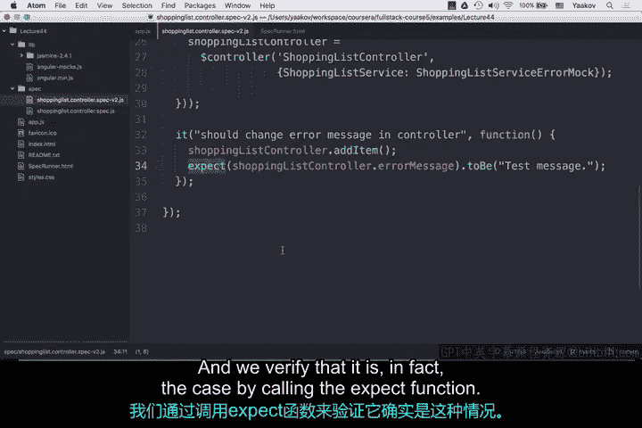
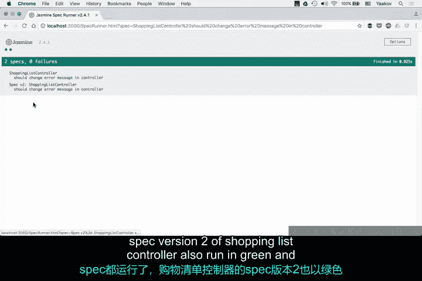
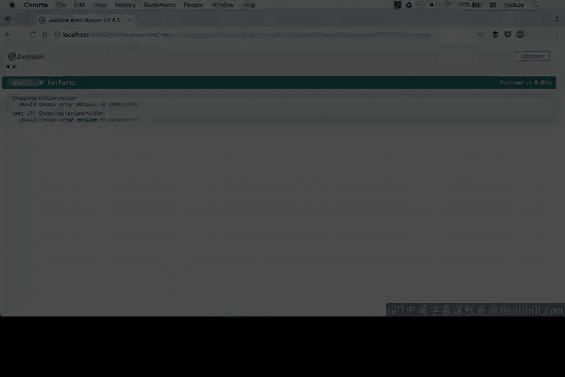
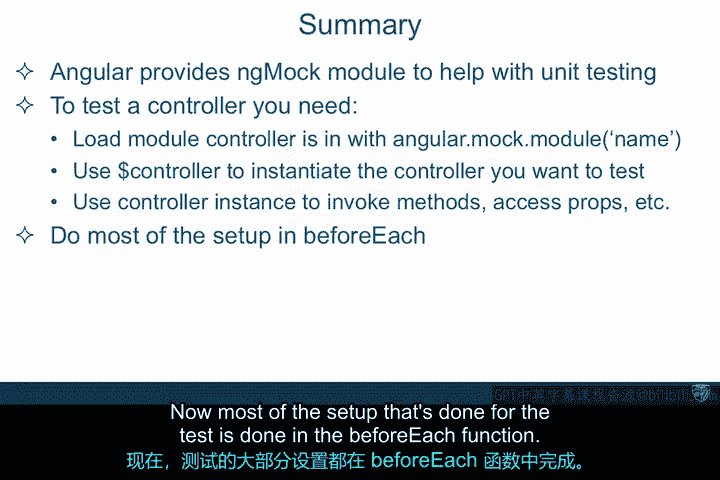

# 约翰霍普金斯大学《使用 AngularJS 开发单页 Web 应用｜Single Page Web Applications with AngularJS》中英 - P96：95_第44讲（第4部分）：测试AngularJS控制器.zh_en - GPT中英字幕课程资源 - BV1dsFDeZEQr

🎼。

Okay so I'm back in my code editor， and I'm still in lecture 44 folder here I'm looking at the shopping list that controller spec dash v2 do js。

 The version2 of the same test setup。 I didn't want this test running before。

 So I stuck an X right in front of describe to basically temporarily disable it So I'm going to remove that X now。

 The first thing we see is the before each function。

 and you could see that we have a couple of things that we're doing here。 First。

 we're creating our mock service called shopping list service Arm。 and second。

 we're actually loading our module that is our application module so we could hook into that and test our controller。

 Let's take a look as to how we're creating this mock service。

 The way were creating it is by letting angular inject the dollar sign provide the provide service。

 The provide service has a service method among other methods and we're calling the service method by passing it the name of our service which is shopping list service errorm which。

😊，Our mock service and right in line we're creating the service for us to use later and you can see it's the same type of stuff that you would use when you create a regular service I created the service local variable and attached a method called Ed item and created another one called Ed or get items which returns no Here you can see I'm just returning that error message called with a message test message So that's it Now Angular knows that such a service called shopping list service  errorm exists Let's go down and take a look as to what we're injecting。

😊，When we're injecting stuff， we're no longer injecting just the controller that we need to instantiate。

 we're also injecting the shopping list service mock。

 just like we would inject any other available service or controller and so on we're injecting it right here This one was not created inside this before each instead it was created using angular dollar sign provide service method So once we injected it we can actually provided as that instance that got injected right here we could provide it as a value to our dollar sign controller call which basically creates our shopping list controller and passes it in the injected service in this case with a key shopping list service and the injected service instance that we're passing is shopping list servicearrow mock So exactly the same one as before except now we're having angular injected into the before each function instead of creating it manually。

😊，ourselvesve inside of it Okay so the last part is the actual test method and a test function is exactly the same we're just calling this add item which triggers our shopping list service errormark to throw an error that error gets translated and the controller is supposed to set the error message to be test message。

 whatever gets returned from that shopping list service which is test message and we verified that it is in fact the case by calling the expect function and if we go back now that we saved it we could see that both specs run and spec version two of shopping list controller also run in So green and both of them passed with zero failures。

😊。

Okay， so let's summarize Angular provides NGM module to help us with unit testing of our Angular applications。

To test the controller， you need to do the following。

You need to load the module that controller is in with the Angularm module。

 passing it the name of the module that you developed for your application。

Then you use the dollar sign controller or the controller service to instantiate the controller you want to test。

You use the controller instance to invoke methods， access properties。

 and so on Now most of the setup that's done for the tests is done in the before each function。

The very listing you should do is at least call the module with the name of the module。

 but maybe even do some more preparations for your tests or the preparations that all of your tests in your tests suite or set of tests are sharing between each other Now there's a couple of ways of creating these mock objects we're going to need in order to control the environment our tests runs in one of them is to create those objects manually but another one is you could use the dollar sign provide or the provide service that you can inject but you have to inject it only through the module method that we spoke about before for other services you can use the regular angular dot mag that inject method and they work just fine because they resemble regular services as opposed to provide is really talking about provider services that we spoke about before when we use the dot config method that only provider services can be injected into that as opposed to other artifacts and resources in your angular application you could use the regular。

😊，In methodAnd in this case， you would use the regular or the mock version of the regular Mac that inject method。

