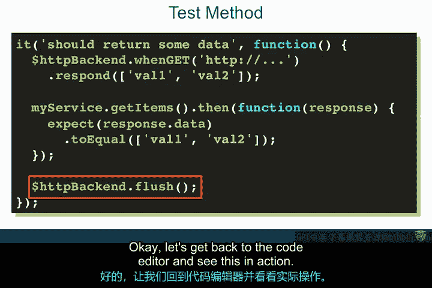

# 约翰霍普金斯大学《使用 AngularJS 开发单页 Web 应用｜Single Page Web Applications with AngularJS》中英 - P97：96_第45讲（第1部分）：测试AngularJS服务和$http.zh_en - GPT中英字幕课程资源 - BV1dsFDeZEQr

🎼。

Testing services in Angular is very easy。Testing services that reach out to the server through the network with some serverside data would have been complex。

 if not for the special Angular provided Do sign HTTP backhand service。

This service interects calls to the server and then lets you simulate server response all without making any network requests。

Obviously testing our service such that it actually does reach out to a real backend service and communicates over the network would be a bad thing the success of our test would then depend on another service working properly how well the network is performing or if we have our testing machine connected to the network to begin with。

😊，I will not go over the entire test setup structure you already know how to do that however。

 in this lecture let's go with the parts that are needed to set up testing an Angular service。

 especially one that uses the Dine HTP service。😊，The first thing we need to do is get a hold of the regular angular injector service this is what Angular uses behind the scenes to do the injection for us。

 but we can also use it to retrieve instances of artifacts like our services from the module we attached that service to。

The way we retrieve our service is through the get method of the injector service。

 passing it the string name we registered our service with the module。

 If our service provides simple utility methods or just used for data sharing and it doesn't try to reach out over the network to communicate with the server。

 we could stop here in our test methods， we can simply exercise the methods of the service and verify the outcome However。

 if the service uses the HTP service， we need to retrieve the mock version of that service that Angular provides here you could see that we're retrieving the HTP backend service and saving it off in a variable which is external to before each function。

😊，Now we can use our service and the Do sign HTP backend in our tests。In our test method。

 the first thing we're going to do is to tell the HTTP backend service what HTP call to expect to which URL and what to respond to such a call That's what we're doing here using the when get method the HTP backend service has numerous methods that correspond to other type of requests you can see the documentation for that service in the provided link。

We can then call our service method as usual and test the expected results。

The last thing that we must do in cases where the HTP backend service is involved is call its flush method。

In the real use of our app， the Deign HTP service always responds asynchronously if we were to preserve that behavior 100% we would need to write asynchronous tests which is not a simple task on the other hand。

 we don't want our tests to be synchronous because we are in fact testing asynchronous behavior and changing that would change the conditions under which our real code rule run that could change the outcome and integrity of our tests。

Instead we keep the call asynchronous， but tell the HTP backend service to flash pending requests immediately after we set it up this preserves our ability to run the code asynchronously while allowing the test to execute synchronously。

Okay， let's get back to the code editor and see this in action。

