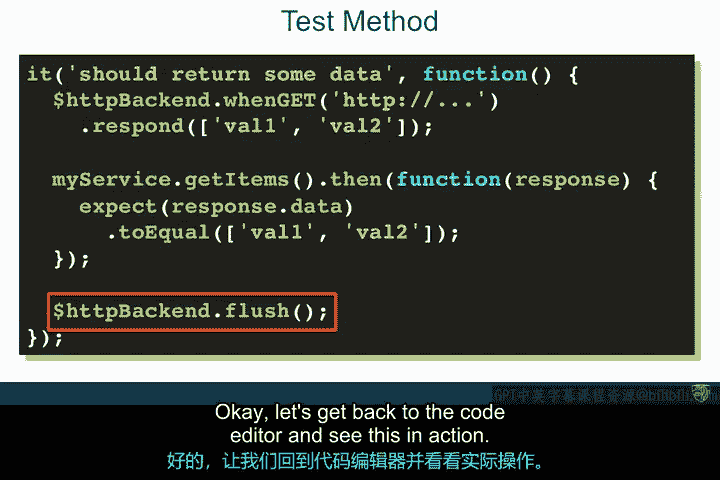

# 使用 AngularJS 开发单页 Web 应用：P97：测试 AngularJS 服务和 $http


在本节课中，我们将要学习如何测试 AngularJS 中的服务，特别是那些使用 `$http` 服务与服务器通信的服务。我们将了解如何利用 Angular 提供的 `$httpBackend` 模拟服务来避免真实的网络请求，从而编写可靠且独立的单元测试。

## 概述

测试 Angular 服务非常简单。然而，对于那些需要通过网络与服务器端数据交互的服务，测试会变得复杂。幸运的是，Angular 提供了一个特殊的 `$httpBackend` 服务来解决这个问题。这个服务能够拦截对服务器的调用，并允许你模拟服务器的响应，整个过程无需发起任何真实的网络请求。

显然，让测试代码去调用真实的后端服务并进行网络通信是不可取的。因为测试的成功与否将取决于另一个服务是否正常工作、网络性能如何，甚至测试机器是否连接到了网络。

## 测试服务的基本设置

上一节我们介绍了测试服务的基本概念，本节中我们来看看具体的设置步骤。我不会重复整个测试框架的搭建过程，因为你已经知道如何操作。在本讲中，我们将重点关注测试一个 Angular 服务（尤其是使用 `$http` 服务的服务）所需的关键部分。

首先，我们需要获取 Angular 的注入器服务。这是 Angular 在幕后为我们执行依赖注入的机制，我们也可以用它来从模块中获取已注册的服务实例。

我们通过注入器服务的 `get` 方法，并传入我们向模块注册服务时使用的字符串名称来获取服务实例。

```javascript
var myService = $injector.get('myServiceName');
```

如果我们的服务只提供简单的工具方法或仅用于数据共享，并且不尝试通过网络与服务器通信，那么测试到这里就可以结束了。在测试方法中，我们可以直接调用服务的方法并验证结果。

## 处理使用 `$http` 的服务

然而，如果服务使用了 `$http` 服务，我们就需要获取 Angular 提供的该服务的模拟版本。以下是获取 `$httpBackend` 服务的示例：

```javascript
var $httpBackend;
beforeEach(inject(function(_$httpBackend_) {
  $httpBackend = _$httpBackend_;
}));
```

现在，我们就可以在测试中使用我们的服务和 `$httpBackend` 了。

## 配置模拟响应与执行测试

以下是测试中使用 `$httpBackend` 的核心步骤：

在测试方法中，首先要做的是告诉 `$httpBackend` 服务期望什么样的 HTTP 调用：访问哪个 URL，以及如何响应这个调用。我们使用 `when` 系列方法（如 `whenGET`）来完成这个配置。

```javascript
$httpBackend.whenGET('/api/someData').respond(200, { data: 'mockData' });
```

`$httpBackend` 服务有许多方法，对应不同类型的 HTTP 请求（GET, POST, PUT, DELETE 等），具体可以参考官方文档。

配置好模拟响应后，我们就可以像平常一样调用服务的方法，并测试预期结果。

```javascript
myService.getData().then(function(response) {
  expect(response.data).toEqual('mockData');
});
```

## 刷新待处理请求

在涉及 `$httpBackend` 服务的测试中，我们必须做的最后一件事是调用它的 `flush` 方法。

在实际应用中，`$http` 服务总是异步响应的。如果我们 100% 地保留这种行为，就需要编写异步测试，但这并非易事。另一方面，我们也不希望测试完全同步执行，因为我们测试的本来就是异步行为，改变这一点会改变真实代码运行的条件，可能影响测试结果的完整性和准确性。

折中的办法是：我们保持调用是异步的，但在设置好模拟响应后，立即告诉 `$httpBackend` 服务刷新所有待处理的请求。这样既保留了代码异步执行的能力，又允许测试同步执行。

```javascript
$httpBackend.flush();
```

## 总结




本节课中我们一起学习了如何测试 AngularJS 中的服务。我们了解到，对于使用 `$http` 的服务，可以通过 Angular 内置的 `$httpBackend` 服务来拦截和模拟 HTTP 请求，从而避免对真实网络和后台服务的依赖。关键步骤包括：获取服务和 `$httpBackend` 实例、使用 `when` 方法配置期望的请求和模拟响应、执行服务方法并断言结果，最后不要忘记调用 `flush()` 方法来立即处理异步请求。这种方法确保了我们的单元测试是独立、快速且可靠的。