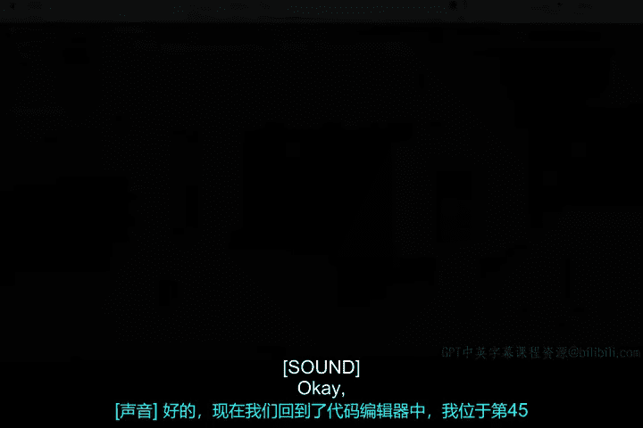
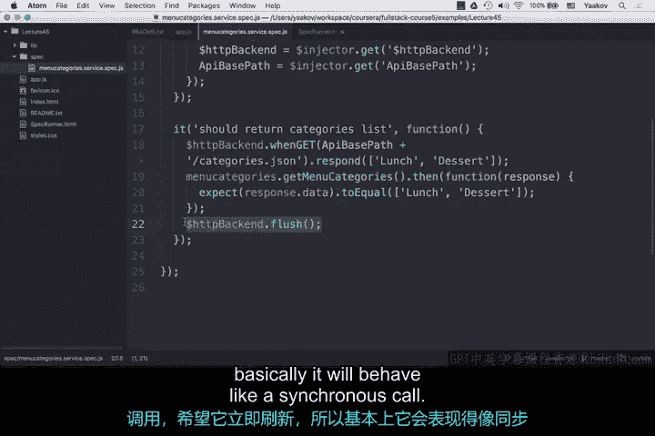
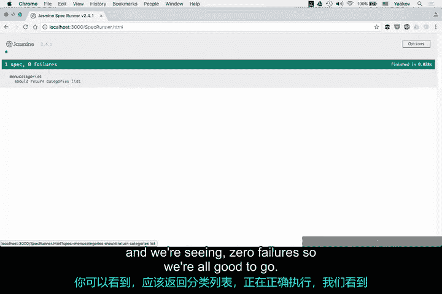

# 约翰霍普金斯大学《使用 AngularJS 开发单页 Web 应用｜Single Page Web Applications with AngularJS》中英 - P98：97_第45讲（第2部分）：测试AngularJS服务和$http.zh_en - GPT中英字幕课程资源 - BV1dsFDeZEQr

🎼。

Okay so we're back in our code editor and I'm located in lecture 45 folder。

 which is located in fulltag coursese5 examples folder and here I opened up the readme Txt that tells us that code for the entire application code that we're actually going to be testing is copied directly from lecture 25 so you can look at that lecture if you want to see it running in the original state here we're going to take a look as to what that code does and basically it has a controller here that uses this menu categories service and this menu categories service reaches out to this API base which is this URL right here we scroll down you'll see this menu categories service and basically it allows us to pull categories of different items within the restaurant menu and we use this API base path because we inject it together with our Dallasasine HP service into our menu category service so that in fact is the service。

We want to test and for this short lecture we're just going to test one method which is get menu categories and what we want to get out of it is to make sure that we set it up properly such that we pass back the response that is return with the data from the server so where we're going to do this let's go to menu categories that service that spec。

gs that's the file that we are writing our test in and let's take a look as to how we set it up the first thing we're doing here is we're calling the before each and we're injecting our module our application module menu categories app that's the same one that we came from the main one from the application we're testing。

😊，The next thing we're going to do is inject the dollar sign injector service using that service。

 we can now call the get method and literally pull out all the things we want to pull out from the angular context and one of them is the menu category service itself that we're testing notice we're just saving it off as a variable inside our describe that we can then reference inside of our it test method notice that we also are not injecting anything manually inside the menu category service even though it requires some injections we don't need to do that Angular will take care of that for us automatically we also need the dollar sign HP backend so we can use that to mock out our requests and we also need the API base path and that's what was defined right here as a constant because we need to reuse that when we make our fake or mocked out network calls once we expose。

😊，Three things outside of our before each， we can then use it inside the it， the test method。

And you can see here the HTP backend we're using the Weget and we're basically compiling this URL。

 we're saying API basease path plus the slash categories and if you take a look into our app and scroll down to the actual method we're testing right here。

 get menuu categories， it is the APIbase path plus/lash categories。

 JSON and which is exactly what we're doing here。Slash categories that Jason。

 And then we're telling it when that coal gets made。

 go ahead and intercepted and respond with an array that chs has two things。

 lunch and dessert strings。 That's really what we want。 We want to make sure it's set up properly。

 Once we set this up。 we can then call menu categories that get menu categories。

 And we know that that returns a promise because the HP service returns a promise。

 And we're saying that we're going to catch that promise in the then function。😊。

And we're gonna grab the response and the response is response that data。

 the data of the response is actually sitting inside the data property。 And depending， of course。

 on your response， it might be a little bit different。

 you might be just passing the data directly out of the get menu categories。 But in our case。

 we passed the entire response out that might have been a mistake。 but it is what it is now。

 so we're checking now and expecting the response that data is equal to what we basically told it to send back。

 which is lunch and dessert as an array。 And then of course we want to make sure not to forget since this is an asynchronous call。

 when to go ahead and flush it right away。 So basically it will behave like a synchronous call。

 So let's save it。 let's go back to our browser and let's click I already started the browser sync。

 So let's click on our test runner and you could see should return categories list is executing properly and we're seeing zero failures。

😊。

We're all good to go。

