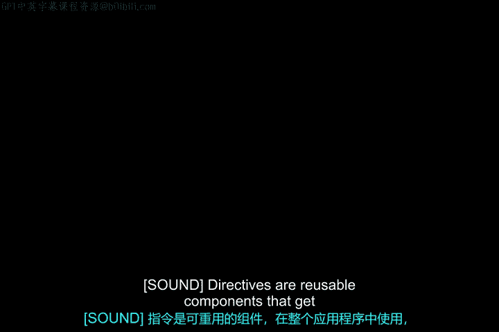
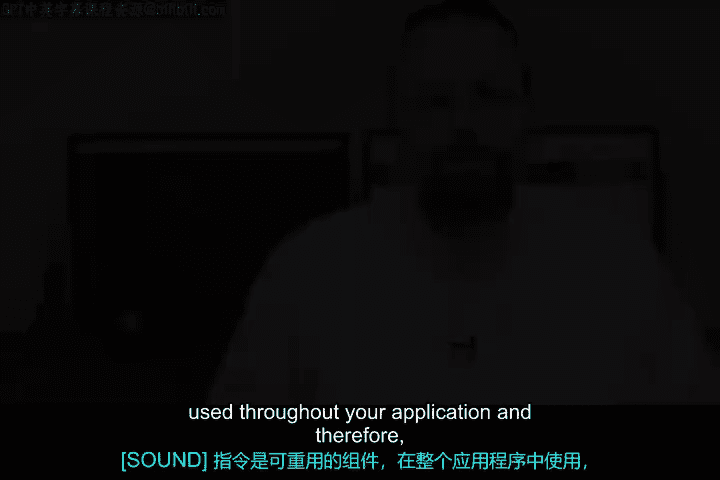
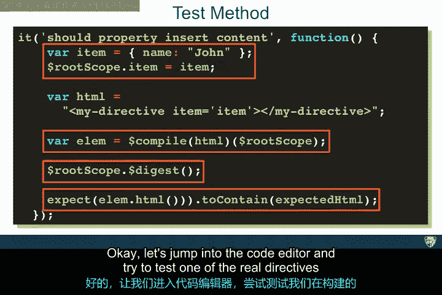

# 约翰霍普金斯大学《使用 AngularJS 开发单页 Web 应用｜Single Page Web Applications with AngularJS》中英 - P99：98_第46讲（第1部分）：测试AngularJS指令.zh_en - GPT中英字幕课程资源 - BV1dsFDeZEQr

🎼。

Directives are reusable components that get used throughout your application and therefore testing their functionality is definitely important in order to test the directive our test has to create a mock environment similar to the one in which a directive usually runs Let's take a look at what's involved。

😊，The first thing we'll need to do is create a variable that will hold the string that is our expected directive output。

Then we'll use the mock inject method to inject two more services。 One we're very familiar with。

 That's the rootcope service。 Our directive usually lives inside of some scope。

 but as everything else in our app， it certainly is inside of the top level scope。

 which is the rootcope。 So in this example will be simulating placing our directive as a direct child of the element with the anng app attribute。

 The second service we haven't seen， but we've spoken about it。

 Remember when we spoke about how Angular converts our custom tags。

 custom attributes and attaches behavior to them expands them into different HTML templates。

 inserts other templates into some placeholders。 Well。

 all that is done through the process of compilation。😊。

Angular actually takes our source HTML and using JavaScript compiles it， in other words。

 converts all of that special syntax like directives components， interpolation。

 into DOm or document object model that any browser can understand as well as associating functionality with those components。

Angular does all that with the Do sign compile service we're going to need that service in order to do that ourselves so we produce the final result of our directive and check it for our expectations notice that we again use the underscore trick in order for us to save off the reference to the service as it's usually named。

😊，If your directive doesn't have a template or has one that embeds it directly in a directive definition object。

 you can skip the step。 however， if it references a template using template URL property this step is needed when a directive uses a template URL Angular uses Ajax to asynchronously request a template file this is an issue for us because we don't want to deal with aynchronous behavior in our test。

 we could use the HV backend service to simulate the response but then we would end up hard coding HTML of our template in our test hard coding would make our test stuck with the version of the template we have for now if tomorrow we decide to update the template even a little bit our test will be out of sync with what it needs to be testing。

The other option is to use the template cache service when Angular loads templates of directives or components。

 the first thing it does is check if that template already exists in the template cache service if it does exist。

 Angular simply uses the cached version and doesn't try to make an asynchronous request to get it again if it's not in a cache it makes the request that means that if we manually place our template into the template cache。

 we won't have to deal with any asynncch requests。Now I will tell you from the outset that the best way of accomplishing that is to use karma Karma is a program that installs on your machine which lets you run these tests on the command line。

 however， we're not covering karma in this course so we'll use a blocking HP request to load the directive template into the cache it's a bit of a hack but it will do for now。

The way we disable the request from being asynchronous is bypassing false as the last argument to the open function。

The last step is to place the retrieve contents of our template into the template cache using the value of the Directive's template URL property。

 that's going to be a key that Angular will look up to see if that template or the contents of that template are already in the cache。

In the test method， the first thing we do is place an item object onto the rootcope with the property named item。

 This is what our directive expects to be there so it can be passed into our directive as an attribute。

 Then we create the HTML for the directive as we would when we place that directive directly inside of the index that HTML or any other HTML template。

 The next step is to compile our directive HTML。 note that the compile service itself returns a function。

 This is the function that needs some scope as an argument in order to bind the data with a newly compiled HTML。

 So we give it our root scopepe which contains the property item we need for our directive to work。

 As you hopefully remember from our digest and watch service discussion the first thing that happens when an angular application initializes is the running of the digest cycle。

 This is needed in order to kick off whatever watches are set up and。😊，Date the views with the data。

Since we're not standing up the whole app but are just testing。

 we need to kick off that process manually， that's why we call the digestigest function on the rootcope after that call the produced HTML is updated with data and is ready to be tested for expectations。

We can now extract the HTML by referencing our compiled and data bound LM variable and then calling the HTML method on it now we could test the HTML string and verify that it is what we expect it to be at this point Okay。

 let's jump into the code editor and try it to test one of the real directives that we have in one of our apps that we've built。

