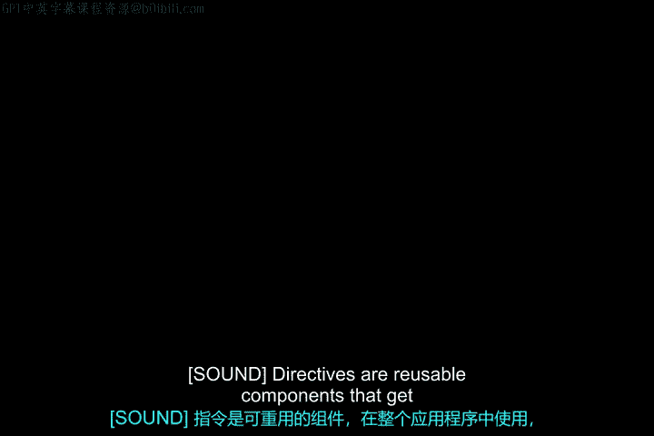
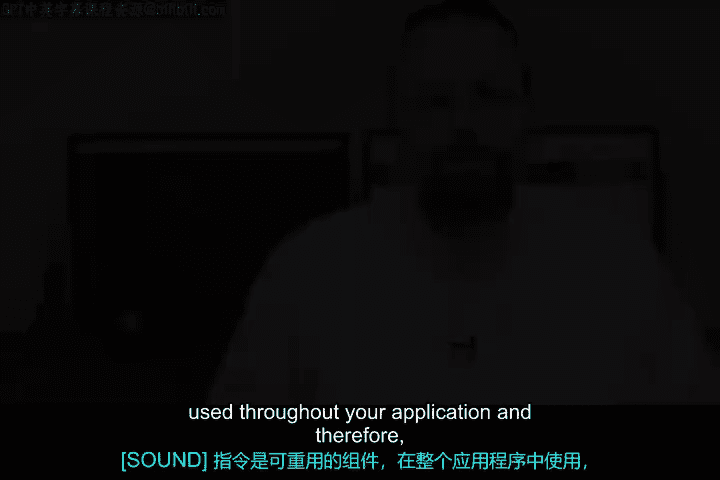
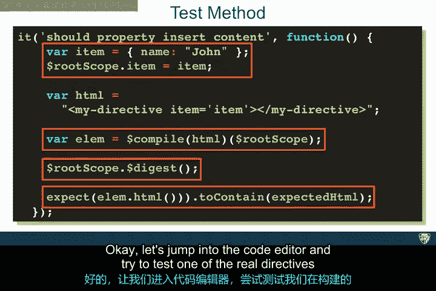

# 使用 AngularJS 开发单页 Web 应用：P99：测试 AngularJS 指令（第1部分）

在本节课中，我们将要学习如何测试 AngularJS 中的指令。指令是可复用的组件，在应用程序中被广泛使用，因此测试其功能至关重要。为了测试指令，我们的测试需要创建一个模拟环境，这个环境与指令通常运行的环境相似。让我们来看看具体涉及哪些步骤。

## 概述测试流程

测试指令的第一步是创建一个变量，用于存放我们期望的指令输出字符串。

接下来，我们将使用 `mock.inject` 方法注入两个服务。第一个服务我们非常熟悉，那就是 `$rootScope` 服务。我们的指令通常存在于某个作用域内，但和应用程序中的其他部分一样，它肯定位于顶级作用域（即 `$rootScope`）之内。在这个例子中，我们将模拟将指令作为带有 `ng-app` 属性的元素的直接子元素。

第二个服务我们之前没有见过，但讨论过它。还记得我们讨论过 Angular 如何转换我们的自定义标签和属性，并将行为附加到它们上面，将它们扩展成不同的 HTML 模板，并将其他模板插入到某些占位符中吗？所有这些工作都是通过编译过程完成的。

## 理解编译服务

Angular 实际上会获取我们的源 HTML，并使用 JavaScript 进行编译。换句话说，它将所有特殊语法（如指令、组件、插值）转换为任何浏览器都能理解的 DOM（文档对象模型），并将功能与这些组件关联起来。

Angular 使用 `$compile` 服务来完成所有这些工作。我们需要这个服务来自行完成编译，从而生成指令的最终结果，并检查它是否符合我们的预期。请注意，我们再次使用了下划线技巧来保存对服务的引用，因为服务通常以此命名。

## 处理指令模板

如果你的指令没有模板，或者其模板直接嵌入在指令定义对象中，可以跳过这一步。然而，如果指令使用 `templateUrl` 属性引用了一个模板文件，那么这一步是必需的。

当指令使用 `templateUrl` 时，Angular 会使用 Ajax 异步请求模板文件。这对我们来说是个问题，因为我们不想在测试中处理异步行为。我们可以使用 `$httpBackend` 服务来模拟响应，但那样我们最终会将模板的 HTML 硬编码到测试中。硬编码会使我们的测试固守于当前版本的模板。如果明天我们决定更新模板，即使只是很小的改动，我们的测试也会与需要测试的内容不同步。

另一个选择是使用 `$templateCache` 服务。当 Angular 加载指令或组件的模板时，它首先会检查该模板是否已存在于 `$templateCache` 服务中。如果存在，Angular 会直接使用缓存的版本，而不会尝试再次发出异步请求。如果不在缓存中，它才会发出请求。这意味着，如果我们手动将模板放入 `$templateCache`，我们就不必处理任何异步请求。

现在，我要提前说明，实现这一目标的最佳方式是使用 Karma。Karma 是一个安装在您机器上的程序，允许您在命令行中运行这些测试。然而，本课程不涵盖 Karma，因此我们将使用一个阻塞的 HTTP 请求将指令模板加载到缓存中。这有点取巧，但目前是可行的。

我们通过向 `open` 函数的最后一个参数传递 `false` 来禁用异步请求。

最后一步是使用指令的 `templateUrl` 属性值作为键，将检索到的模板内容放入 `$templateCache`。Angular 将查找这个键，以查看该模板或其内容是否已在缓存中。

## 执行测试步骤

在测试方法中，我们首先要做的是将一个带有名为 `item` 的属性的 `item` 对象放到 `$rootScope` 上。这是我们的指令期望存在的数据，以便它可以作为属性传递给我们的指令。

然后，我们像在 `index.html` 或其他 HTML 模板中直接放置该指令一样，创建指令的 HTML。

下一步是编译我们的指令 HTML。请注意，`$compile` 服务本身返回一个函数。这个函数需要一些作用域作为参数，以便将数据与新编译的 HTML 绑定。因此，我们给它提供包含指令工作所需的 `item` 属性的 `$rootScope`。

正如您可能从关于 `$digest` 和 `$watch` 服务的讨论中记得的那样，Angular 应用程序初始化时发生的第一件事就是运行 `$digest` 循环。这是为了启动所有已设置的监视器，并用数据更新视图所必需的。

由于我们不是启动整个应用程序，而只是进行测试，因此需要手动启动这个过程。这就是为什么我们在 `$rootScope` 上调用 `$digest` 函数。在此调用之后，生成的 HTML 会使用数据进行更新，并准备好进行期望测试。

现在，我们可以通过引用我们编译并数据绑定的 `elem` 变量，然后调用其上的 `html()` 方法来提取 HTML。此时，我们可以测试 HTML 字符串，并验证它是否符合我们的预期。

## 总结

本节课中，我们一起学习了测试 AngularJS 指令的基本流程。我们了解了需要模拟 `$rootScope` 和 `$compile` 服务来创建测试环境，并探讨了如何处理使用 `templateUrl` 的指令模板，以避免异步请求。最后，我们回顾了编译 HTML、绑定数据、手动触发 `$digest` 循环以及验证最终 HTML 输出的完整测试步骤。掌握这些知识对于确保指令在整个应用中的正确功能至关重要。