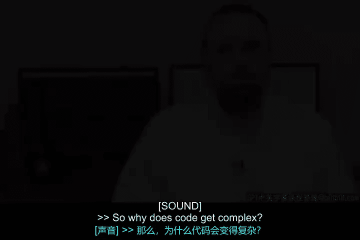
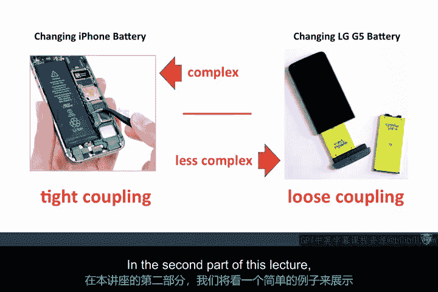

# 约翰霍普金斯大学《使用 AngularJS 开发单页 Web 应用｜Single Page Web Applications with AngularJS》中英 - P9：8_第2讲（第1部分）：为什么代码会变得复杂.zh_en - GPT中英字幕课程资源 - BV1dsFDeZEQr

🎼。

So why does code get complex， in other words， what makes it lose those good code characteristics we spoke about？

Well， one of them is if people write hard to read code。

And that can include bad or inconsistent coding style， so it's one way in one part of the file。

 a different way in another part of the file and the spacing is all messed up and it's just simply hard to read another way it could be hard to read the code if people make up all kinds of very hard to read function or variable names Another one if there is no comments or even API documentation hard to read code issue is fairly easy to fix you just rewrite the code or format the code the way it's supposed to be according to some style guide however there is a much harder problem to address and that was a problem that software engineering is kind of battled with for years and then there's lack of high cohesion and low coupling So what is high cohesion and low coupling mean So let's take a look。

😊，High cohesion is when small pieces of functionality are strongly related to each other within some code boundary Now I say code boundary for a couple of reasons。

 one because in some languages the boundary that this principle usually refers to is a class and some other languages it's a module in some others。

 it's a function， but another perhaps more important reason is because it's really a question of what you're designing for high cohesion。

😊，You can try to design a whole module for high cohesion or you could try to design a simple function for high cohesion It's a question of how much you zoom in。

 so to speak on some area of your code。😊，So to say it very succinctly。

 high coion is how well does that one thing stick to doing just one thing？

Now one piece of high cohesive functionality can use other functions to achieve that， so for example。

 if you have one function that contains several other functions。

 the key component here is that all three functions are very closely related to each other。

In the scope of that one function， they're trying to accomplish the same thing。

 just taking different tasks towards the same goal。So let's take a look at a fun example for example。

 if you take a look at my daily schedule and basically map it out as a coding module has a whole bunch of things in it。

 wake up， brush teeth， caffeine code and so on Now if you take that same thing and it makes the daily schedule of my Mac of my computer the schedule is much simpler and if you take a look closely you'll see that in my schedule there's very low cohesion and in the max schedule very high cohesion all it does is on flash pretty lights run as sleep and then it turns off in my schedule there are things that are conflicting with each other you know work and working and code at work。

 eating dinner， creating Cosera course late snack with cookies and losing weight are all very conflicting things they don't really 100% belong to each other so therefore the schedule makes it a little bit more complex to deal with Of course it's also makes it more fun to deal with as opposed to the boring computer but computers are good at being boring not so much human。

😊，So the low cohesion is what's making you know， our daily schedules as human being complex。

On the other hand， we have this loose coupling and loose coupling means that least possible dependency of one component on another component Having loose coupling and software is a good thing and it makes development much less complex because it allows you not to have to worry about the rest of the system when you're dealing with one small。

 loosely coupled piece of it。So to say it most succinctly， when we speak about software components。

 you have loose coupling in such a case in which if you change one component。

 you do not have to change the other for example， if you have a shopping card and it's working very well and then you add another component that helps you charge credit cards so the shopping card calls the credit card processing component if these two components are loosely coupled。

 it means that if we change how credit card processing is done。

 shopping card code will not change it will not care whatsoever how credit card processing component is working it just needs to be able to go out to it and the rest of the details it doesn't care about。

😊，If we take a look at an example of that in real life， for example。

 changing an iPhone battery is a fairly complex process as opposed to changing let's say an LG G5 battery。

 you just pop it out and pop it back in and here's by the iPhone battery you have tight coupling and therefore you have very complex things to do in order to pop it out and put a new one in and in the case of LGG5 battery。

 it's loose coupling because all you have to do is press some button。

 it pops out the battery and you pop the new one in。Okay。

 so how does this express itself in software and for our purposes。

 how does this express itself in a web application software in the second part of this lecture。

 we're going to take a look at a simple example that shows us these concepts。😊。

