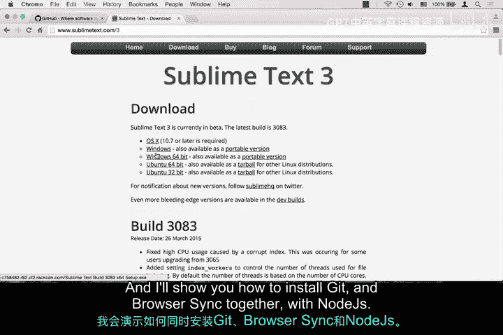

# 001：开发环境配置 第1部分

在本节课中，我们将学习如何为后续的Web开发课程配置开发环境。我们将介绍完成本课程所需的核心工具，并指导你完成初步的准备工作。

## 课程所需工具概述

以下是完成本课程需要准备的工具列表。我们将逐一介绍它们的作用和获取方式。

1.  **Github账户**：你需要在Github.com上注册一个账户。我们将在整个课程中频繁使用Github。
2.  **Google Chrome浏览器**：我们将重度依赖Google Chrome浏览器。请下载并安装它。该浏览器自带**Chrome开发者工具**，我们也会广泛使用这些工具。
3.  **代码编辑器**：你需要一个代码编辑器。我推荐使用**Sublime Text 3**。虽然它技术上仍处于测试版，但开发者推荐下载此版本，且其稳定性和插件生态都非常出色。其他可选的编辑器包括Visual Studio Code和Brackets。
4.  **Git**：我们需要版本控制工具Git。
5.  **Browser Sync**：这是一个开发工具，用于实现浏览器实时同步刷新。
6.  **Node.js**：为了安装Browser Sync，我们需要先安装Node.js。

## 工具安装详解（第一部分）

上一节我们列出了所有必需工具，本节中我们来看看其中几项的简单安装步骤。本讲座将分为两部分，第一部分（即本节）将演示一些初步设置，第二部分将分别针对Windows和Mac系统，详细讲解Git、Browser Sync和Node.js的安装。

### 1. Google Chrome浏览器

关于如何安装Google Chrome浏览器，这里不做详细演示。你可以通过搜索引擎找到下载链接，或者你可能已经在使用它了。**Chrome开发者工具**已集成在浏览器中，无需单独安装。

### 2. Github账户注册

我们将在课程中大量使用Github。注册过程非常简单：访问Github.com，提供用户名、邮箱并创建密码即可完成注册。

### 3. Sublime Text 3 代码编辑器

接下来，我们需要获取代码编辑器Sublime Text 3。

以下是下载步骤：
*   打开浏览器，搜索“Sublime Text 3”。
*   确保进入的是Sublime Text 3的页面，而不是Sublime Text 2。
*   在下载页面，你可以看到针对Mac、Windows（32位/64位）和Linux系统的不同版本。
*   根据你的操作系统选择对应的版本进行下载。
*   下载完成后，根据你的系统进行安装（双击安装程序或拖拽安装）。

## 本节总结与下节预告

本节课中我们一起学习了开发环境配置的初步工作，包括了解所需工具、注册Github账户以及下载Sublime Text 3编辑器。

我将结束本讲座的第一部分。在第二部分，我们将分为Windows和Mac两个版本，详细演示如何安装Git、Browser Sync以及Node.js。