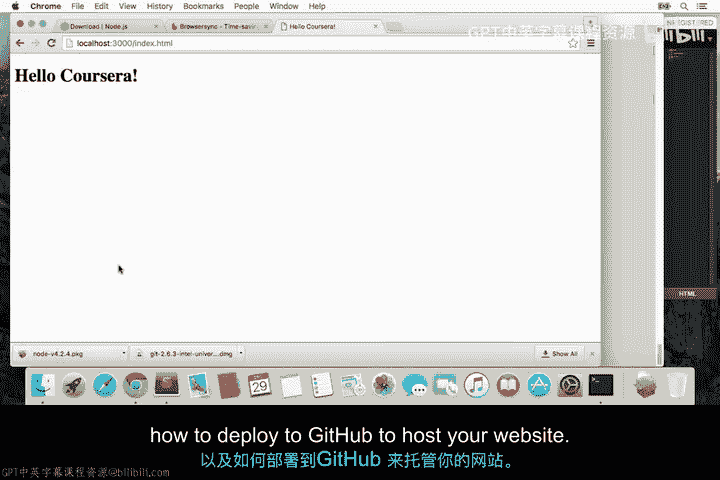

# 002：开发环境配置 (macOS版) - 第2部分


## 概述
在本节课中，我们将继续在macOS系统上配置Web开发环境。我们将安装Git版本控制系统、Node.js运行环境以及Browser-sync工具，并验证它们是否安装成功。最后，我们会创建一个简单的测试网站来初步体验Browser-sync的实时刷新功能。

---

## 安装Sublime Text编辑器
上一节我们介绍了课程的基本情况，本节中我们来看看如何在macOS上安装并配置开发工具。

首先，我已经下载了Sublime Text编辑器。以下是安装步骤：
1.  双击下载的安装文件。
2.  在弹出的窗口中，将Sublime Text图标拖拽到“应用程序”文件夹。
3.  安装完成后，可以通过 `Command + 空格键` 打开聚焦搜索，输入“sublime”来启动它。
4.  首次打开时，系统会询问是否允许，点击“是”即可。

现在，Sublime Text已成功安装并可以随时使用。

---

## 安装Git版本控制系统
接下来，我们需要安装Git。Git是一个分布式版本控制系统，对于代码管理至关重要。

以下是安装Git的步骤：
1.  打开浏览器，搜索“download Git for Mac”并访问官网。
2.  下载适用于Mac的最新版本安装包。
3.  下载完成后，双击打开`.dmg`文件。
4.  在打开的窗口中，双击`.pkg`安装包文件。
5.  如果系统提示“无法打开，因为来自未识别的开发者”，需要进入“系统偏好设置” > “安全性与隐私”，点击“允许从以下位置下载的应用程序”下的“任何来源”。（完成安装后，建议将此设置改回以增强安全性）
6.  解锁设置后，再次双击安装包，按照提示输入管理员密码完成安装。

为了验证Git是否安装成功，我们需要打开终端（Terminal）应用程序。可以通过 `Command + 空格键` 搜索“terminal”来打开它。

在终端中输入以下命令并回车：
```bash
git --version
```
如果终端显示类似 `git version 2.6.3` 的版本信息，则说明Git已成功安装。

---

## 安装Node.js与Browser-sync
为了安装Browser-sync这个能实时刷新浏览器的工具，我们首先需要安装它的运行环境——Node.js。

以下是安装Node.js的步骤：
1.  在浏览器中搜索“download Node.js for Mac”并访问官网。
2.  下载Mac安装程序（.pkg文件）。
3.  下载完成后，双击打开并按照安装向导的提示进行操作，同意许可协议并输入管理员密码。

安装完成后，最好重启一下终端应用程序，以确保环境变量生效。然后，我们可以验证Node.js及其包管理工具npm是否安装成功。

在终端中依次输入以下两个命令：
```bash
node --version
npm --version
```
这两个命令应分别返回Node.js和npm的版本号，例如 `v6.9.1` 和 `3.10.8`。

现在，我们可以安装Browser-sync了。在浏览器中搜索“browser sync”找到其官网。根据官网说明，我们需要使用npm进行全局安装。

由于macOS系统的权限设置，建议使用 `sudo` 命令来获取管理员权限进行安装。在终端中输入以下命令：
```bash
sudo npm install -g browser-sync
```
输入命令后，系统会提示你输入当前用户的管理员密码。输入密码（输入时不会显示字符）后按回车。

安装过程中可能会出现一些警告信息，这通常是正常的。如果系统提示需要安装“Command Line Developer Tools”，请点击“安装”，这是开发所必需的工具包。

安装完成后，输入以下命令验证Browser-sync是否可用：
```bash
browser-sync --version
```
如果终端返回版本号，则表明安装成功。

---

## 创建测试网站并体验Browser-sync
现在，让我们创建一个简单的测试网站，并体验Browser-sync的实时预览功能。

首先，我们在终端中创建一个名为“test_site”的目录，并进入该目录：
```bash
mkdir test_site
cd test_site
```
接着，打开Sublime Text，创建一个新的HTML文件。输入 `html` 然后按 `Ctrl + 空格键` 可以快速生成HTML文档模板。

在模板的 `<body>` 标签内，我们添加一个标题：
```html
<h1>Hello, Coursera.</h1>
```
将这个文件保存到刚才创建的 `test_site` 目录下，命名为 `index.html`。

现在，回到终端，确保当前目录是 `test_site`，然后启动Browser-sync服务器。我们使用以下命令，让它以目录模式启动，并监视所有文件的变化：
```bash
browser-sync start --server --directory --files "*"
```
命令解释：
*   `start --server`：启动一个本地服务器。
*   `--directory`：如果请求的是目录，则显示目录文件列表（方便我们选择`index.html`）。
*   `--files "*"`：监视当前目录下所有文件的变动。

执行命令后，终端会显示服务器已在 `http://localhost:3000` 运行。打开浏览器（如Chrome），访问这个地址。

在打开的页面中，点击 `index.html` 链接，你就能看到“Hello, Coursera.”的页面了。

此时，如果你用Sublime Text修改 `index.html` 文件并保存（例如将“Coursera”改为“World”），Browser-sync会自动检测到文件变化，并立即刷新浏览器页面，无需你手动操作。

---

## 总结
本节课中我们一起学习了在macOS上配置Web开发环境的后续步骤。我们成功安装了代码编辑器Sublime Text、版本控制工具Git、JavaScript运行环境Node.js以及实时预览工具Browser-sync。我们还创建了一个简单的测试网站，并实践了如何使用Browser-sync来实现代码修改与浏览器显示的同步更新。在下一部分，我们将更深入地演示Browser-sync的使用，并学习Git的基础操作以及如何将网站部署到GitHub上进行托管。

😊





