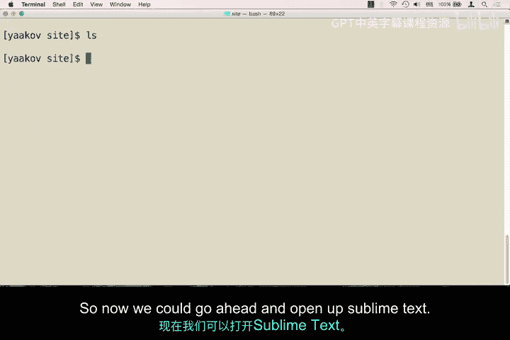
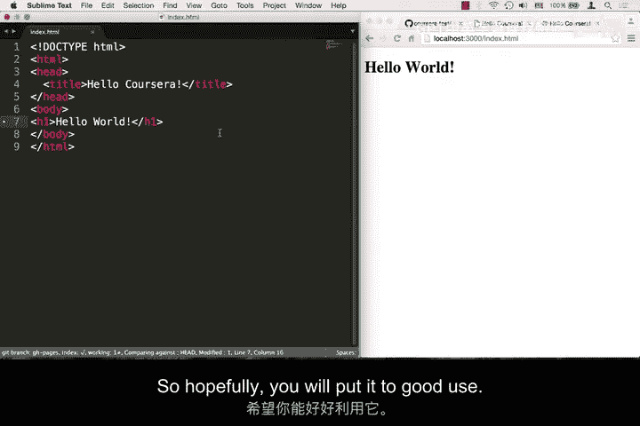
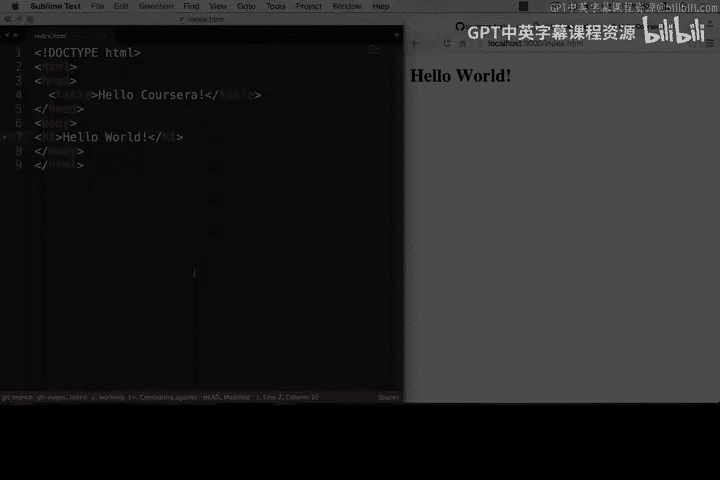

# 004：3_开发环境配置 第3部分 GitHub与浏览器同步 🚀


在本节课中，我们将学习如何创建GitHub仓库，将其配置为托管网站，并使用Git命令将本地代码同步到GitHub。此外，我们还将介绍一个名为Browser Sync的强大工具，它能在你修改代码时自动刷新浏览器页面，从而极大地提升开发效率。

---

## 创建GitHub仓库并配置页面托管

上一节我们介绍了本地开发环境的搭建，本节中我们来看看如何将我们的代码与GitHub同步，并利用GitHub Pages功能托管我们的网站。

首先，你需要登录到你的GitHub账户。接下来，我们将创建一个新的仓库（Repository），这是你提交作业和存储网站代码的地方。

以下是创建新仓库的步骤：

1.  点击页面右上角你的头像旁边的加号（+）图标。
2.  在下拉菜单中选择“New repository”。
3.  在“Repository name”输入框中，为你的仓库命名，例如 `coursera-test`。
4.  系统会检查名称是否可用，显示绿色对勾则表示可用。
5.  你可以添加一个描述，例如“Coursera test repository”。
6.  保持仓库为“Public”（公开）。如果你想创建私有仓库，则需要付费。
7.  勾选“Initialize this repository with a README”选项，这通常是个好习惯。
8.  最后，点击“Create repository”按钮。

现在，你的仓库已经创建好了。为了将这个仓库变成一个可以对外访问的网站，我们需要启用GitHub Pages功能。

以下是配置GitHub Pages的步骤：

1.  进入你刚创建的仓库。
2.  点击顶部的“Settings”（设置）选项卡。
3.  向下滚动到“GitHub Pages”部分。
4.  点击“Launch automatic page generator”（启动自动页面生成器）按钮。
5.  你可以选择页面布局，但为了演示，我们直接滚动到底部。
6.  点击“Continue to layouts”（继续选择布局），然后点击“Publish page”（发布页面）。

完成后，GitHub会为你生成一个网站，并提供一个专属URL，格式通常为 `https://[你的用户名].github.io/[仓库名]`。你可以在“Settings”页面的“GitHub Pages”部分再次找到这个链接。

需要注意的是，GitHub Pages功能实际上创建了一个名为 `gh-pages` 的特殊分支。只有这个分支里的内容才会被发布到你的网站链接上。对于初学者，建议你直接在这个分支上进行所有操作。

---

## 将GitHub仓库克隆到本地

现在，我们已经有了一个在线的仓库和网站。接下来，我们需要将这个仓库“克隆”（Clone）到本地计算机，以便在本地进行代码编辑。

首先，在GitHub仓库页面找到仓库的URL（通常以 `.git` 结尾），并复制它。

然后，打开你的终端（Terminal），使用 `git clone` 命令将仓库下载到本地。

```bash
git clone [你复制的仓库URL]
```

命令执行后，会在当前目录下创建一个与仓库同名的文件夹。使用 `cd` 命令进入这个文件夹。

```bash
cd coursera-test
```

默认情况下，你处于 `master` 分支。由于我们的网站托管在 `gh-pages` 分支，我们需要切换到这个分支。



```bash
git checkout gh-pages
```


切换后，使用 `ls` 命令查看目录，你会看到GitHub自动生成的网站文件。

---

## 在本地编辑并同步代码到GitHub

现在，我们可以在本地进行开发了。为了避免覆盖自动生成的首页，我们可以在仓库内创建一个子文件夹来存放我们的代码。

在终端中，创建一个名为 `site` 的文件夹并进入。

```bash
mkdir site
cd site
```

然后，你可以使用Sublime Text或其他编辑器在此文件夹中创建你的网页文件，例如 `index.html`。

编辑并保存文件后，我们需要使用Git命令将这些更改提交（Commit）到本地仓库，然后推送（Push）到GitHub。

以下是同步代码的基本Git命令流程：

1.  **添加更改到暂存区**：使用 `git add` 命令标记你想要提交的文件。
    ```bash
    git add .
    ```
    （`.` 表示添加当前目录下的所有更改）

2.  **提交更改到本地仓库**：使用 `git commit` 命令并附上描述信息。
    ```bash
    git commit -m “我的第一个页面”
    ```

3.  **推送更改到GitHub**：使用 `git push` 命令将本地提交上传到远程仓库（GitHub）。
    ```bash
    git push
    ```
    首次推送时，可能会要求你输入GitHub的用户名和密码。

完成推送后，稍等片刻，刷新你的GitHub Pages网站链接（记得在URL后加上 `/site/`），就能看到你刚刚创建的页面了。

之后任何代码修改，只需重复 `add` -> `commit` -> `push` 这个流程，即可更新你的网站。

---

## 使用Browser Sync实现实时预览

在开发过程中，频繁地手动刷新浏览器来查看更改效果非常低效。Browser Sync工具可以监听文件变化，并自动刷新浏览器，实现实时预览。

首先，确保你通过Node.js的包管理器npm全局安装了Browser Sync。

```bash
npm install -g browser-sync
```

安装完成后，你可以在你的项目目录（例如 `site` 文件夹）中启动Browser Sync。

以下是启动Browser Sync服务器的命令：

```bash
browser-sync start --server --directory --files “**/*”
```

这个命令做了以下几件事：
*   `start --server`：启动一个本地服务器。
*   `--directory`：如果访问根目录，显示文件列表。
*   `--files “**/*”`：监听当前目录下所有文件的变化。

执行命令后，Browser Sync会自动在浏览器中打开一个标签页，显示你的本地网站。现在，当你用编辑器修改并保存HTML、CSS或JavaScript文件时，浏览器中的页面会自动刷新，显示最新的修改结果。

这个工具能显著提升前端开发的体验和效率。

---





本节课中我们一起学习了如何利用GitHub进行代码版本控制和免费网站托管，掌握了基本的Git命令（`clone`, `checkout`, `add`, `commit`, `push`）来同步本地与远程代码。此外，我们还配置了Browser Sync工具，实现了开发时的浏览器实时自动刷新。现在，你的开发环境已经全部配置完毕，可以高效地开始Web开发之旅了。