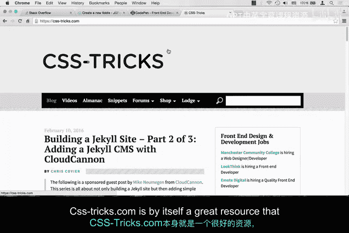
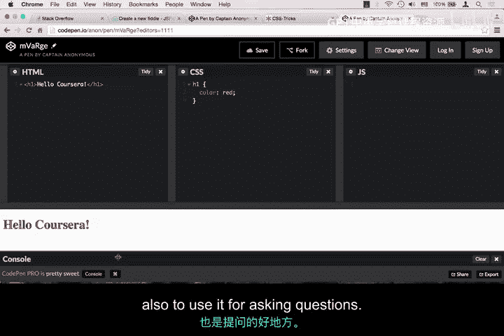

# 005：问题咨询资源


## 概述
在本节课中，我们将学习在Web开发过程中遇到问题时，如何有效地寻求帮助。课程将介绍几个核心的在线资源平台，并讲解如何通过分享可运行的代码片段来更清晰地描述问题，从而获得更快、更准确的解答。

---

## 寻求帮助的在线资源

在开发过程中，尤其是Web开发，你必然会遇到需要向他人求助的情况。本节将为你介绍几个可以寻求帮助的资源平台。

### Stack Overflow
一个首要的网络资源是 **stackoverflow.com**。这个网站拥有庞大的开发者社区，随时准备为你提供帮助。当你未来知识增长后，也可以通过这个网站回馈社区。

**请务必记住这个网站。**

---

## 如何有效地提问

当你提出编程问题时，如果解答者能够查看你的代码，这对他们会有很大帮助。直接将代码复制粘贴到问题中是一种方法，但提供一段**实际可运行的代码**通常更有助于他人诊断和解决问题。这样做能显著提高你获得快速、准确解答的几率。

以下是几个在Web开发领域特别有用的网站，它们可以帮助你分享可运行的代码。

### JSFiddle
一个网站叫做 **jsfiddle.net**。这个网站允许你编写HTML、CSS和JavaScript代码，并通过链接分享这些代码。

**操作示例：**
1.  在HTML面板中输入：`<h1>Hello Coursera</h1>`
2.  点击“Run”按钮，结果面板会显示“Hello Coursera”。
3.  在CSS面板中输入：`h1 { color: red; }`
4.  再次点击“Run”，文字颜色变为红色。
5.  点击“Save”按钮，你会获得一个唯一的URL。你可以复制并分享这个链接。

**优势：**
他人通过这个链接可以查看你的全部代码和运行结果。他们还可以“Fork”（即基于你的代码创建新副本）来修正或补充代码，方便你对比查看解决方案。



**jsfiddle.net 是一个极佳的资源。**

### CodePen
另一个我非常喜欢的网站是 **codepen.io**。这个网站由Web开发社区的知名人物Chris Coyier参与创立。他创办的 **css-tricks.com** 本身也是一个关于CSS和HTML的优质教程与答案资源库。

**codepen.io** 的功能与jsfiddle类似，但它围绕网站构建了更庞大的社区。你可以查看“精选作品”，这些解决方案可能会让你惊叹，并且你能学习他们是如何通过HTML、CSS和JavaScript实现这些效果的。

**操作示例：**
1.  创建一个新Pen（无需注册，但注册后可以保存所有作品）。
2.  在HTML部分输入：`<h1>Hello Coursera</h1>`，结果会**自动**显示。
3.  在CSS部分输入：`h1 { color: red; }`，颜色会**自动**更新。
4.  它还有一个类似浏览器的控制台功能。例如，在JS面板输入：
    ```javascript
    var x = "Hello Coursera";
    console.log(x);
    ```
    控制台会输出“Hello Coursera”。
5.  点击“Save”后，你可以复制URL并分享给他人以寻求帮助。

**我强烈建议你查看这些网站，并将它们作为资源储备。** 它们不仅能用于查找资料，也能在提问时派上用场，长远来看会对你大有裨益。

---




## 总结
本节课我们一起学习了在Web开发中寻求帮助的方法。我们介绍了 **Stack Overflow** 这个核心问答社区，并重点讲解了如何通过 **JSFiddle** 和 **CodePen** 这两个在线代码编辑与分享平台来创建和分享可运行的代码片段，从而更清晰、高效地描述问题，获得社区的帮助。掌握这些工具将极大地提升你解决问题的效率。