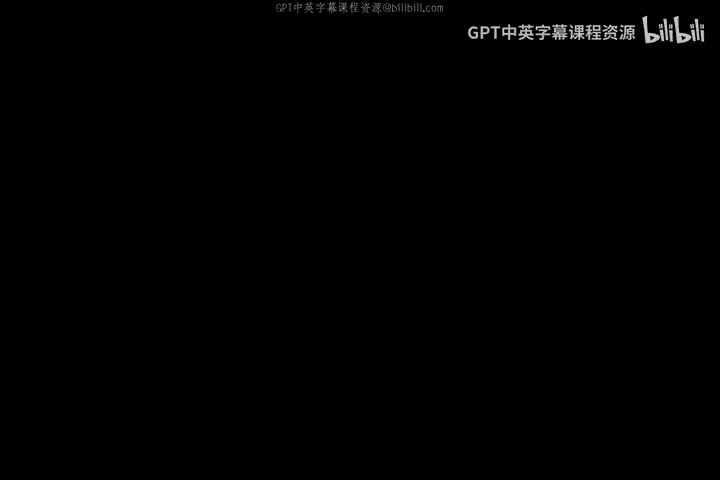
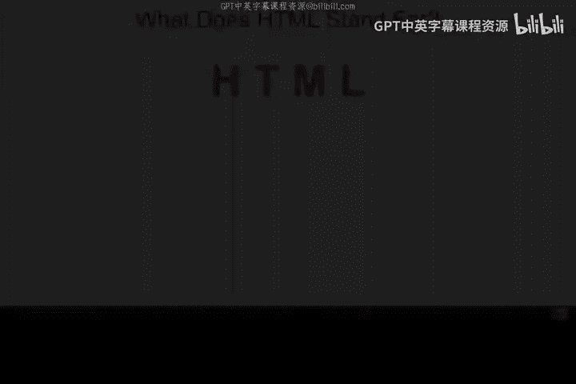
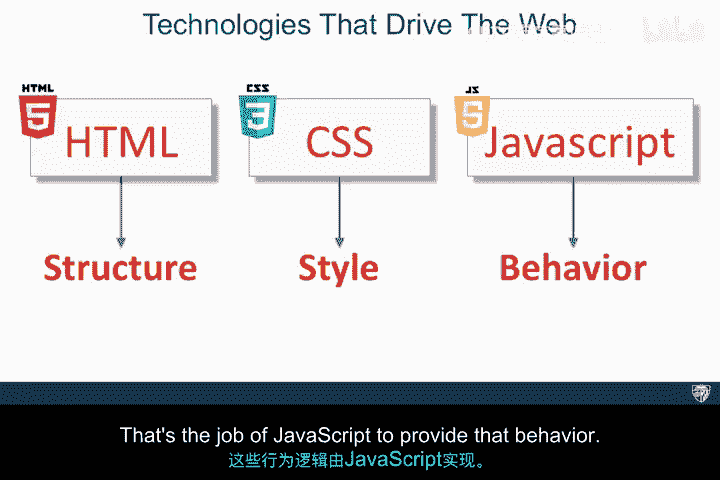
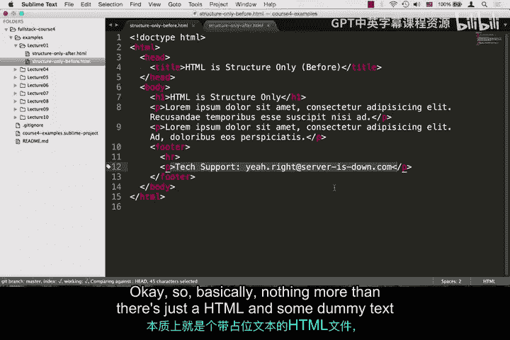
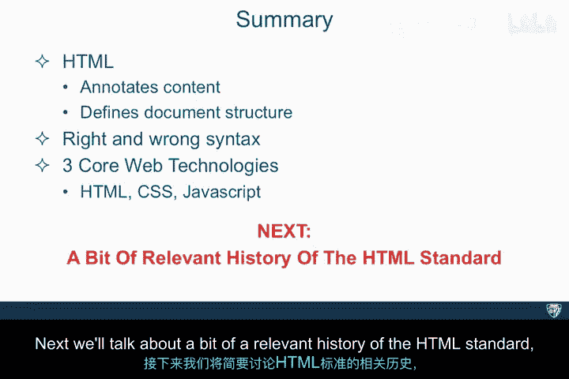
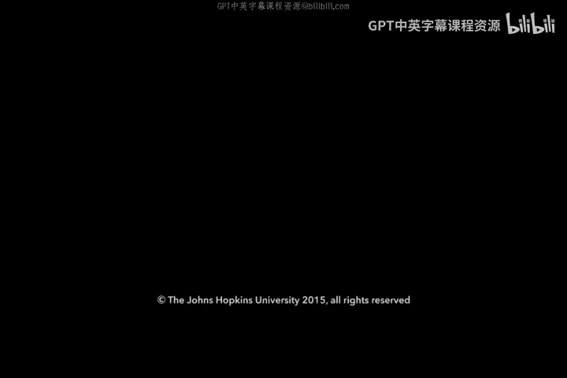

# 006：5_第1讲 HTML简介 🧱



在本节课中，我们将要学习HTML的基础概念，了解它在Web开发中的核心作用，并认识驱动现代网页的三大核心技术：HTML、CSS和JavaScript。

---

## 什么是HTML？

HTML是**超文本标记语言**的缩写。我们来逐一解析这个术语的含义。



**超文本**指的是包含指向其他文本链接的文本。这构成了整个万维网的基础：一个文档指向另一个文档，如此不断延伸，有时还会链接回原始文档，最终形成一个巨大的网络。


如今，**超媒体**在网络中扮演着重要角色。你可以观看视频、收听音乐，超媒体本质上是超文本的延伸。

**标记**意为对内容进行标注或注释。网络的核心是内容。假设你有一篇名为《我为何热爱这门课程》的文档，这就是内容。HTML的作用就是用标记语言（如标签）来包裹这些内容，以告知浏览器或其他程序这些内容的含义。

例如，`<title>我为何热爱这门课程</title>` 这段代码中，内容被一个`<title>`标签包裹，这告诉软件这是文档的标题。这引出了第一个要点：**HTML是人类可读的**。这些标签看起来就像文档结构的指令，无需通过解释器就能理解文档的输出结构。

**语言**意味着HTML拥有自己的语法，即有正确和错误的编码方式。例如，在下面的错误代码中，`</div>`标签出现在`</h1>`标签之后，关闭顺序颠倒，这会导致解析和潜在的渲染错误。

```html
<!-- 错误的语法示例 -->
<h1>标题</div></h1>
```

HTML也有自己的语义，这意味着标签名称对机器或人类都具有特定含义。

---

## 驱动Web的三大技术

接下来，我们谈谈驱动Web的三大技术。每一项都有其独特的目的，并且三者能完美地协同工作。

**HTML** 提供**结构**。它定义HTML文档包含哪些组件，例如一个标题、两个段落和一个页脚。

```html
<h1>主标题</h1>
<p>第一个段落。</p>
<p>第二个段落。</p>
<footer>页脚信息</footer>
```

请注意，HTML并不告诉你这些组件在视觉上如何布局、它们看起来是什么样子、是什么颜色或字体大小。它只告诉你由哪些组件构成，就像一栋房子，你只知道有三个房间和一个厨房，但不知道厨房的颜色或墙壁的样式。

**CSS** 负责**样式**。颜色、布局、字体大小等所有样式相关的内容都由CSS处理。例如，如果我们的HTML文档中有一个标题，CSS会定义它的颜色和字体大小。

**JavaScript** 提供**行为**和**功能**。它为页面添加交互功能。例如，当HTML文档加载完成时会发生什么，或者点击标题时会发生什么，这些都是JavaScript的工作。



---

## 概念实例演示

让我们通过一个快速示例来理解这些概念的实际应用。


我们将查看位于`examples/lecture01`文件夹中的两个文件。



第一个文件是`structure-only-before.html`。它只是一个简单的HTML文件，包含一些HTML结构和虚拟文本数据。它有一个标题、一个主标题、几个段落和一个包含技术支持邮箱的页脚。

第二个文件是`structure-only-after.html`。它拥有完全相同的HTML结构，但我们插入了一些样式和行为。例如，我们将标题变为绿色并居中对齐，为第二个段落添加了边距，并且点击页脚中的技术支持邮箱时会弹出一个警告框。


在浏览器中查看这两个文档，区别显而易见。第一个文档只有朴素的结构。第二个文档中，标题变成了绿色的大号居中字体，第二个段落也居中且字体更大，点击邮箱地址会触发一个警告弹窗。

这里需要注意的关键点是：两个HTML文档的**结构**完全相同，区别仅在于我们添加的**样式**和**行为**。

---

## 本节总结

本节课中我们一起学习了：
1.  HTML是**超文本标记语言**，其核心作用是**注释内容**和**定义文档结构**。
2.  作为一种语言，HTML有正确的语法规则需要学习。
3.  Web开发的三大核心技术**HTML、CSS和JavaScript**各司其职：HTML负责结构，CSS负责样式，JavaScript负责行为。它们分工明确，协同工作。

在下一节中，我们将简要回顾一下HTML标准的相关历史。






