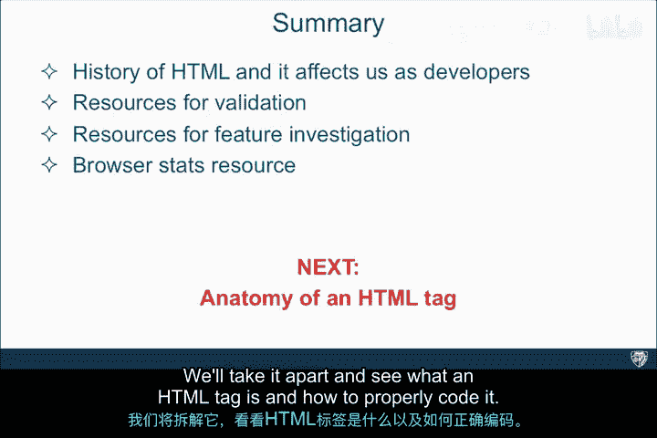
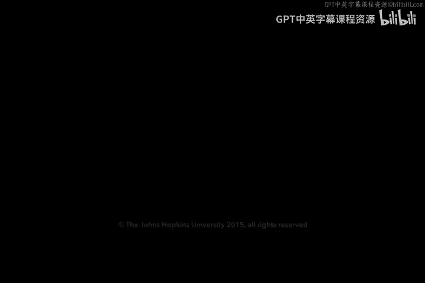

# 007：HTML发展简史

在本节课中，我们将简要回顾HTML的发展历程。了解这段历史不仅有助于我们理解这项技术是如何演进的，还能让我们认识到HTML中至今仍然适用和相关的某些方面。

## 早期：标准缺失的“狂野西部”时代

在1997年之前，网络世界没有统一的标准。浏览器厂商各自为政，他们随意发明新标签，对相同标签的实现方式也各不相同。这可以说是网络的“狂野西部”时代。用户访问一个网站时，可能会被告知其浏览器不兼容，必须更换浏览器才能正常浏览。

## 标准的诞生：W3C与HTML 4

大约在1997年，万维网联盟（W3C）制定了第一个标准——HTML 4，并很快更新为HTML 4.01。然而，这个标准较为宽松，浏览器厂商在如何实现和渲染页面方面仍有很大的自由发挥空间。

## 转向严格：XHTML的尝试

大约在2000年，W3C推出了另一个基于XML的规范，称为XHTML 1.0。XML是一种非常严格但清晰的标记语言。W3C希望沿用这一思路，并随后推出了XHTML 2.0。

## 分歧与对抗：WHATWG的成立

此时，浏览器厂商已有不完全遵循标准的历史。他们认为W3C的进程过于缓慢，且规范的发展方向是错误的。因此，几家主要的浏览器厂商联合起来，成立了另一个制定规范的组织——**WHATWG**。

*   **WHATWG** 是 **Web Hypertext Application Technology Working Group** 的缩写。
*   与W3C相比，WHATWG的决策过程不那么民主。它设有一位总编辑，拥有最终决定权。
*   WHATWG是推动现代HTML5发展的主要力量。

## 合作与统一：HTML5的诞生

很长一段时间里，W3C和WHATWG两个组织各行其道，互不合作。但W3C最终意识到，WHATWG是由真正重要的公司（即浏览器开发商）驱动的。大约在2007-2009年间，双方开始尝试合作。他们最终共同产出的成果，就是我们今天所知的 **HTML5**。

## 现状：双轨制与“常青”浏览器

那么，这段历史对我们有何影响？关键在于，目前有两个组织在某种程度上共同负责HTML：W3C和WHATWG。它们的职责划分如下：

*   **W3C** 负责制定和维护官方的 **HTML5标准**。这是他们的核心工作。
*   **WHATWG** 则不再为其HTML规范设定版本号。他们认为HTML是**持续演进**的，没有所谓的最终版本。WHATWG负责推动新特性的实现，而W3C则会将其中较为成熟、已被浏览器开始实现的部分，逐步纳入官方标准。

这种双轨制使得情况有些复杂，开发者需要跟踪哪些特性是浏览器应该支持的。这在当今“常青”浏览器的时代尤为重要。

**“常青”浏览器**意味着浏览器会在用户电脑上静默自动更新，无需用户手动干预。这带来了安全补丁和最新HTML5特性的自动获取。所有主流浏览器（Chrome、Firefox、Safari、Edge等）现在都是常青浏览器。

## 开发者实用资源

为了帮助大家更好地跟踪这些变化，以下是一些非常有用的网络资源。

### W3C官方标准文档

第一个应该分享的资源是W3C的HTML5标准文档。这是一份学术性较强的阅读材料，但你可以从中查找信息。如果你想了解各方都同意的官方标准是什么，这是一个很好的起点。

> 网址：[https://www.w3.org/TR/html5/](https://www.w3.org/TR/html5/)

### Can I use... 特性兼容性查询

另一个你必须查看并纳入自己工具箱的优秀网站是 **Can I use...**。这个网站本身就在跟踪HTML5、CSS、JavaScript API等各种Web标准，告诉你哪些浏览器支持什么特性。

例如，如果我搜索一个较新的属性 `srcset`（我们稍后会讨论），它会告诉我这是一个什么属性，以及目前哪些浏览器支持它，哪些（如旧版IE）不支持。你可以据此决定是否要使用某个特定特性。

> 网址：[https://caniuse.com/](https://caniuse.com/)

### W3C标记验证服务

另一个用于检查你的HTML是否能在浏览器中正常工作的好资源是使用验证器。W3.org网站提供了一个很棒的验证器。你可以直接粘贴你网站的URL，上传HTML文件，或者复制粘贴HTML代码进行验证。如果验证通过，那么它在浏览器中正常工作的几率就非常高。

> 网址：[https://validator.w3.org/](https://validator.w3.org/)

### 浏览器市场份额统计

在实际开发中，你不可能声称要支持网络上存在的每一个浏览器，因为浏览器种类繁多，有些已经非常过时。因此，查看浏览器统计数据总是一个好主意。W3Schools网站提供了浏览器市场份额统计。

例如，查看2015年9月的数据，你会发现Chrome占据了绝对主导地位。了解这些数据可以帮助你做出明智的决定，确定你的Web应用应该主要针对哪些浏览器进行开发和测试。

> 示例网址：[https://www.w3schools.com/browsers/](https://www.w3schools.com/browsers/)

### 搜索引擎：日常开发的必备工具

最后但同样重要的是，像Google这样的搜索引擎。在Web开发中，几乎没有一天不需要上网查找资料。这是日常工作的一部分。如果你要从事Web开发，就必须习惯不断查找资料，因为技术一直在变化，没有人能仅凭自己就知道一切。

## 总结

本节课我们一起回顾了HTML的发展简史，并了解了这段历史如何影响我们今天的开发工作。我们介绍了一些用于验证HTML的资源（如W3C验证器），这能增加你的HTML在浏览器中正常工作的信心。我们还介绍了用于特性调查的资源（如Can I use...网站），它可以告诉你特定特性在特定浏览器版本中的支持情况。最后，我们了解了在哪里可以查看浏览器统计数据，以便你能明智地决定你的Web应用应该主要支持哪些浏览器。

下一节，我们将讨论HTML标签的构成，将其拆解开来，看看HTML标签是什么以及如何正确编写它。