# 009：HTML基本文档结构 📄

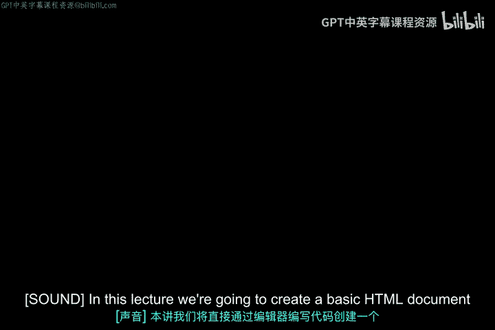

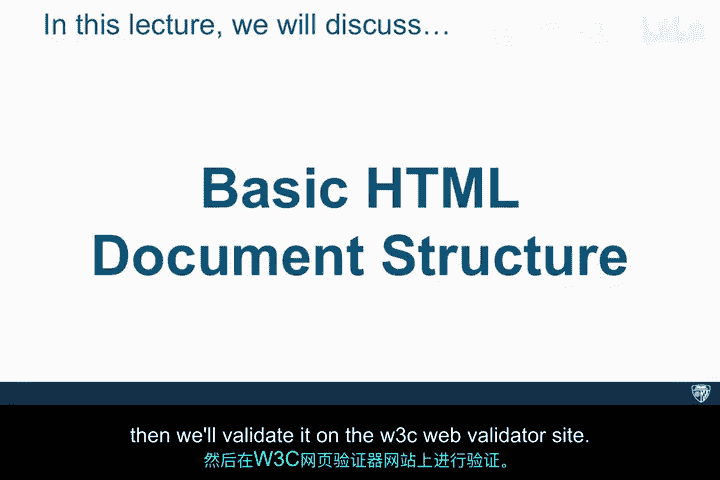

在本节课中，我们将学习如何创建一个基本的HTML文档结构。我们将直接在编辑器中编写代码，然后使用W3C验证器来检查我们的代码是否符合标准。

## 概述

我们将从零开始构建一个HTML页面，了解其核心组成部分，包括文档类型声明、`<html>`、`<head>`和`<body>`等标签。理解这些基础结构是学习Web开发的第一步。

## 创建基本HTML文档

首先，我们打开一个文本编辑器，创建一个名为`doc-structure-before.html`的新文件。我们将从一个空白页面开始构建。

### 文档类型声明

每个HTML页面都应该以文档类型声明开始。其作用是告诉浏览器准备渲染HTML内容。

在HTML5中，这个声明非常简单：
```html
<!DOCTYPE html>
```
`<!DOCTYPE html>`这几个单词可以是大写或小写。唯一需要注意的是，在`<!`和`DOCTYPE`之间不能有空格，其他地方的空格数量则没有严格限制，但为了美观，通常只保留一个空格。

这个声明在历史上更为复杂。过去，网络上有许多不符合标准的页面。为了帮助浏览器正确渲染这些旧页面，浏览器会使用文档类型声明来区分“怪异模式”和“标准模式”。如今，如果你省略这个声明，浏览器会将你的页面视为不遵循HTML标准，这可能导致布局和样式出现问题。因此，请始终使用这个简单的HTML5文档类型声明。

### HTML标签结构

声明之后是`<html>`标签，它包含了整个HTML文档。

在`<html>`标签内部，首先是`<head>`标签。`<head>`标签包含了描述页面主要内容的元数据，例如字符编码、页面标题以及渲染页面所需的外部资源。

以下是`<head>`部分的一个例子：
```html
<head>
    <meta charset="UTF-8">
    <title>页面标题</title>
</head>
```
我们使用`<meta charset="UTF-8">`来指定页面的字符编码为UTF-8，这是最常用的编码。请注意，`<meta>`是一个自闭合标签，没有单独的闭合标签。`<title>`标签是`<head>`中必须存在的标签，没有它HTML将是无效的。

`<head>`标签之后是`<body>`标签。`<body>`标签是所有对用户可见内容的根容器，通常被称为“视口”。我们在这里编写页面的主要内容。

### 完整的文档示例

将以上部分组合起来，一个最基本的有效HTML文档如下所示：
```html
<!DOCTYPE html>
<html>
<head>
    <meta charset="UTF-8">
    <title>Coursera很酷</title>
</head>
<body>
    <p>课程很棒，我学到了很多。</p>
</body>
</html>
```
在浏览器中打开这个文件，你将看到标题为“Coursera很酷”，并且页面上显示段落文字“课程很棒，我学到了很多。”。

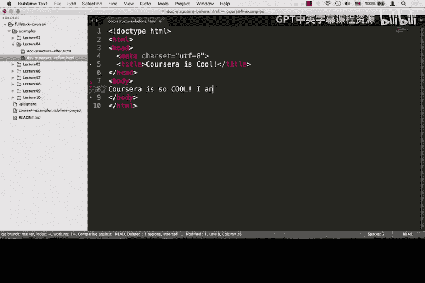

## 验证HTML代码

编写完代码后，最好使用W3C验证器进行检查。将我们的代码复制粘贴到验证器中，如果一切正确，它会显示“文档验证成功”。这能确保我们的代码遵循Web标准。

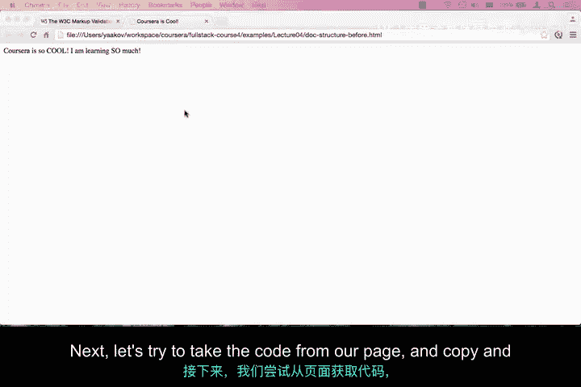

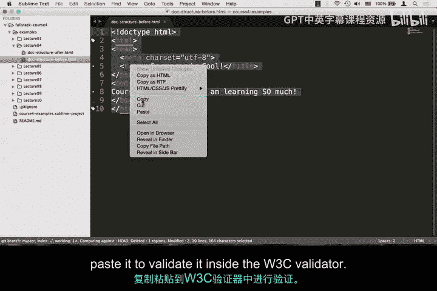

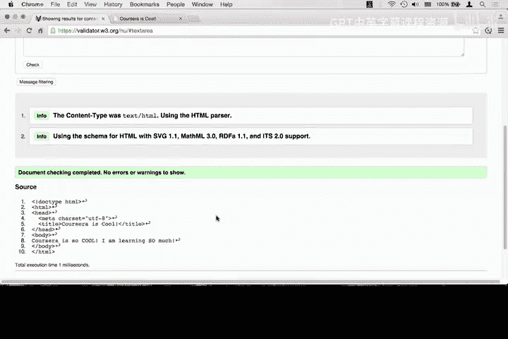

## HTML标签的嵌套规则

你可能已经注意到，HTML标签是相互嵌套的。例如，`<head>`标签包含了`<title>`标签。

嵌套HTML标签时有一条重要规则：**必须先关闭最后打开的标签，然后才能关闭其父标签**。如果顺序错误，HTML将是无效的。

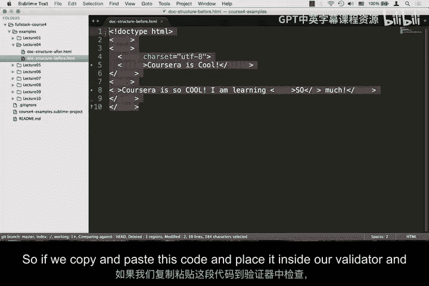

例如，以下代码是错误的，因为`<span>`标签在`<p>`标签关闭之后才关闭：
```html
<p>这是一段<span>文本</p></span>
```
正确的嵌套顺序应该是：
```html
<p>这是一段<span>文本</span></p>
```
如果将错误的代码放入验证器，它会提示错误，要求我们先关闭最后打开的`<span>`标签。

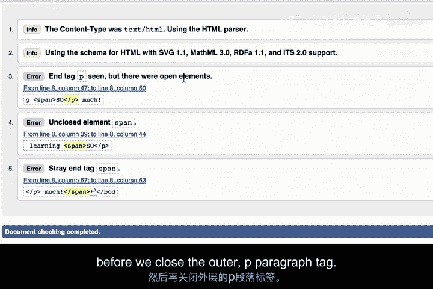

## 浏览器的渲染顺序

在继续学习之前，还有一点需要注意：浏览器在打开HTML页面时，总是**从上到下顺序地**渲染和解释HTML代码。它首先解释文档类型声明，然后是`<html>`标签，接着是`<head>`标签，依此类推，直到遇到最后一个闭合的`</html>`标签。记住这个顺序对我们后续课程的学习非常重要。

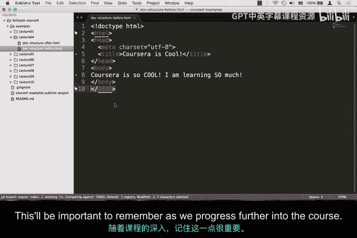

## 总结

本节课我们一起学习了HTML文档的基本结构。我们回顾了构成一个HTML页面的最小必要元素：

*   我们学习了必须使用的HTML5文档类型声明：`<!DOCTYPE html>`。
*   我们使用了第一批HTML标签：`<html>`、`<head>`、`<meta>`、`<title>`、`<body>`和`<p>`。
*   我们了解到浏览器是**从上到下顺序渲染**HTML代码的。
*   我们掌握了HTML标签的**嵌套规则**：后开的标签必须先闭合。
*   我们实践了使用W3C验证器来检查代码的有效性。

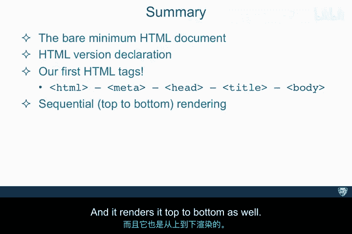

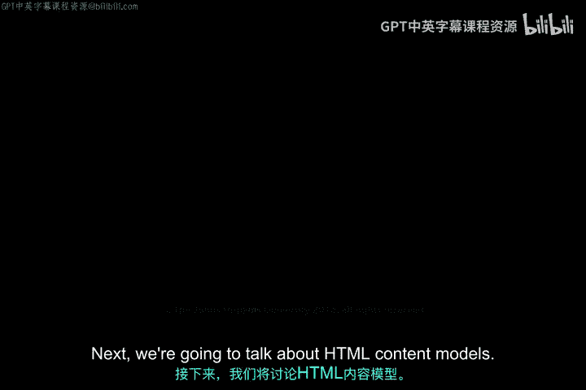

下一节课，我们将讨论HTML的内容模型。