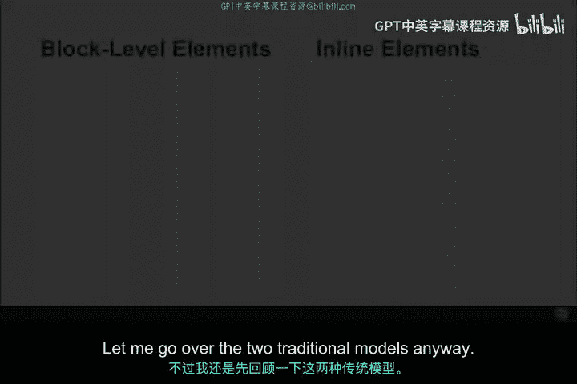
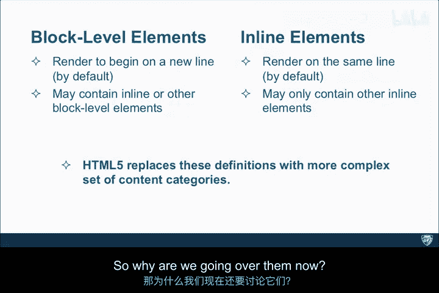
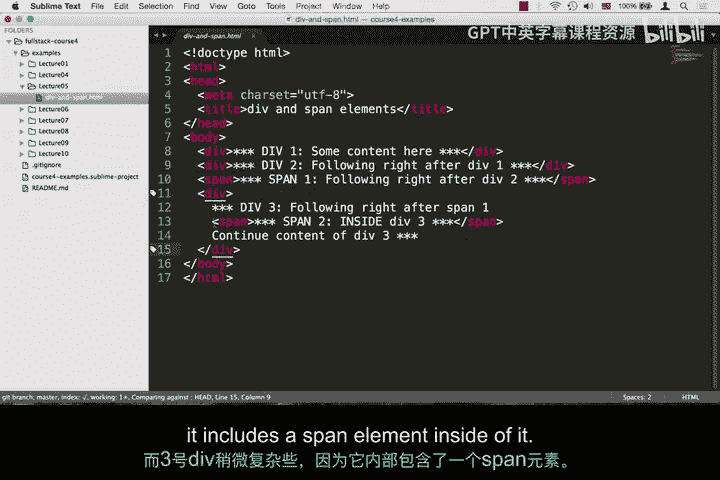
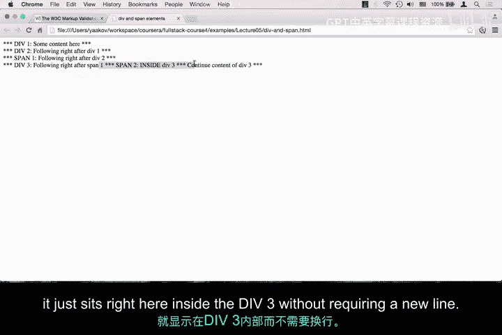
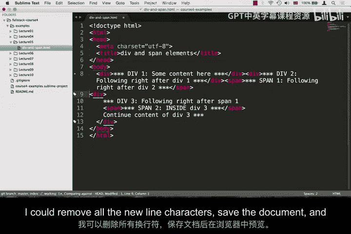
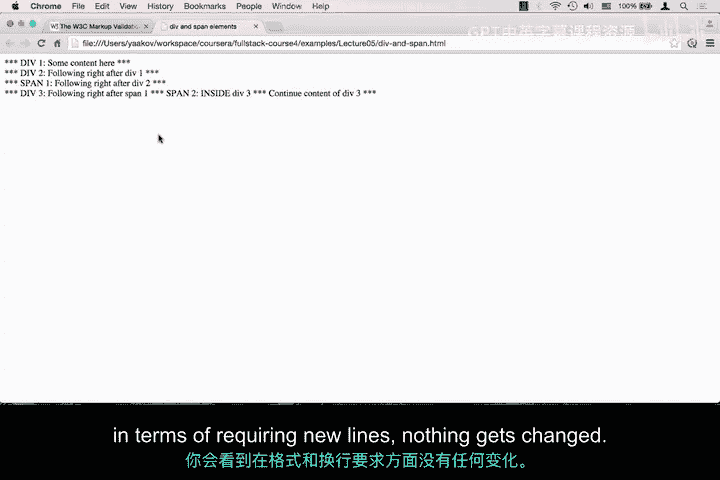
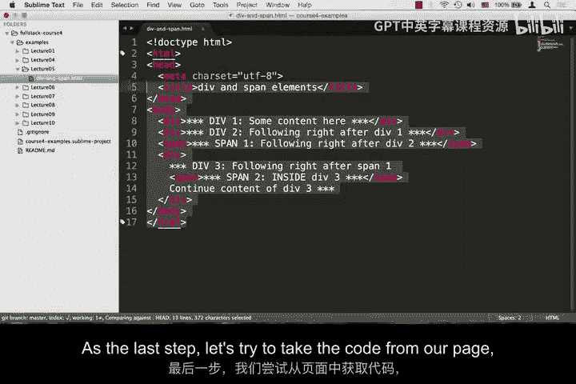
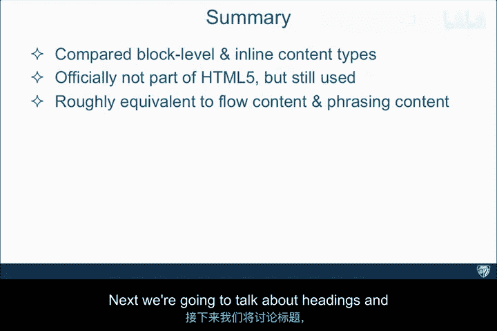
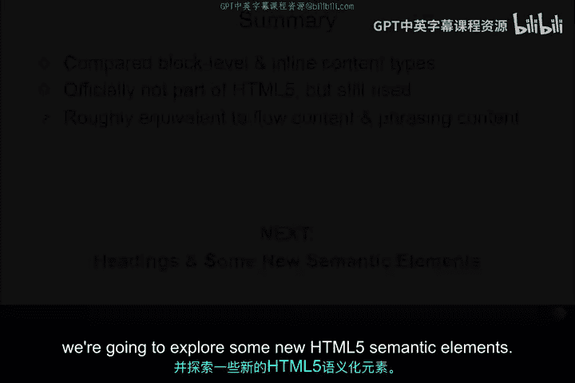

# 010：HTML内容模型

在本节课中，我们将要学习HTML内容模型的概念。内容模型定义了浏览器如何处理特定类型的元素，以及这些元素之间如何嵌套。理解内容模型对于编写结构良好、符合标准的HTML代码至关重要。

## 概述：什么是内容模型？ 📖

内容模型这一术语，指的是浏览器应用于属于该内容模型的元素的默认行为，以及这些元素的嵌套规则。换句话说，它规定了哪些元素可以嵌套在其他哪些元素内部。

在HTML5规范之前，HTML元素要么是块级元素，要么是内联元素。HTML5将这两种内容模型拆分成了七种模型，因此情况变得稍微复杂了一些。

## 传统内容模型：块级与内联 🧱

尽管如此，我们仍然需要回顾一下两种传统模型。我稍后会解释为什么这样做。在传统的内容模型结构下，所有元素基本上分为两类：**块级元素**或**内联元素**。

### 块级元素

块级元素默认会**在新的一行开始渲染**。你可以用CSS改变这一点，但我们目前还不讨论CSS。这意味着，每次在HTML中指定一个块级元素时，浏览器会自动将该元素放置在文档流的新行上。

块级元素允许在其内部包含内联元素或其他块级元素。

### 内联元素

这与内联元素形成对比。内联元素默认**在同一行上渲染**。同样，你可以改变这一点，但默认情况下，它们在同一行渲染。这意味着，如果你将一堆内联元素彼此相邻放置，它们都会显示在同一行上，就像没有换行符一样。

内联元素还有一个限制：它们只能包含其他内联元素。换句话说，一个内联元素不能将块级元素作为其内容的一部分。

## 为何仍要学习传统模型？ 🤔

我提到过，HTML5实际上用一组更复杂的内容类别取代了这些定义。那么，为什么我们现在还要学习它们呢？原因是，块级元素和内联元素之间的这种区分仍然非常实用，因为它与仍然存在的CSS规则非常吻合。

因此，尽管HTML5提出了新的内容模型名称、新的子类别和新的分类方式，但就你的编码而言，你仍然可以将所有这些视为块级元素和内联元素。这显然有点过于简化，但它是有效的。

为了更完整地说明：块级元素大致对应于HTML5新的**流内容**类别，而内联元素大致对应于HTML5的**措辞内容**类别。

## 代码演示：`
` 与 `` 💻

为了演示块级元素和内联元素之间的区别，我们将查看一个名为 `div_and_span.html` 的HTML文档。它位于示例的 `lecture05` 文件夹中。

也许每个类别中最通用的元素就是 `div` 和 `span` 元素，这也是我们将在本文档中介绍的元素。

*   `div` 代表“分区”，是你的**最通用的块级元素**。
*   `span` 代表“跨度”，是你的**超级通用的内联元素**。

让我们快速浏览一下这个文档。我们有几个 `div` 依次排列：`div1` 和 `div2`。然后，在 `div2` 后面跟着一个 `span` 元素。第三个 `div` 稍微复杂一些，因为它内部包含了一个 `span` 元素。

### 浏览器中的效果

在浏览器中查看时，你可以看到：
*   `div1` 元素独占一行。
*   `div2` 元素也独占一行。
*   即使 `span1` 是一个内联元素，并且紧跟在 `div2` 之后，但由于 `div2` 要求独占一行，它也将下一个内联元素推到了自己的行上。
*   对于 `div3` 也是如此：即使 `span1` 是内联元素，理论上下一个标签应该紧跟在 `span1` 后面，但由于 `div3` 是块级元素，它要求独占一行，因此被推到了下一行。
*   `span2` 标签位于 `div3` 内部，由于它是内联元素，不会引起任何额外的格式变化，它只是位于 `div3` 内部，不需要新行。

### 关于换行符的说明

需要明确的是，`div` 标签后面的换行符对HTML页面的渲染方式**绝对没有影响**。我可以删除所有换行符，保存文档并在浏览器中再次预览。你会看到，在格式化和要求新行方面，没有任何变化。

## 验证嵌套规则 ✅

作为最后一步，让我们尝试从页面中复制代码，并在W3C验证器中进行验证。

如你所见，页面是有效的。但是，如果我在验证器中，直接在 `span` 标签内添加另一个带有内容的 `div` 标签并关闭它，然后再次检查页面，会发生什么呢？

现在你会看到它报错了：**在此上下文中，不允许将 `div` 元素作为 `span` 元素的子元素**。它告诉你 `div` 元素可以使用的上下文是**流内容**，而 `span` 元素的内容模型是**措辞内容**。再次强调，措辞内容大致对应于内联内容，流内容大致对应于块级内容。

## 进一步探索 🔍

我提供几个URL供你进一步探索HTML5内容模型的不同类别。我想快速演示其中一个，即W3C的“内容种类”部分，它基本上列出了HTML5定义的七种内容类型。这个页面的酷之处在于，你可以将鼠标悬停在图形的不同部分，看到属于该特定HTML5内容模型类别的所有不同元素。

## 总结 📝

本节课中，我们一起学习了：
1.  **内容模型**的概念，它定义了元素的默认行为和嵌套规则。
2.  传统的**块级元素**和**内联元素**的区别：块级元素独占一行，可包含多种内容；内联元素同行排列，只能包含其他内联内容。
3.  尽管HTML5引入了更精细的分类（如流内容和措辞内容），但传统模型因其与CSS的紧密关联，在实践中仍然非常有用。
4.  通过 `
` 和 `` 的代码示例，直观地看到了这两种元素在浏览器中的渲染差异。
5.  使用W3C验证器验证了元素嵌套规则，并理解了违反规则（如在 `span` 内嵌套 `div`）会导致验证错误。

总而言之，我们比较了块级和内联内容类型，我们知道它们不是官方HTML5规范的一部分，但在文献和常规编码中仍然经常使用，并且它们分别大致等同于流内容和措辞内容。

接下来，我们将讨论标题，并探索一些新的HTML5语义元素。