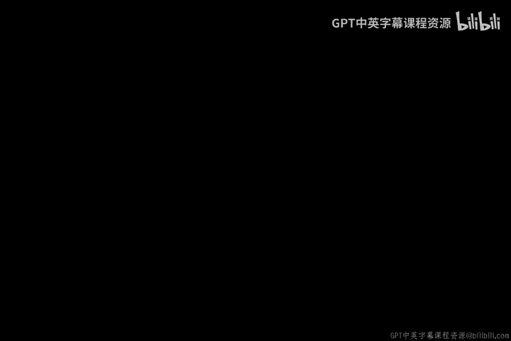
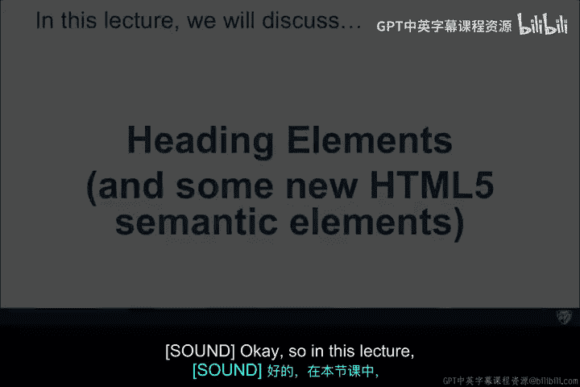
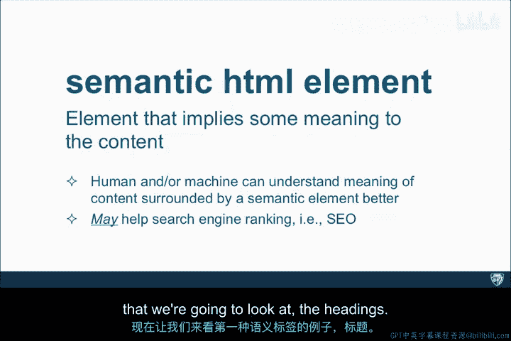
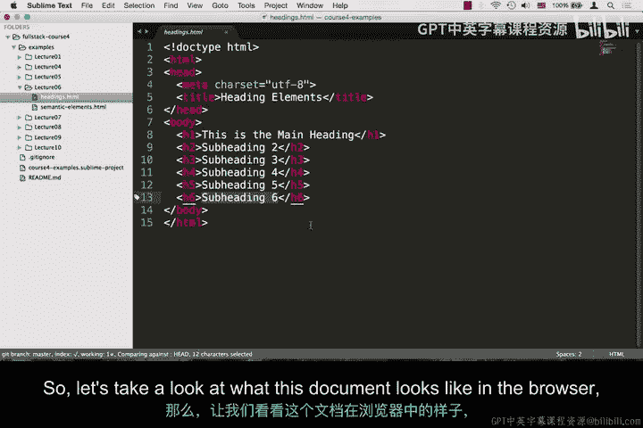
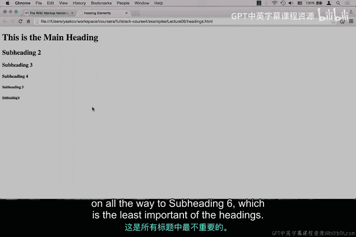
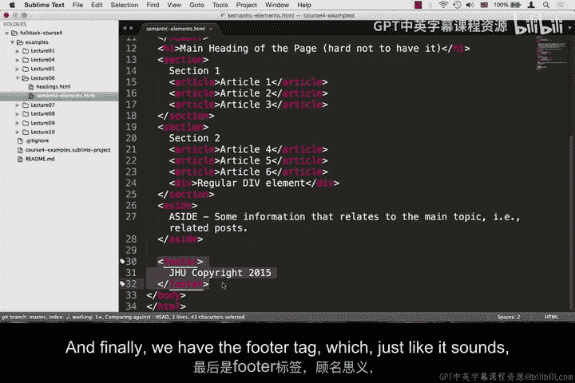
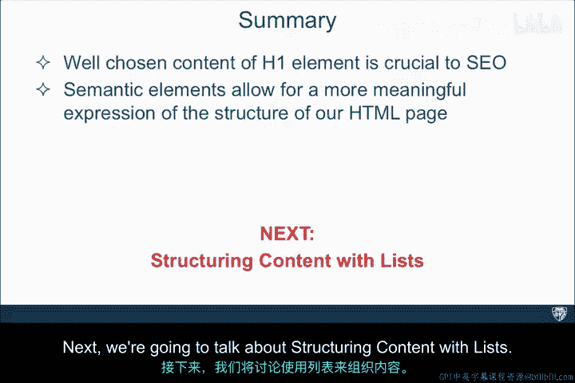
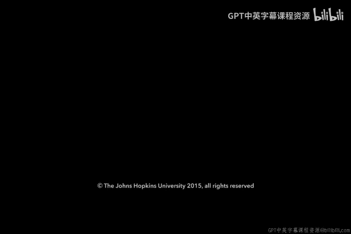

# 011：标题元素与HTML5新语义标签





在本节课中，我们将要学习HTML中的标题元素以及HTML5引入的一些新的语义化标签。我们将了解“语义化”的含义，探讨这些元素的重要性，并通过实例来理解它们如何使我们的网页结构更清晰、更易于理解。

## 概述：什么是语义化？

首先，我们来理解“语义化”这个词的含义。语义化指的是与语言或逻辑中的意义相关。换句话说，它本身带有某种固有的含义。

当这个概念应用于HTML时，一个**语义化的HTML元素**意味着该元素对其所包含的内容赋予了某种意义。它告诉阅读者（无论是人类还是机器）关于这段内容的一些信息，例如其重要性或描述。这比仅仅使用一个不传达任何具体含义的通用标签（如`<div>`）要好得多。

使用语义化标签可能有助于提升搜索引擎排名（即SEO，搜索引擎优化）。但需要指出的是，专家们对此观点存在争议。一些专家认为，现代搜索引擎非常复杂，除了内容本身，几乎没有其他因素能显著影响页面排名。尽管如此，在标题元素（尤其是`<h1>`）的使用上，大家普遍认为它对SEO至关重要。



## 标题元素

上一节我们介绍了语义化的概念，本节中我们来看看最基础、最重要的语义化元素之一：标题元素。

标题元素从`<h1>`到`<h6>`，用于表示文档中不同层级标题的重要性。`<h1>`代表最重要的标题，`<h6>`则代表最不重要的标题。



以下是所有可用标题元素的示例代码：
```html
<h1>这是最重要的标题 (Heading 1)</h1>
<h2>次级标题 (Heading 2)</h2>
<h3>再次级标题 (Heading 3)</h3>
<h4>标题 4 (Heading 4)</h4>
<h5>标题 5 (Heading 5)</h5>
<h6>最不重要的标题 (Heading 6)</h6>
```



在浏览器中，这些元素默认具有不同的样式（如字体大小、粗细），以视觉方式区分其重要性。

关于标题元素，有几点非常重要：
1.  **不应仅用于样式**：虽然浏览器默认赋予了它们视觉上的区分，但这些元素的本意是传达HTML页面的结构，而非样式。任何元素都可以通过CSS被设计成类似标题的样子。
2.  **使用`<h1>`的原因**：如果我们用`<div>`代替`<h1>`，就会失去“这是一个最重要标题”的语义含义。
3.  **`<h1>`的重要性**：被标记为`<h1>`的内容显然是整个页面最重要、最概括的描述。尽管专家对语义标签的SEO效果有争议，但一致认为`<h1>`标签的使用至关重要，它应包含能准确传达页面核心主题的词语。

## HTML5 新语义标签

了解了基础的标题元素后，我们现在来探索HTML5引入的一系列新的语义化标签，它们能帮助我们构建更具描述性的页面结构。

以下是一个使用了多种HTML5语义标签的示例文档结构：
```html
<header>
    <nav>
        <!-- 导航链接 -->
    </nav>
    <h1>网站主标题</h1>
</header>

<section>
    <article>
        <!-- 文章内容 1 -->
    </article>
    <article>
        <!-- 文章内容 2 -->
    </article>
    <article>
        <!-- 文章内容 3 -->
    </article>
</section>

<section>
    <article>
        <!-- 文章内容 4 -->
    </article>
    <article>
        <!-- 文章内容 5 -->
    </article>
</section>

<aside>
    <!-- 侧边栏内容，与主内容相关但不直接 -->
</aside>

<footer>
    <!-- 页脚信息 -->
</footer>
```

以下是这些新标签的简要说明：
*   **`<header>`**：通常包含页面的页头信息，如公司Logo、标语，有时也包含导航。
*   **`<nav>`**：表示用于网站导航的内容部分。
*   **`<section>`**：定义文档中的一个章节或区域。
*   **`<article>`**：定义独立、完整的内容块，如博客文章、新闻故事。
*   **`<aside>`**：表示与页面主内容相关但不直接属于主内容的部分，如侧边栏、引用框。
*   **`<footer>`**：包含页脚信息。

需要理解的关键点是，所有这些标签在默认情况下都是**块级元素**，在视觉上每个都会独占一行。从纯样式角度看，我们本可以全部使用`<div>`标签。



然而，使用这些语义标签后，代码的结构清晰度大大提升。例如，你可以轻松看出文章1、2、3是相关的，并且与文章4、5、6分属不同的章节。这就是语义化元素的力量——它们天生就传达出结构意义。

## 总结

本节课中我们一起学习了HTML的语义化概念及其应用。

我们首先探讨了**标题元素（`<h1>` 到 `<h6>`）**，理解了它们用于定义内容层级和重要性，并且**`<h1>`元素的内容选择对SEO至关重要**。

接着，我们认识了**HTML5的新语义标签**，如`<header>`、`<nav>`、`<section>`、`<article>`、`<aside>`和`<footer>`。这些标签本身不提供比`<div>`或`<span>`更多的功能，但它们允许我们以更具意义的方式来表达HTML代码的结构，使代码对人类阅读者和机器都更加友好。





记住，精心设计的语义化结构是编写高质量、可维护网页的基础。下一讲，我们将讨论如何使用列表来组织内容。