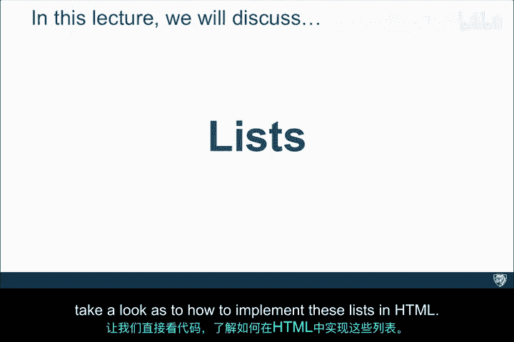
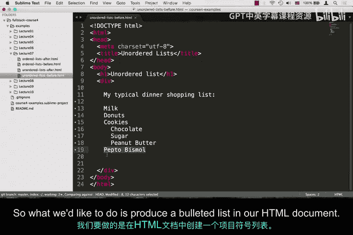
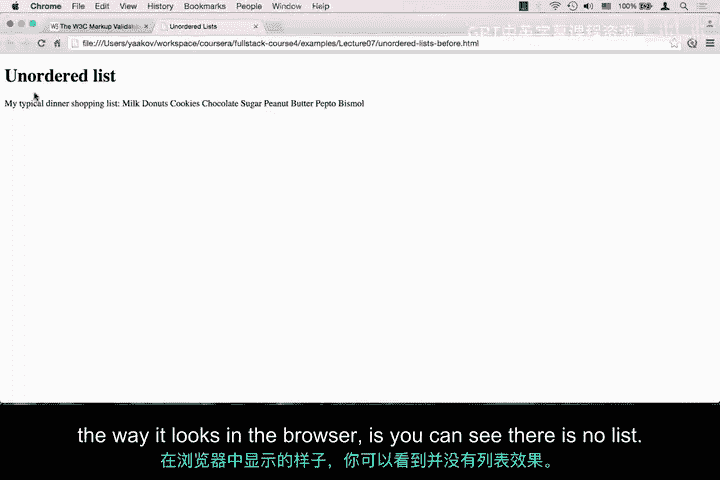
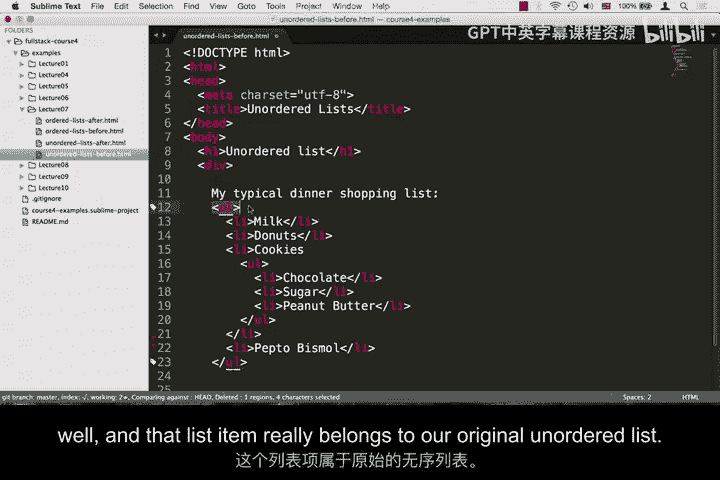
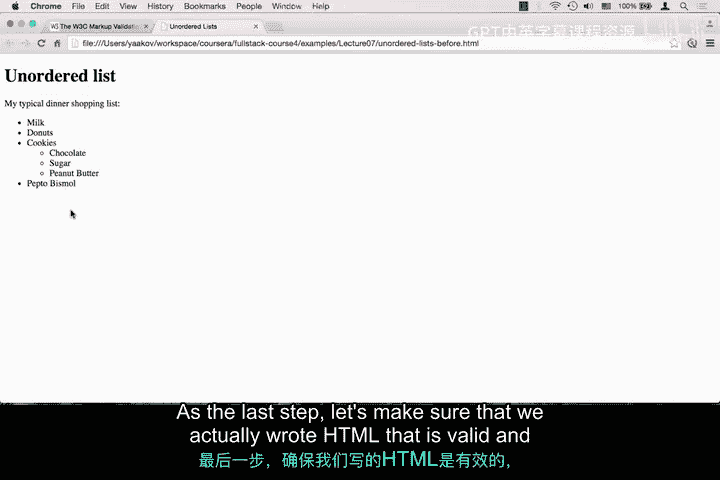
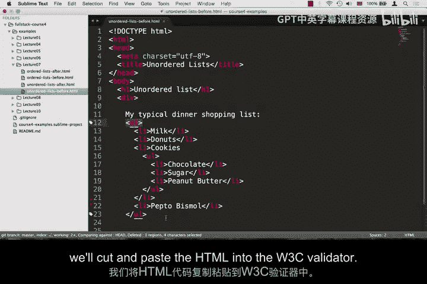
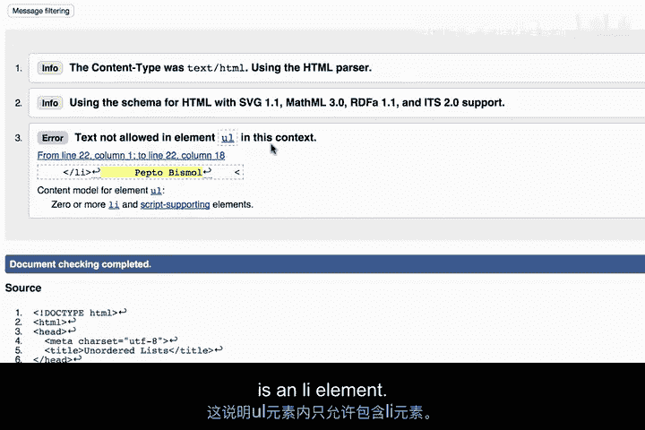
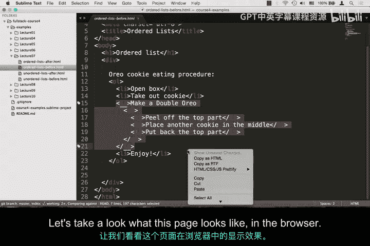
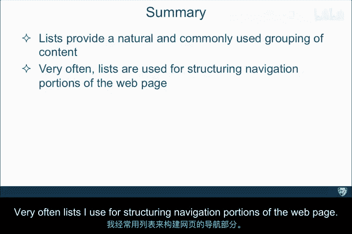
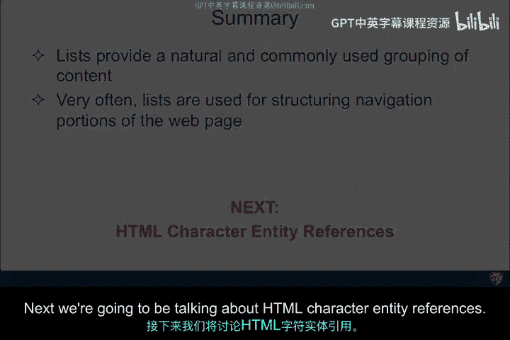

# 012：第7讲 列表

## 📋 概述
在本节课中，我们将要学习HTML中的列表。列表是一种非常有用的HTML结构，它允许你将相关的内容进行分组。我们作为普通人，通常会以列表的形式来思考事物，例如待办事项列表、购物清单等。因此，列表作为一种组织工具，对我们来说非常自然。接下来，我们将直接进入代码，看看如何在HTML中实现这些列表。

## 📝 无序列表
上一节我们介绍了列表的基本概念，本节中我们来看看如何创建无序列表。无序列表适用于项目之间没有特定顺序的情况，例如购物清单。

首先，我们来看一个典型的晚餐购物清单示例，包含牛奶、甜甜圈、饼干和胃药。在HTML中，如果我们只是简单地分行书写这些项目，浏览器会忽略换行符和多余的空格，最终只会显示为用空格分隔的一行文本。为了创建带项目符号的列表，我们需要使用无序列表。

创建无序列表的方法是使用 `<ul>` 标签（unordered list的缩写）包裹整个列表内容，列表中的每一个项目都需要用 `<li>` 标签（list item的缩写）包裹。

以下是创建无序列表的步骤：
1.  使用 `<ul>` 标签开始一个无序列表。
2.  使用 `<li>` 标签包裹列表中的每一个项目。
3.  使用 `</ul>` 标签结束无序列表。

有时，列表项内部可能包含子列表。例如，“饼干”这个项目下可能还有更细的分类。处理方法是，在“饼干”这个 `<li>` 标签的内部，再创建一个新的 `<ul>` 列表来包含其子项目。

完成代码编写后，在浏览器中刷新页面，就能看到一个带项目符号的无序列表了。

最后，确保我们编写的HTML代码是有效的非常重要。我们可以使用W3C验证器来检查代码。有效的HTML意味着 `<ul>` 标签内部只能直接包含 `<li>` 标签，不能包含其他文本或元素。如果违反此规则，例如移除了某个项目的 `<li>` 标签，验证器就会报错，提示“在此上下文中不允许在UL内部使用文本”。

## 🔢 有序列表
上一节我们学习了无序列表，本节中我们来看看有序列表。有些列表项目之间有严格的顺序要求，例如操作步骤说明，这时就需要使用有序列表。

有序列表与无序列表的创建方式非常相似，唯一的区别是将外层的 `<ul>` 标签替换为 `<ol>` 标签（ordered list的缩写）。列表项依然使用 `<li>` 标签。

例如，一个“吃奥利奥饼干的步骤”列表就必须是有序的，以确保第一步和第二步不会混淆。在代码中，我们只需将包裹整个步骤的标签改为 `<ol>`。

处理有序列表中的子列表（嵌套列表）的方法与在无序列表中完全一致。如果一个步骤（如“制作双层奥利奥”）内部包含多个子步骤，我们就在该步骤的 `<li>` 标签内部再创建一个新的 `<ol>` 列表。

在浏览器中查看时，有序列表的每个项目前会显示数字序号（如1, 2, 3），而不是项目符号，清晰地表明了步骤的先后顺序。

## 🎯 总结
本节课中我们一起学习了HTML中的两种列表：无序列表和有序列表。列表为内容提供了一种自然且常用的分组方式，在网页中常用于组织导航菜单等内容。我们掌握了如何使用 `<ul>` 和 `<ol>` 标签来创建列表，以及如何使用 `<li>` 标签定义列表项。我们还学习了如何处理嵌套列表，并了解了编写有效HTML代码的重要性。