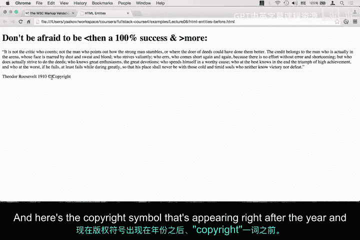
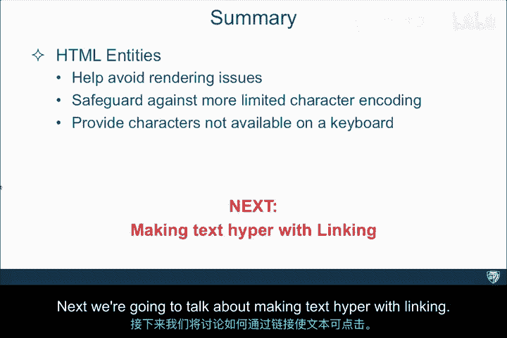
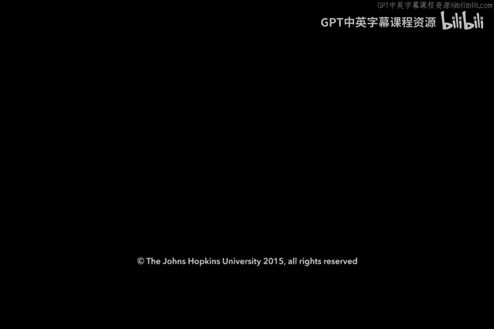

# 013： HTML字符实体引用 🧩

在本节课中，我们将学习HTML字符实体引用。这是一种特殊的语法，用于在网页中显示那些在HTML语法中具有特殊含义的字符，例如 `<`、`>` 和 `&`。我们还将了解如何使用它们来插入键盘上没有的符号，以及在某些特定场景下确保文本正确显示。

## 概述

HTML使用某些字符（如 `<` 和 `>`）来定义标签。如果我们想在网页内容中显示这些字符本身，而不是让浏览器将它们解释为代码，就需要“转义”它们。HTML字符实体引用就是解决这个问题的工具。本节将介绍其核心用途和常见示例。

## 为什么需要字符实体引用？

由于HTML将特定字符用于其语法，我们需要一种方法来区分这些字符是作为HTML代码使用，还是作为普通内容显示。如果我们希望浏览器将特殊的HTML字符解释为常规内容，就需要一种方式来“转义”它们。换句话说，我们需要告诉浏览器不要将它们解释为HTML。

具体来说，有三个字符应始终进行转义，以确保它们不会立即或日后引发渲染问题。

以下是这三个字符及其对应的实体引用：

*   **小于号 `<`**： 应使用 `&lt;`。
*   **大于号 `>`**： 应使用 `&gt;`。
*   **和号 `&`**： 应使用 `&amp;`。

因此，如果你在HTML中输入 `&lt;`，浏览器会将其解释为一个小于字符 `<`，而不是一个标签的开始。

## 实践示例：修复问题标题

让我们通过一个例子来看看这个概念的实际应用。

我们查看一个名为 `html-entities-before.html` 的文档，它位于示例文件夹中。这个文档包含一段引文和一个看起来有些奇怪的标题。

标题内容原文是：
`Don't be afraid to be <100% success> more.`

在浏览器中查看时，标题显示不完整，只显示了“Don't be afraid to be more”。这是因为浏览器将 `<` 解释为一个新标签的开始，并试图寻找与之匹配的 `>`，导致中间的内容被忽略。

我们可以通过将特殊字符替换为对应的HTML实体引用来修复这个问题。将 `<` 替换为 `&lt;`，将 `>` 替换为 `&gt;`，将 `%` 旁边的 `&` 替换为 `&amp;`。

修复后的代码如下：
`Don't be afraid to be &lt;100&amp; success&gt; more.`

保存并重新加载网页后，整个标题内容就能正确显示了。

## 其他常用实体引用

HTML包含大量不同的实体引用。虽然无法逐一介绍，但有几个特别常见。

**1. 版权符号 ©**

版权符号在键盘上不常见，但可以轻松使用实体引用插入。其代码是 `&copy;`。

例如，在年份后添加 `&copy;`，就会显示版权符号 ©。

**2. 不换行空格**

有时我们希望几个单词始终在同一行显示，不被拆开。这时可以使用不换行空格实体引用 `&nbsp;`。

例如，将句子中的“victory nor defeat”之间的普通空格替换为 `&nbsp;`：
`victory&nbsp;nor&nbsp;defeat`

这样，当调整浏览器窗口宽度时，这几个单词会作为一个整体一起换行或保持在同一行。

**⚠️ 注意：** 很多人误用 `&nbsp;` 来在单词间添加多个空格以达到排版效果（例如 `critic&nbsp;&nbsp;&nbsp;who`）。这是不正确的做法。如果需要调整间距，应该使用CSS（例如为元素添加 `margin` 或 `padding`）。`&nbsp;` 应仅用于需要阻止换行的特定词组。

**3. 引号和其他符号**

在某些环境下（例如一些电子邮件客户端），字符编码可能受限，导致引号等符号显示为乱码。这时可以使用实体引用来确保正确显示。

例如：
*   左双引号：`&ldquo;`
*   右双引号：`&rdquo;`
*   左单引号：`&lsquo;`
*   右单引号：`&rsquo;`

使用这些实体引用可以替代直接输入键盘引号，在某些编码设置下提供更可靠的显示。

## 总结

本节课我们一起学习了HTML字符实体引用。它们主要帮助避免渲染问题，特别是针对 `<`、`>` 和 `&` 这三个容易被浏览器误解为代码的字符。我们还看到，实体引用可以用于防范字符编码受限的环境，并能提供键盘上没有的字符（如版权符号©）。正确使用实体引用是编写健壮、兼容性好的HTML的重要一环。

接下来，我们将讨论如何通过链接让文本变得互联。