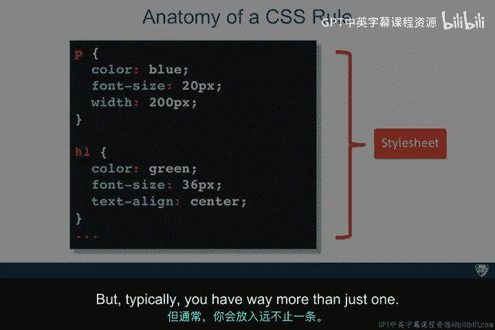
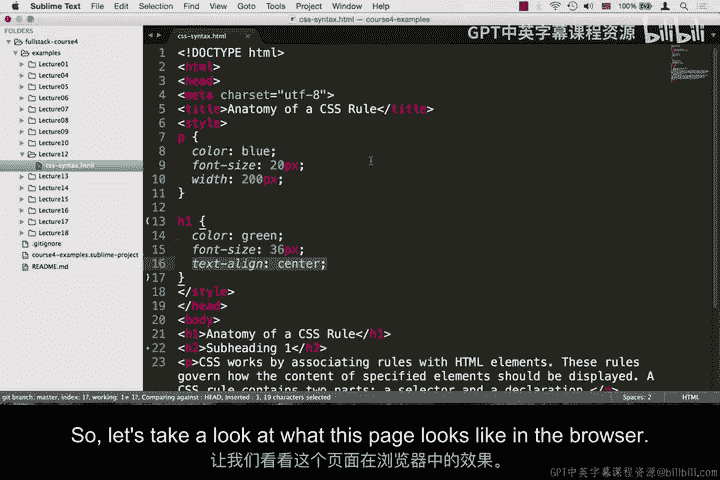
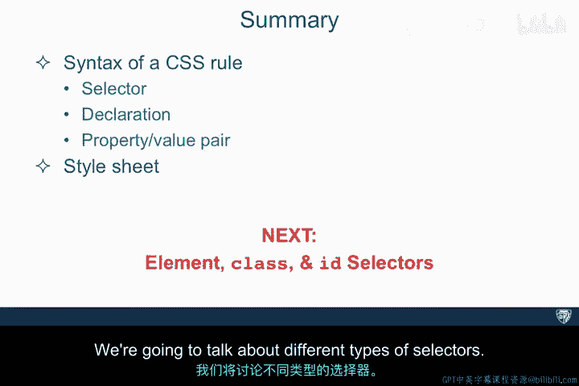
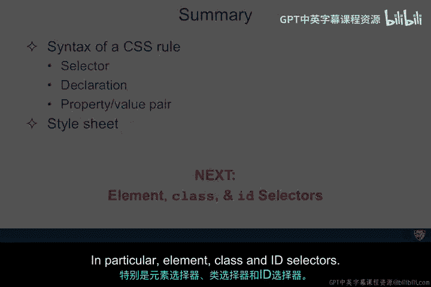

# 018：CSS规则结构解析


在本节课中，我们将要学习CSS规则的基本结构。我们将解析一条CSS规则的组成部分，并通过一个简单的例子来理解这些部分如何协同工作，以控制网页元素的样式。

## 概述：CSS如何工作

CSS通过将规则与HTML元素关联来工作。这些规则控制着指定元素的内容应如何显示。虽然为整个网页设计样式可能是一个相当复杂的过程，但定义一个简单的CSS规则是相当直接的。

## CSS规则的基本结构

一条CSS规则由两个主要部分组成：**选择器**和**声明块**。

### 选择器 (Selector)

选择器用于指定这条规则将应用于哪些HTML元素。例如，选择器 `p` 表示规则将应用于HTML页面中的每一个段落标签（`<p>`）的内容。

### 声明块 (Declaration Block)

选择器后面跟着一对大括号 `{}`，大括号内部包含一个或多个**CSS声明**。

每个CSS声明又由两部分组成：
*   **属性 (Property)**：一个由CSS规范预定义的样式名称（如 `color`, `font-size`）。
*   **值 (Value)**：为属性指定的具体设置。每个属性都有一组预定义的值，或者特定类型的数值。



属性和值之间用一个冒号 `:` 分隔，每个声明以分号 `;` 结束。从技术上讲，分号并非总是必需，但遵循最佳实践，应始终使用它。

一条CSS规则可以包含多个声明。例如，以下规则为段落设置了颜色、字体大小和宽度：

```css
p {
  color: blue;
  font-size: 20px;
  width: 200px;
}
```

这条规则的含义是：页面中所有段落的内容应为蓝色，字体大小为20像素，并且段落本身占据的宽度为200像素。

## 什么是样式表 (Style Sheet)

这些CSS规则的集合被称为**样式表**。从技术上讲，一个空的样式表也是样式表，只是不太有用。通常，一个样式表中会包含多条CSS规则。

## 实践：在HTML中应用CSS



上一节我们介绍了CSS规则的抽象结构，本节中我们来看看一个具体的例子。

以下是一个HTML文档的结构示例，其中包含一个一级标题（`<h1>`）、几个二级标题（`<h2>`）和一些段落（`<p>`）。我们的目标是为这些元素添加自定义样式。

为了方便起见，我们将样式表直接放在HTML文档的 `<head>` 部分（在实际网站中，CSS样式的放置位置可能不同，这将在后续课程中讨论）。

```html
<!DOCTYPE html>
<html>
<head>
    <style>
        /* 针对段落标签的规则 */
        p {
            color: blue;
            font-size: 20px;
            width: 200px;
        }
        /* 针对一级标题的规则 */
        h1 {
            color: green;
            font-size: 36px;
            text-align: center;
        }
    </style>
</head>
<body>
    <h1>这是一个主标题</h1>
    <h2>子标题一</h2>
    <p>这是第一个段落。</p>
    <h2>子标题二</h2>
    <p>这是第二个段落。</p>
</body>
</html>
```

在这个例子中：
*   我们只指定了一次 `p` 选择器，但文档中的**每一个**段落都应用了相同的样式（蓝色，20像素字体，200像素宽）。这体现了CSS在保持样式一致性和编写代码效率方面的强大能力。
*   我们为 `h1` 元素设置了绿色、36像素字体大小和居中对齐。

## 浏览器默认样式

你可能注意到，示例中的 `<h2>` 元素（“子标题一”和“子标题二”）显示为粗体且比普通文本稍大。这个样式并非来自我们编写的CSS规则。

这个样式来自于**浏览器本身的默认样式表**。每个浏览器都会为不同的HTML元素（如 `<h1>`, `<h2>`, `<p>` 等）应用一些默认样式。很多时候，网页开发者的工作之一就是重置或覆盖这些默认样式，以应用自己设计的样式。

## 总结

本节课中我们一起学习了CSS规则的核心语法。我们讨论了：
1.  **选择器**：用于指定样式应用的目标元素。
2.  **声明块**：包含一个或多个属性-值对，用于定义具体的样式。
3.  **样式表**：CSS规则的集合。
4.  **浏览器默认样式**：理解浏览器自带的初始样式是进行网页设计的基础。





下一节，我们将深入探讨CSS规则中的一个关键部分——**选择器**。我们将详细介绍不同类型的选择器，特别是元素选择器、类选择器和ID选择器。