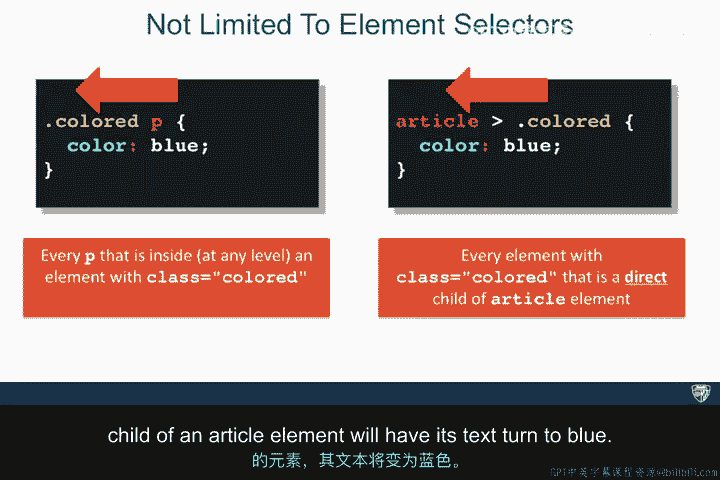
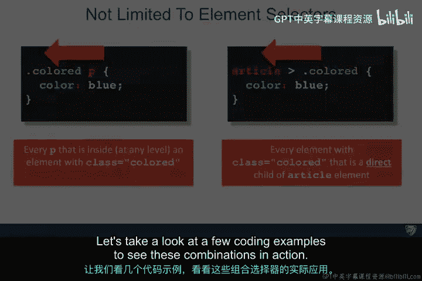
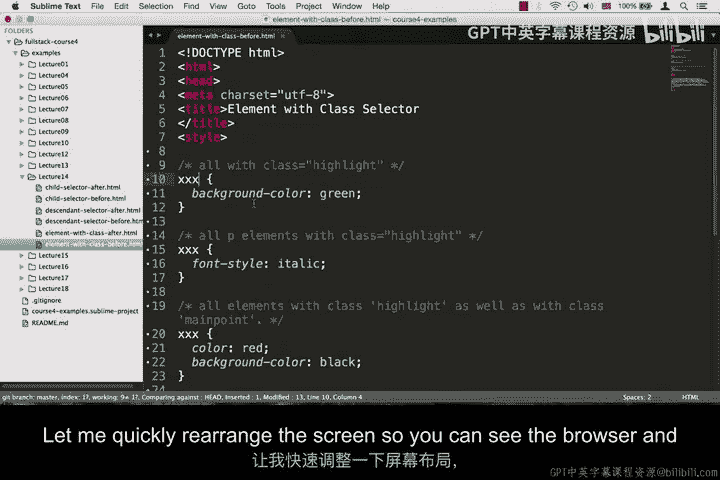
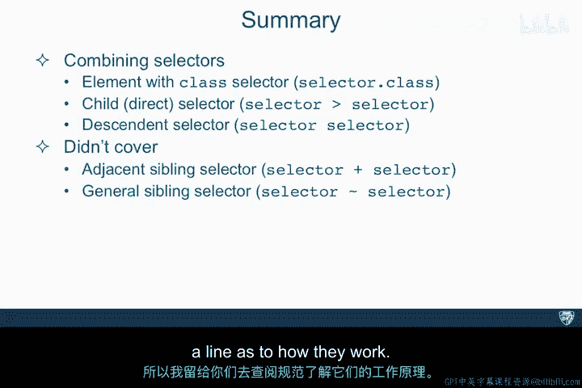
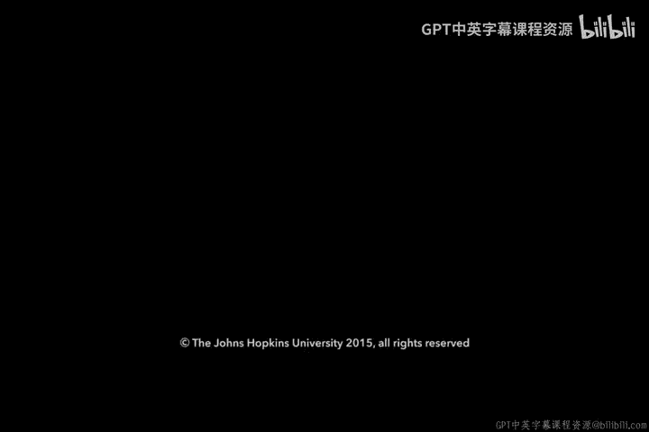

# 020：组合选择器 🎯


在本节课中，我们将学习如何组合CSS选择器。这是一种强大的技术，能让我们更精确地定位页面上的元素。我们将探讨几种最常见的组合方式，并通过实例来加深理解。

---

## 概述

组合选择器允许我们通过将多个简单选择器连接起来，创建更具体、更强大的选择规则。本节将重点介绍三种核心的组合方式：元素与类选择器组合、子选择器和后代选择器。掌握这些技巧是编写高效、可维护CSS的关键。

---

## 元素与类选择器组合

上一节我们介绍了基本的选择器，本节中我们来看看如何将它们组合起来。第一种组合方式是**元素与类选择器**。

其语法是：一个元素选择器**直接**后跟一个类选择器，中间**没有空格**。这表示选择所有具有指定类名的特定元素。

**语法公式**：
`element.className`

例如，`p.big` 会选择所有 `class="big"` 的 `<p>` 元素。如果在元素和类选择器之间加了空格，含义将完全不同，它会变成一个后代选择器。

以下是使用此组合方式的一个关键点：
*   确保元素选择器和类选择器之间没有空格。
*   这种组合常用于当某个CSS类应用于多种元素，但您希望它在特定元素上呈现不同样式时。

在右侧示例中，只有 `class="big"` 的 `<p>` 元素会获得20像素的字体大小，而其他具有 `class="big"` 的元素则不会。

---

## 子选择器

接下来，我们学习**子选择器**。它用于选择作为某个元素**直接子元素**的元素。

其语法是：一个选择器后跟一个右尖括号 `>`，再跟另一个选择器。我们**从右向左**阅读这个组合：选择所有作为左侧选择器**直接子元素**的右侧选择器元素。

**语法公式**：
`parentSelector > childSelector`

例如，`article > p` 会选择所有作为 `<article>` 元素**直接子元素**的 `<p>` 元素。

在示例中，作为 `<article>` 直接子元素的 `<p>` 会变成蓝色。而另一个 `<p>` 元素，虽然也在 `<article>` 内部，但它是 `<div>` 的子元素，因此不是 `<article>` 的**直接**子元素，所以其样式不受影响。

---

## 后代选择器



现在，让我们看看**后代选择器**。它与子选择器类似，但范围更广，选择的是某个元素内部**任意层级**的后代元素。





其语法是：一个选择器后跟一个**空格**，再跟另一个选择器。同样**从右向左**阅读：选择所有位于左侧选择器元素**内部**（无论嵌套多深）的右侧选择器元素。

**语法公式**：
`ancestorSelector descendantSelector`

例如，`article p` 会选择 `<article>` 元素内部的所有 `<p>` 元素，无论它们是直接子元素，还是嵌套在更深层的其他元素中。

在示例中，第一个 `<p>` 是直接子元素，会变蓝；第二个 `<p>` 完全不在 `<article>` 内，不受影响；第三个 `<p>` 虽然不是直接子元素（中间隔着 `<div>`），但由于它是 `<article>` 的后代，所以也会变蓝。

---

## 选择器组合的灵活性

需要指出的是，这些组合不仅限于元素选择器。我们可以使用任何类型的选择器进行组合。

例如：
*   `.colored p` 是一个后代选择器，表示选择所有位于 `class="colored"` 的元素内部的 `<p>` 元素。
*   `article > .colored` 是一个子选择器，表示选择所有作为 `<article>` 直接子元素的、`class="colored"` 的元素。

---

## 代码示例与实践

让我们通过几个代码示例来看看这些组合选择器如何实际工作。

### 示例1：元素与类选择器

我们有一个简单的HTML文件。其结构包含一个带有 `class="highlight"` 的 `<h1>`，两个 `<p>` 标签（其中一个有 `class="highlight"`），以及一个带有 `class="main point highlight"` 的 `<div>`。

以下是我们要编写的CSS规则：

首先，我们想选中所有 `class="highlight"` 的元素。
```css
.highlight {
  background-color: green;
}
```

其次，我们想选中所有**同时**是 `<p>` 元素**且**具有 `class="highlight"` 的元素。注意，`p` 和 `.highlight` 之间没有空格。
```css
p.highlight {
  font-style: italic;
}
```

最后，我们想选中所有**同时**具有 `class="highlight"` **和** `class="main point` 的元素。写法是将两个类选择器直接连在一起。
```css
.highlight.mainpoint {
  color: red;
  background-color: black;
}
```
应用这些规则后，只有同时拥有两个类的 `<div>` 元素会变成红字黑底。

### 示例2：子选择器

这个HTML文件的结构包含两个 `<section>`。第一个 `<section>` 内有一个 `<div>`，`<div>` 内有一个 `<article>`。第二个 `<section>` 内直接有一个 `<article>` 子元素。此外，还有一个 `<h2>` 在 `<section>` 外部。

以下是我们要编写的CSS规则：

首先，选中所有作为 `<section>` **直接子元素**的 `<article>` 元素。
```css
section > article {
  color: blue;
}
```
只有第二个 `<section>` 下的 `<article>` 会变蓝。

其次，选中所有作为 `<section>` **直接子元素**的 `<h2>` 元素。
```css
section > h2 {
  color: red;
}
```
只有第一个 `<section>` 下的 `<h2>`（“subheading 1”）会变红。

### 示例3：后代选择器

这个HTML文件包含两个无序列表 `<ul>`。第一个 `<ul>` 在 `<section>` 元素内部，第二个 `<ul>` 在 `<article>` 元素内部。

我们的目标是：选中所有位于 `<section>` 元素**内部**（任何层级）的 `<li>` 元素。
```css
section li {
  color: green;
}
```
应用此规则后，第一个 `<ul>` 中的所有 `<li>` 都会变成绿色，即使它们与 `<section>` 之间还隔着一个 `<ul>` 元素。

---

## 总结与延伸

本节课中我们一起学习了三种核心的CSS选择器组合方式：
1.  **元素与类选择器** (`element.className`): 用于选择具有特定类名的特定元素。
2.  **子选择器** (`parent > child`): 用于选择作为某元素直接子元素的元素。
3.  **后代选择器** (`ancestor descendant`): 用于选择位于某元素内部任何层级的后代元素。

记住，这些组合中的“选择器”可以是任何有效的CSS选择器，不限于元素标签。

此外，还有两种不太常见但有时很有用的组合选择器未在本课详述：
*   **相邻兄弟选择器** (`element + sibling`): 选择紧接在另一个元素后的兄弟元素。
*   **通用兄弟选择器** (`element ~ sibling`): 选择指定元素之后的所有兄弟元素。





您可以查阅CSS规范或在线资料来了解它们的详细用法。下一讲，我们将探讨**伪类选择器**，它允许我们根据元素的状态或位置来应用样式。