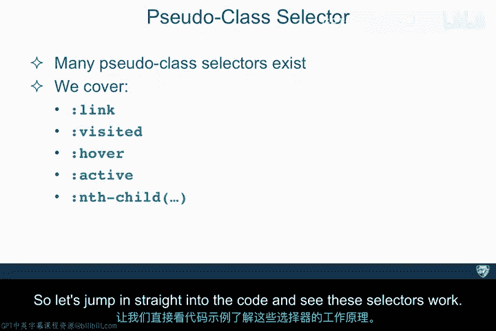
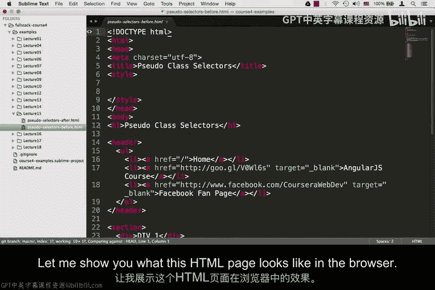
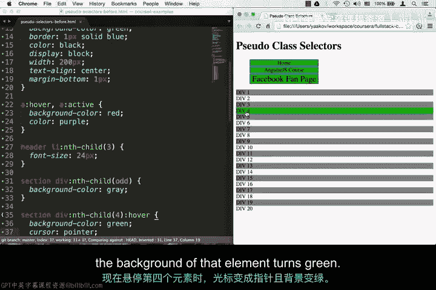
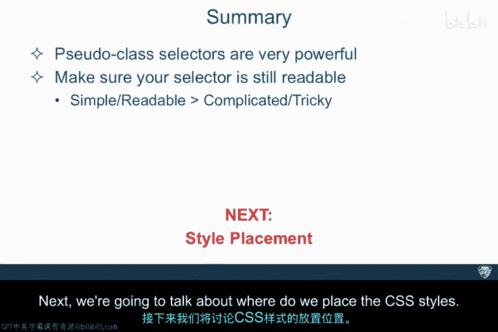
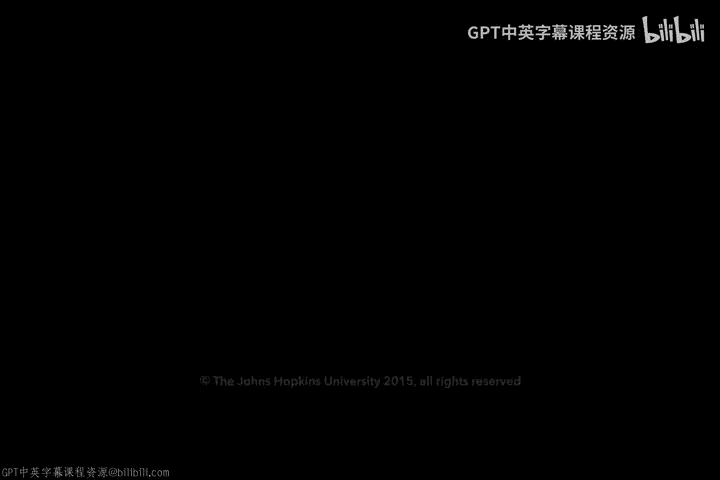

# 021：伪类选择器 🎯


在本节课中，我们将要学习CSS伪类选择器。伪类选择器允许我们根据元素的状态（如用户交互）或其在文档结构中的位置来应用样式，而不仅仅是基于元素类型、类或ID。我们将通过实例来了解几个最常用和强大的伪类选择器。

上一节我们介绍了基础的选择器，本节中我们来看看如何利用伪类选择器实现更动态和精细的样式控制。

## 理解伪类选择器



伪类选择器用于定位两种目标：一是可以通过常规选择器组合定位的结构；二是基于用户与页面交互状态（例如鼠标悬停）来应用样式的能力。



指定伪类选择器的方式是：在一个已知的选择器后加上冒号和一个预定义的伪类名称。例如：`selector:pseudo-class`。

在本讲中，我们将涵盖五个伪类选择器。前四个——`:link`、`:visited`、`:hover` 和 `:active`——非常基础且使用频率极高。最后一个 `:nth-child()` 则功能强大，虽然可以变得相当复杂，但其基本用法相当直观。

现在，让我们直接进入代码，看看这些选择器如何工作。

## 实战：将列表样式化为菜单

我们从一个包含标题和多个`<div>`的HTML页面开始。标题内有一个无序列表，其中包含多个链接。我们的第一个任务是将这个无序列表样式化为一个菜单按钮栏。

首先，我们需要定位这些列表项。我们将使用后代选择器 `header li`，并通过 `list-style: none;` 移除默认的项目符号。

```css
header li {
  list-style: none;
}
```

接下来，我们需要样式化`<li>`元素内的链接，使它们看起来像按钮。然而，样式化链接并不像样式化常规元素那样直接，因为链接具有不同的状态，这些状态可以通过伪类来表达。

以下是链接的几种状态，我们经常将其中两种组合在一起定义样式：
*   `:link`：链接的默认状态。
*   `:visited`：链接被访问后的状态。
*   `:hover`：用户鼠标悬停在元素上时的状态。
*   `:active`：用户点击元素但尚未释放鼠标按钮时的状态。

我们首先将 `:link` 和 `:visited` 状态组合起来，为它们设置相同的基础样式。这通常是一种常见做法，表示我们不区分未访问和已访问的链接。

```css
a:link, a:visited {
  text-decoration: none; /* 移除默认下划线 */
  background-color: green;
  border: 1px solid blue;
  color: black;
  display: block; /* 将行内元素改为块级元素 */
  width: 200px; /* 限制按钮宽度 */
  text-align: center; /* 文字居中 */
  margin-bottom: 1px; /* 按钮间添加间距 */
}
```

默认情况下，`<a>`元素是行内元素。为了创建块级按钮效果，我们将其 `display` 属性设置为 `block`，并指定宽度和对齐方式。

现在，我们有了三个基础的菜单按钮。为了增加交互性，我们需要定义用户悬停和点击时的样式。我们将 `:hover` 和 `:active` 状态组合起来。

```css
a:hover, a:active {
  background-color: red;
  color: purple;
  cursor: pointer; /* 鼠标悬停时变为手形指针 */
}
```

这样，当用户将鼠标悬停在按钮上或点击按钮时，背景色会变为红色，文字变为紫色，光标也会变成手形指针。

## 使用 `:nth-child()` 伪类

`:nth-child()` 伪类选择器允许我们根据元素在其父元素中的位置（序号）来选择目标元素。

其基本形式是 `:nth-child(n)`，其中 `n` 可以是数字、关键词（如 `odd` 奇数、`even` 偶数）或公式（如 `2n` 表示所有偶数项）。

例如，如果我们想单独放大菜单中的第三个链接（假设是“Facebook粉丝页”链接），可以这样做：

```css
header li:nth-child(3) {
  font-size: 24px;
}
```

这只会影响标题中无序列表的第三个`<li>`子元素。

`:nth-child()` 的功能远不止于此。例如，我们有一系列单调的`<div>`，我们希望让列表更易读，可以为所有奇数项设置灰色背景。

```css
section div:nth-child(odd) {
  background-color: gray;
}
```

现在，所有位于`<section>`内的奇数序号`<div>`都会拥有灰色背景。

## 组合伪类选择器

就像常规选择器可以组合一样，伪类选择器也可以组合使用。这允许我们创建更具体、更动态的样式规则。

例如，我们希望上面`<div>`列表中的第四项在鼠标悬停时有不同的行为。我们可以这样写：

```css
section div:nth-child(4):hover {
  background-color: green;
  cursor: pointer;
}
```

这个选择器表示：选择`<section>`内第四个`<div>`子元素，并且仅当它处于悬停状态时，应用绿色背景和手形指针样式。

## 注意事项与最佳实践

通过以上示例，你已经看到了选择器，尤其是伪类选择器的强大功能。然而，有一个重要的警告：请确保你的选择器仍然易于阅读和理解。

这些规则可以很快变得非常复杂。如果你写的选择器让其他开发者（甚至一个月后的你自己）都难以快速理解其目标，那么它可能会变成维护的噩梦。



因此，**简单、可读的代码绝对优于复杂、取巧的代码**。你或许能用复杂的技巧让人印象深刻，但让代码超级复杂绝不是良好的编程实践。

## 课程总结

本节课中我们一起学习了CSS伪类选择器。我们了解了如何利用 `:link`、`:visited`、`:hover` 和 `:active` 来根据链接状态应用样式，从而创建交互式UI元素如菜单按钮。我们还探索了强大的 `:nth-child()` 伪类，它允许我们基于元素在父容器中的位置来定位和样式化元素，并学习了如何组合伪类以实现更精细的控制。





记住，强大的工具需要负责任地使用。在追求功能强大的同时，始终保持代码的清晰和可维护性。