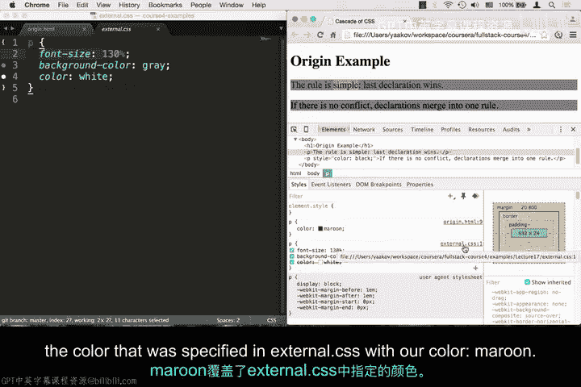
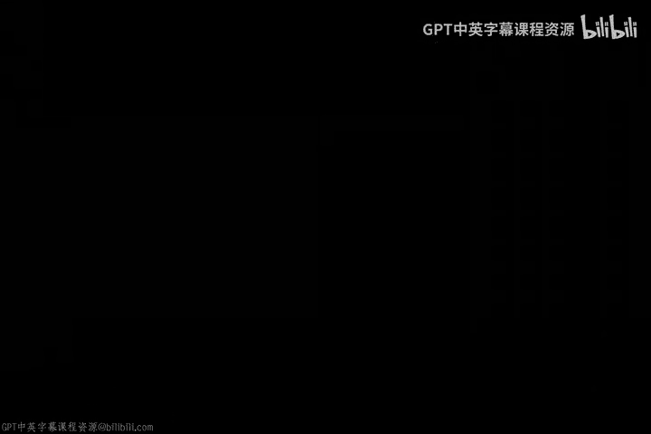
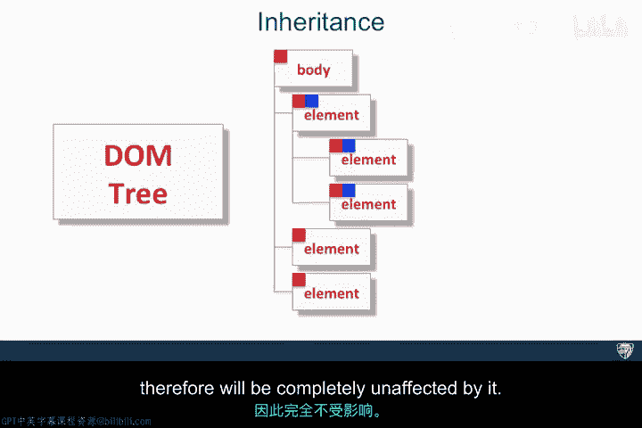
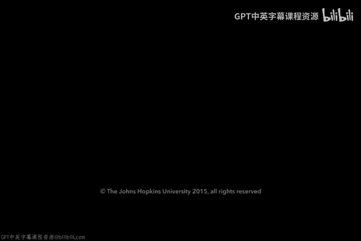

# 023：第17讲 第1部分 样式冲突解决 🎨

在本节课中，我们将要学习CSS的一个核心机制——层叠（Cascading）。我们将探讨当多个CSS规则试图控制同一个元素时，浏览器如何决定最终应用哪个样式。理解这个过程是掌握CSS的关键。

## 什么是层叠？ 🔄

层叠是CSS的一个基本特性。它是一种算法，定义了如何组合来自不同来源的属性值。正如其名称“层叠样式表”所暗示的，层叠算法是理解和使用CSS的核心。该算法通过结合样式声明的重要性、来源、特异性和源代码顺序，来确定最终应用于任何给定元素的声明，并在存在冲突时解决这些冲突。

## 核心概念：来源与合并 📝

层叠算法涉及许多术语和概念。然而，要掌握其工作原理，你需要理解以下四个概念：来源（Origin）、合并（Merge）、继承（Inheritance）和特异性（Specificity）。本节我们先来看前两个：来源与合并。

当两个声明发生冲突时，即它们为同一个目标元素指定了相同的属性，**来源优先规则**就会生效。这是一个非常简单的规则：**最后声明的规则胜出**。

在判断哪个是“最后声明”时，你需要记住HTML是按顺序（从上到下）处理的。因此，声明在页面中出现的位置越靠下，其优先级就越高。同时，对于外部CSS文件，可以将其视为在HTML中`<link>`标签所在的位置被声明的。为了判断声明的先后顺序，你可以想象将外部CSS文件的全部内容直接剪切并粘贴到HTML文件`<head>`部分中该CSS链接声明的位置。

当不同的CSS声明没有冲突时，即它们仍然针对同一个元素，但设置的CSS属性不同，规则则更为简单：**声明会合并**。例如，一个针对字体大小的声明和一个针对颜色的声明，由于它们是两个不同的属性，即使它们来自两个不同的来源，当它们应用于同一个元素时，也会合并为一个。该元素将同时获得字体大小和颜色的样式。

让我们通过代码快速看一个例子。

以下是代码示例的解析：

在HTML文件的`<head>`部分，首先通过`<link>`链接了一个外部CSS文件。该文件规定所有`
`标签的字体大小为130%，背景为灰色，文字颜色为白色。

紧接着，在同一个`<head>`部分，有一个`<style>`标签，它覆盖了`
`元素的文字颜色，将其设置为栗色（maroon）。

在页面主体中，有两个段落。第一个是普通段落，第二个段落通过`style`属性内联声明了文字颜色为黑色。

**结果分析：**
*   第一个段落：背景为灰色，文字颜色为栗色。这是因为外部CSS的声明（灰色背景、白色文字）首先被应用，但随后`<style>`标签中的声明（栗色文字）覆盖了颜色属性。字体大小和背景颜色没有冲突，因此被合并应用。
*   第二个段落：背景为灰色，文字颜色为黑色。这是因为内联样式（`style="color: black;"`）是最后声明的颜色规则，因此它覆盖了之前所有的颜色声明。同样，字体大小和背景颜色被合并应用。

这演示了来源优先规则的实际应用。同时，对于没有冲突的属性（如`background-color`和`font-size`），它们被合并到了最终的样式中。

## 核心概念：继承 🌳

接下来我们要看的概念是继承，这是一个相当简单的概念。其基本思想是：文档对象模型（DOM）是一个树形结构。如果你在某个元素上指定了某个CSS属性，那么该元素的所有子元素、孙元素等都将继承该属性，而无需你为每个元素单独指定。

例如，如果我在`<body>`标签上指定了一个属性，那么`<body>`标签的每个子元素，甚至子元素的子元素等，都将继承该属性。同样，如果我在HTML页面中的某个元素上指定了一个属性，那么该元素的每个子元素和孙元素等也将继承该属性。但显然，该元素的父元素不会继承此属性，因此完全不受其影响。

让我们看看代码中的继承是什么样子。

在CSS中，继承是一个非常简单易懂的概念，同时也是一种非常强大的技术。它允许我指定一条规则，并让目标元素的所有子元素都继承该规则。

以下是代码示例的解析：

在HTML中，一个常见的做法是为`<body>`标签指定一些声明。原因很明显：就视口而言，`<body>`是我们HTML中的顶层元素。我可以在其中为整个HTML文档指定一些规则，然后利用我们的层叠来源优先规则，在文档靠下的位置覆盖一些特定的规则，同时保持其他所有内容的一致性。

在这个例子中，我指定了文档中出现的任何文本颜色应为红色，并且所有内容都应居中对齐。同时，指定了一种将在整个HTML文档中保持一致的字体（这里是Helvetica）。这是一种非常常见的做法。

然后，我仅为段落（`
`）指定了特定的文本颜色（蓝色）。这样，即使每个段落都会继承红色的文本颜色，我们在这里用蓝色覆盖了它。

最后，在更靠下的`<h2>`标签中，我再次使用来源优先规则，将这个特定二级标题的文本颜色覆盖为绿色。

**结果分析：**
在浏览器中，`<h1>`和第一个`<h2>`显示为红色，尽管我从未明确指定`<h1>`或`<h2>`为红色。我只是说`<body>`内的任何内容颜色都应为红色。

同时，你会注意到这里的每个块级元素都是居中的，原因是我在`<body>`上指定了`text-align: center`。

字体家族也是如此，整个文档都是Helvetica。我从未为页面中的每个元素单独指定`text-align`或`font-family`，但我为它们的父元素`<body>`标签指定了这些属性。

正如你所见，这非常强大。

## 本节总结 📚

本节课中，我们一起学习了CSS层叠机制的前半部分。我们了解了当样式规则发生冲突时，浏览器如何通过**来源优先**规则来决定胜出者，即最后声明的样式生效。我们也看到了当规则不冲突时，样式会**合并**应用。此外，我们还探讨了**继承**这一强大特性，它允许样式从父元素自动传递给子元素，从而简化了代码并保持了一致性。

由于本讲内容稍长，我们将在第二部分完成最后一个核心概念——**特异性（Specificity）**的学习。特异性是解决样式冲突的另一个关键因素，它决定了当多个选择器指向同一个元素时，哪个规则具有更高的优先级。