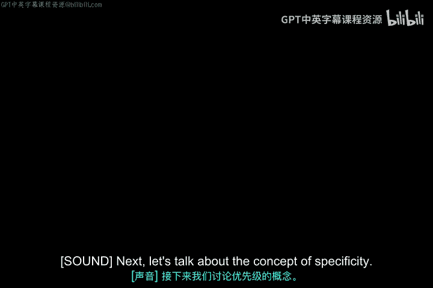
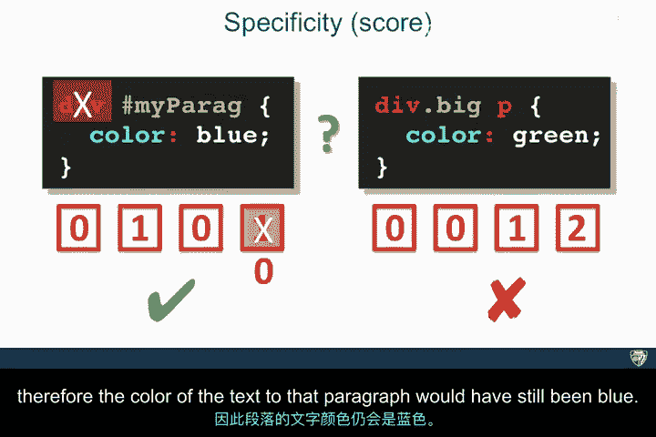
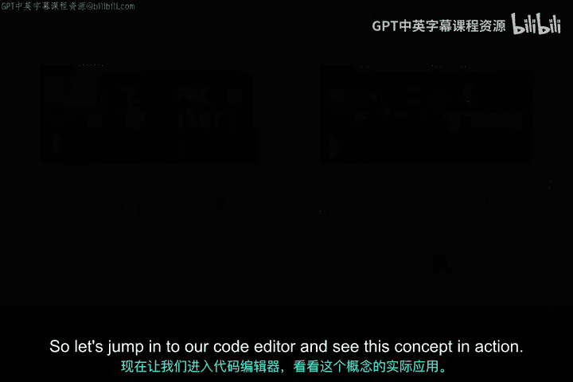
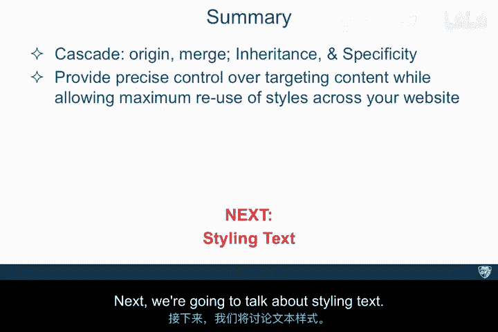
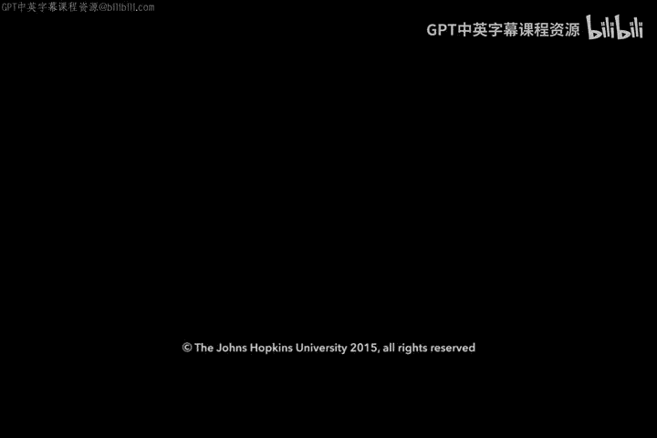

# 024：第17讲 第2部分 样式冲突解决

在本节课中，我们将要学习CSS中一个至关重要的概念：**特异性**。我们将了解浏览器如何决定当多个CSS规则同时应用于同一个元素时，哪一个规则最终生效。理解特异性是掌握CSS并避免常见样式问题的关键。

## 特异性概念

上一节我们介绍了层叠算法的基本概念，本节中我们来看看**特异性**。特异性也有一条简单的规则：**最具体的CSS选择器组合胜出**。虽然这条规则听起来简单，但开发者最常遇到的问题往往就是忽略了特异性的概念及其在CSS中的实现方式。

## 特异性计算方法

以下是一种直观的技巧，可以帮助你判断哪个选择器组合更具体。

你可以将选择器的特异性想象成一个计分系统，分数最高的选择器获胜。换句话说，分数最高的选择器被认为是最具体的。

为了方便计算分数，我们将影响分数的选择器类型从左到右排列，左侧的特异性值最高。然后，只需查看你的CSS规则，在相应的位置填入该类型选择器出现的次数，最终得到的数字就是你的分数。

让我们看看屏幕上的四个方框：
*   CSS中最具体的定位方式根本不使用任何选择器，那就是元素的 **`style`属性**。当你直接在元素上使用`style`属性定义CSS声明时，就属于这种情况。这非常合理，因为指定`style`属性就像用手指着那个元素说“就是这一个”，没有比这更具体的了。这就是为什么`style`属性位于最左侧的方框。
*   特异性值其次的是 **ID选择器**。
*   然后是 **类选择器或伪类选择器**。
*   最后是你的选择器组合中使用的 **元素选择器数量**。

例如，对于规则 `h2 style="color: green;"`，我们使用了`style`属性，这意味着第一个方框得1分，其余方框得0分。这几乎是你能得到的最高分数：`1,0,0,0`。

再看另一个选择器，例如 `div p { color: green; }`。它没有在`style`属性中定义，所以第一个方框得0分。没有ID选择器，第二个方框得0分。也没有类选择器，第三个方框得0分。但这里有两个元素选择器（`div`和`p`），所以最后一个方框得2分。分数是 `0,0,0,2`。

## 特异性比较示例

现在让我们看看如何通过比较来决定哪个选择器组合会胜出。

假设你正在为一个特定的段落标签设置样式。一种情况使用屏幕左侧显示的选择器组合，另一种情况使用屏幕右侧显示的选择器组合。哪一个会胜出？换句话说，该段落的文本颜色会是蓝色还是绿色？

让我们快速计算一下分数：
*   **左侧选择器**：没有使用`style`属性，得0分。使用了一个ID属性，得1分。没有使用类，得0分。元素数量为1，得1分。所以最终分数是 `0,1,0,1`。
*   **右侧选择器**：没有使用`style`属性，得0分。没有使用ID属性，得0分。使用了一个类，得1分。使用了两个元素，得2分。所以分数是 `0,0,1,2`。

因此，左侧的选择器胜出，段落的文本颜色将是蓝色，而不是绿色。

观察左侧的分数和我们为获得该分数所选择的选择器，我们可以看到，其实我们一开始可以不指定`div`元素。仅使用ID选择器表达，我们仍然会赢得这场“选择器之战”，因此段落的文本颜色仍将是蓝色。

## 代码实践

让我们进入代码编辑器，看看这个概念的实际应用。

这里我们在Sublime Text中查看 `specificity.html` 文件。这是一个非常简单的文档，基本上只有一个段落标签，它位于一个类名为 `navigation` 的 `header` 标签内。

如果你查看为这个文档指定的样式，有两个相互竞争的规则：一个试图将文本颜色设置为蓝色，另一个试图将文本颜色设置为红色。显然，正如你在右侧浏览器中看到的，文本颜色最终是蓝色的。这是为什么？

记住我们刚刚学到的知识，这里起作用的正是**特异性规则**。
*   两条规则都有一个类选择器，所以各得10分（注：此处讲师将类/伪类的权重计为10，是一种简化教学方式，实际计算中通常按位比较 `0,0,1,0` 和 `0,0,1,0`）。
*   然而，第一条规则指定了两个元素（`header p`），而另一条只指定了一个元素（`.navigation`）。所以第一条规则的分数更高（例如 `0,0,1,2` vs `0,0,1,1`），因此这条规则胜出。

## `!important` 规则

我想向你展示另一个概念：使用 `!important` 来覆盖所有规则。

这里我们有第三种方式来定义这个段落标签的文本颜色为绿色。这次我将使用 `!important` 关键字来定义。`!important` 基本上是说：**无论特异性如何，我都想覆盖一切，并按照我定义的方式设置这个属性**。这里我们定义颜色为绿色。

所以，如果我们刷新浏览器，即使这条规则（`p { color: green !important; }`）的特异性（例如 `0,0,0,1`）远低于另一条规则（例如 `0,0,1,2`），但由于我们指定了 `!important`，文本颜色将变为绿色。

**关于使用 `!important` 的警告**：虽然跳过理解所有这些层叠规则和特异性规则，每当样式不生效时就在各处随意添加 `!important` 非常诱人，但这在真实世界的项目中会迅速演变成一场维护噩梦。你将不得不用一个 `!important` 声明去覆盖另一个 `!important` 声明，最终会建立一套自己的、混乱不堪的规则体系。因此，除非绝对必要，否则请避免使用 `!important`。

## 总结

本节课中我们一起学习了层叠算法中的**特异性**。我们探讨了如何计算选择器的特异性分数，并通过比较分数来决定哪个样式规则最终生效。我们还了解了强大的 `!important` 规则及其潜在风险。

层叠算法通过对目标内容提供精确的控制，同时允许你在网站中最大程度地重用样式，这基本上就是CSS如此强大的原因。

接下来，我们将讨论文本样式的设置。

