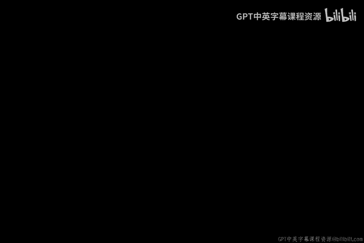
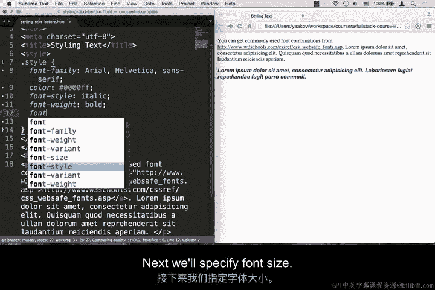
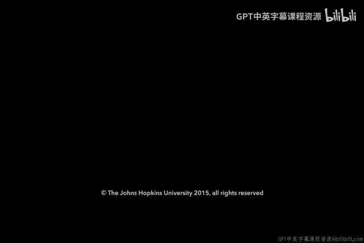

# 025：第18讲 第1部分 文本样式设计



在本节课中，我们将要学习如何使用CSS来设计和控制网页上文本的显示样式。我们将从最基础的字体属性开始，逐步介绍一系列关键的文本样式属性，并通过实例演示它们的效果。

---

有许多CSS属性可以影响文本的显示方式。我们不会试图覆盖每一个属性，而是通过查看几个关键属性来理解其背后的样式设计概念。让我们直接进入代码编辑器开始学习。

现在，我正使用Sublime Text查看一个名为“Styling-text-before.html”的文件。首先，让我快速调整一下屏幕布局，以便你能同时看到浏览器和代码编辑器。

我们的第一个任务是为HTML文件中的第二个段落应用样式。该段落被赋予了一个名为`.style`的类。目前，浏览器中显示的两个段落都使用的是浏览器的默认样式。我们的目标是只对第二个段落进行样式设置，以便进行对比。

通常，我们首先要指定的属性是`font-family`（字体系列）。

`font-family`属性的值可以变化。事实上，我已在HTML页面中提供了一个链接，点击该链接可以查看常用的字体组合。通常，你会为`font-family`指定一个由多个字体名称组成的值。这样做的原因是，你依赖于用户计算机上已安装的字体。如果用户电脑上没有安装你指定的第一种字体，浏览器会尝试列表中的下一个字体。你至少应该指定是使用衬线字体（serif）还是无衬线字体（sans-serif），因为每台电脑都会有某种默认的这两种字体。衬线字体在线条的末端有装饰性笔画，而无衬线字体则线条非常笔直。

我个人偏好特定的字体组合，因此我会复制它并粘贴到代码中。

```css
.style {
    font-family: Arial, Helvetica, sans-serif;
}
```

保存文件并刷新浏览器后，可以看到段落字体已变为Arial。

接下来，让我们改变文本颜色。虽然测试时使用如`red`、`green`、`blue`这样的预定义颜色名是可以的，但在实际网站中，通常使用十六进制值来指定精确的颜色。颜色的选择完全取决于你的设计。

```css
.style {
    font-family: Arial, Helvetica, sans-serif;
    color: #0000FF;
}
```

十六进制颜色值的表示方法是：前两位数字代表红色，中间两位代表绿色，最后两位代表蓝色。`FF`是蓝色分量的最大值。这本质上是RGB颜色规范的一种十六进制表达方式。保存并刷新后，文本变成了蓝色。

`font-style`属性用于指定文本是否倾斜。

```css
.style {
    font-family: Arial, Helvetica, sans-serif;
    color: #0000FF;
    font-style: italic;
}
```

保存并刷新后，字体变为斜体。

`font-weight`属性用于设置字体的粗细。它可以从`normal`到`bold`，也可以用数字（如100到900）来指定。`bold`关键字通常就足够使用，它大约等同于数值900。

```css
.style {
    font-family: Arial, Helvetica, sans-serif;
    color: #0000FF;
    font-style: italic;
    font-weight: bold;
}
```

接下来，我们指定`font-size`（字体大小）。

```css
.style {
    font-family: Arial, Helvetica, sans-serif;
    color: #0000FF;
    font-style: italic;
    font-weight: bold;
    font-size: 24px;
}
```



这会使字体比当前默认的16像素更大。请注意，`px`（像素）是屏幕上的绝对尺寸单位，而`pt`（点）通常用于印刷品。像素相对于观看设备：对于低DPI设备，一个CSS像素对应一个设备像素点；对于打印机和高分辨率屏幕，一个CSS像素可能对应多个设备像素点。

在介绍了字体大小之后，让我们再了解几个你可能想知道的文本属性。

`text-transform`属性允许你控制文本的大小写形式。

以下是`text-transform`属性的几个常用值：
*   `capitalize`：将每个单词的首字母转换为大写。
*   `lowercase`：将所有字母转换为小写。
*   `uppercase`：将所有字母转换为大写。

```css
.style {
    font-family: Arial, Helvetica, sans-serif;
    color: #0000FF;
    font-style: italic;
    font-weight: bold;
    font-size: 24px;
    text-transform: uppercase;
}
```

保存并刷新后，整个文本变为大写。

另一个有用的属性是`text-align`，它允许你在其块级元素内对齐文本。

以下是`text-align`属性的几个常用值：
*   `left`：左对齐（默认）。
*   `center`：居中对齐。
*   `right`：右对齐。
*   `justify`：两端对齐。

```css
.style {
    font-family: Arial, Helvetica, sans-serif;
    color: #0000FF;
    font-style: italic;
    font-weight: bold;
    font-size: 24px;
    text-transform: uppercase;
    text-align: justify;
}
```

保存并刷新后，文本在容器内实现了两端对齐。

---



本节课中我们一起学习了CSS文本样式的基础知识。我们探讨了如何设置字体系列、颜色、样式、粗细和大小，并介绍了控制文本大小写和对齐方式的属性。在下一部分，我们将继续本讲座，讨论相对字体尺寸单位。