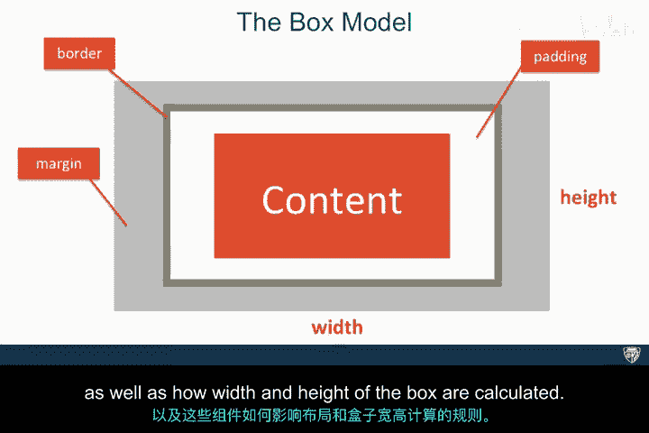
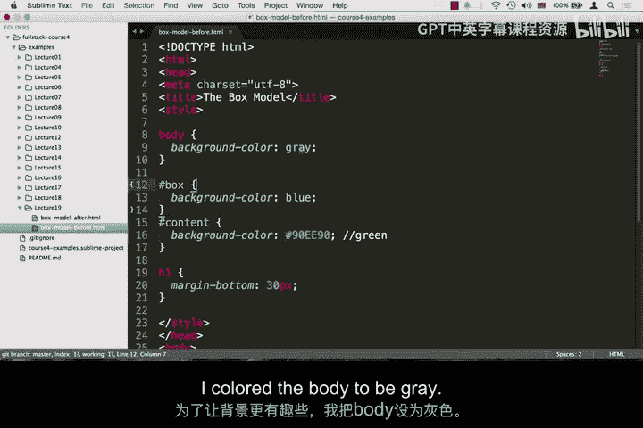
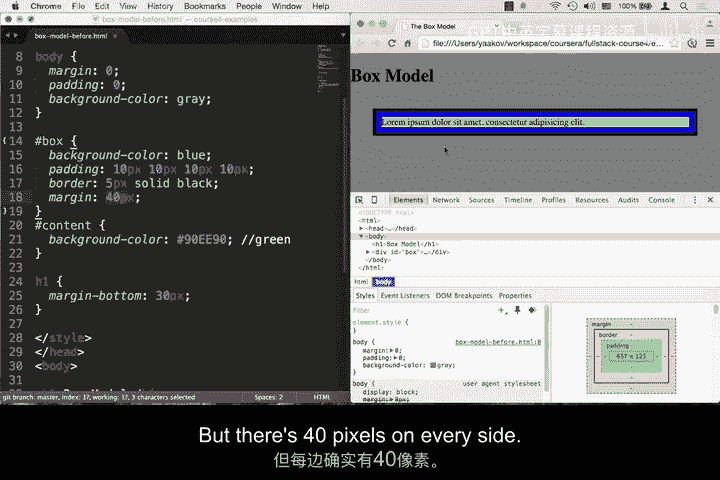
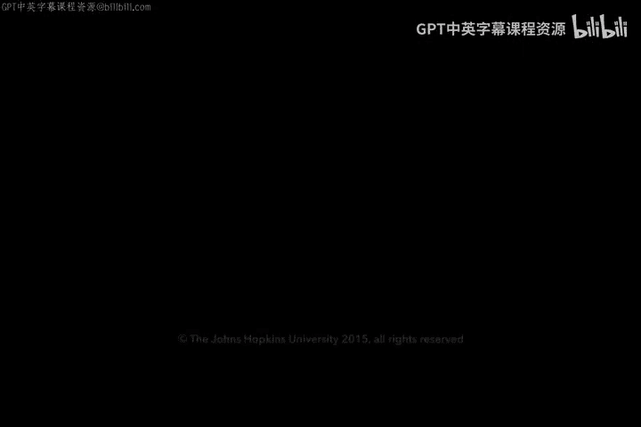

# 027：盒子模型 📦

在本节课中，我们将要学习CSS盒子模型。盒子模型是网页布局的核心概念，它描述了每个HTML元素在页面上如何被看作一个矩形盒子，以及这个盒子的各个组成部分如何影响其尺寸和与其他元素的关系。

在HTML中，每个元素都被视为一个盒子。然而，这个盒子不仅仅包含元素所包裹的内容。让我们快速浏览一个简单的示意图。

除了实际内容外，每个盒子都由内边距、边框和外边距组成。盒子模型指的是构成HTML盒子的组件，以及管理这些盒子组件如何影响布局、如何计算盒子宽度和高度的规则。让我们进入代码，看一些例子。

现在，我在Sublime Text中查看一个名为 `box-model-before.html` 的文件，它位于 `examples/lecture19` 文件夹中。让我们快速检查一下这个文档的HTML结构，它实际上非常简单。它只有一个 `h1` 标题，一个ID为 `box` 的 `div`，在这个 `div` 内部，有另一个ID为 `content` 的 `div`，里面包含一些虚拟文本。此外，我将 `box` 的背景色设置为蓝色，将 `content` 的背景色设置为浅绿色。为了让背景色更有趣，我将 `body` 的背景色设置为灰色。

这是我们的页面在浏览器中的呈现。由于 `div` 是块级元素，它会尝试在宽度上填满整个父元素。所以它试图填满浏览器的整个宽度。但这里有些奇怪的现象，如果你观察一下，在内容文本的开头和结尾处有一些间距。让我们快速查看一下Chrome开发者工具，弄清楚这些间距是怎么回事。

我们选择 `box` 元素，看看发生了什么。`box` 本身似乎没有设置任何间距。但 `body` 标签本身呢？看，我们发现 `body` 标签四周有8像素的外边距。这个8像素从哪里来的？它来自用户代理样式表，也就是浏览器本身的默认样式。浏览器这样做是很常见的。为了不影响我们的操作，我们需要重置它。网上有很多重置浏览器默认样式的方法。我们将设置 `margin: 0` 和 `padding: 0`，这样就不会受到任何默认样式的影响。保存并刷新后，现在我们的内容与浏览器窗口边框对齐了。

继续，我们看到内容是绿色的。但我们没有看到 `box` 的背景色，因为内部的 `content` `div` 完全覆盖了外层的 `box` `div`。它们都试图填满它们的父元素（即 `body` 标签），由于内部的 `div` 位于外部的 `div` 内部，它覆盖了蓝色的背景。

现在，让我们给 `box` 设置一些内边距。我们设置 `padding: 10px 10px 10px 10px`。顺便说一下，这显然有一个简写方式，你可以只写 `padding: 10px`，意思完全相同。我建议你查阅所有不同的简写方式，但这里我先保留完整写法。要点是，顺序总是上、右、下、左。保存并刷新浏览器，现在我们看到了内边距。内边距的作用是在内容周围提供一些空间。我们的内容（即带有文本的 `content` `div`）被挤压在中间，内边距显示在四周，现在你可以看到蓝色背景了，那是我们 `box` 的背景色。

接下来，让我们给 `box` 添加边框。设置 `border: 3px solid black`。这意味着边框将是3像素厚、实线、黑色。保存并刷新浏览器，我们可以看到边框也显示出来了。实际上，让我们把它加粗一点，改成 `5px`。最后，让我们也给它添加一些外边距。使用简写符号 `margin: 40px`，这意味着我希望四周都有40像素的外边距。刷新后，你可以看到现在每个边都有40像素的外边距。

到目前为止，我们让内容和一些边距等来决定盒子的大小。但如果我们自己设置它的宽度呢？

让我们设置它的宽度为300像素。保存并刷新后，我们看到盒子变小了。让我们在Chrome开发者工具中检查这个盒子。

它显示我们的盒子确实是300像素宽。由于我们没有限制高度，它会自动调整以包裹文本。除非我们手动指定高度，否则高度会根据需要调整。如果我们把它调小一点，比如100像素，刷新后你会发现高度变大了，变成了72像素，因为内容被挤压得需要换行，增加了额外的行。让我们把它改回300像素并刷新。

现在，如果我们看这个分解图，我们遇到了第一个非常有趣的点。首先，让我们浏览所有组件：绿色高亮部分是纯粹的内容；再往外一点，会高亮显示内边距；再往外是边框；外边距在鼠标悬停时可能不太明显，但四周的40像素依然存在。

现在有趣的问题是：这个盒子到底有多大？当我们开始放置更多盒子、制作不同HTML组件的布局时，为了正确设计UI，我们需要知道每个盒子的大小。我们指定了盒子宽度为300像素，但问题在于它实际上并不是300像素宽。我们忽略了它周围还有边框和内边距。内边距一边是10像素，另一边也是10像素。不仅如此，还有边框，一边是5像素，另一边也是5像素。所以实际上是 300 + 10 + 10 + 5 + 5 = 330 像素。如果你看这个盒子的实际可见边框，这个距离不是300，而是330。

一个有趣（或者说有点烦人）的部分是，根据你设置的边框和内边距，这个宽度会改变。让我们看看，如果我把边框设得非常大，比如20像素，刷新后，边框变成了20像素，现在我的盒子边界延伸到了那里。如果我把内边距也设得更大，比如右边和左边都设为30像素，再看这个盒子，它又变大了。

所以，尽管我们说希望盒子的宽度是300，结果我们设置的并不是盒子的宽度，而是内容的宽度（即绿色部分）。对于布局和一般意义上的合理性来说，这有点烦人。你确实想改变这一点，而CSS3实际上确实改变了它。

原来，默认情况下，每个HTML元素都有一个 `box-sizing` 属性，默认值设置为 `content-box`。这意味着当你指定高度和宽度时，你指定的是内容框的高度和宽度，而不是整个盒子。CSS3为这个属性引入了一个新值，叫做 `border-box`。让我们在这里设置它：`box-sizing: border-box`。

刷新后，看看，它变小了。现在，如果你看分解图，你会发现尽管我们指定宽度为300，但这个宽度现在保证是从这个边框边缘到那个边框边缘的整个盒子的宽度。计算一下：200 + 30 + 30 = 260，再加上 20 + 20 = 40，总共是300。如果我们改回默认的 `content-box`，它会跳回原来的大小。

但事实是，所有现代框架（如Bootstrap等）都使用 `border-box` 作为其尺寸模型。当你规划和设计布局时，这是明智的选择。所以请确保你始终使用 `box-sizing: border-box`。

本节课中我们一起学习了CSS盒子模型。我们了解了每个HTML元素如何被视为一个由内容、内边距、边框和外边距组成的盒子。我们探讨了默认的 `content-box` 模型如何导致实际元素尺寸与设定宽度不符，并学习了CSS3引入的 `border-box` 模型如何解决这个问题，确保设定的宽度就是元素可见框的总宽度。掌握盒子模型是进行精确网页布局的基础。