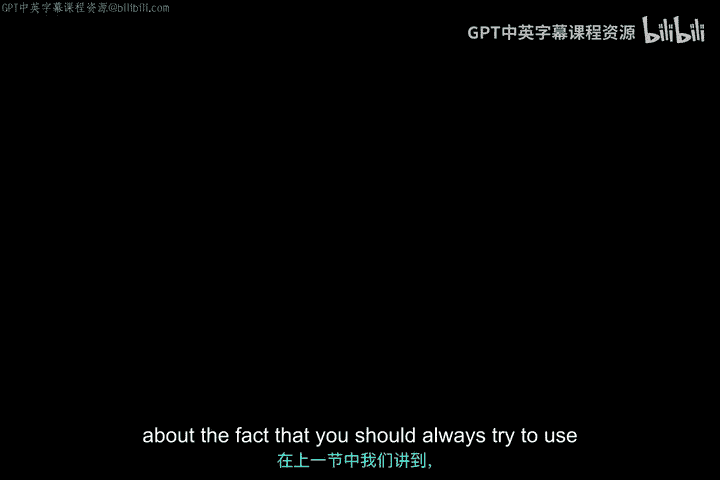
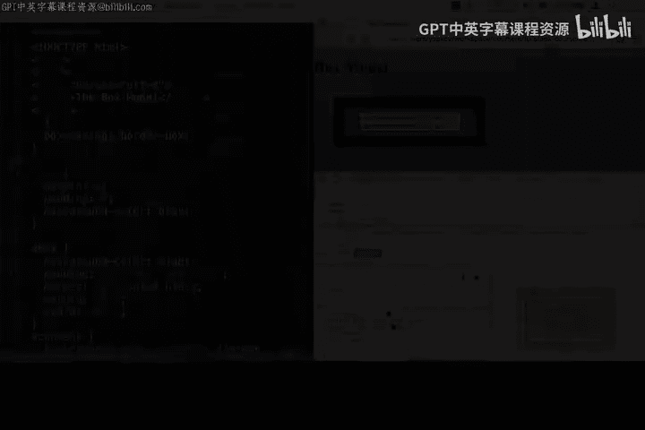
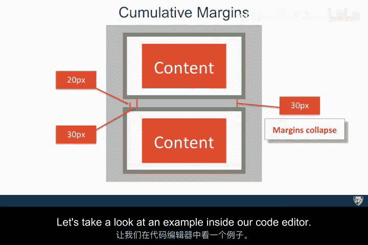

# 028：11_第19讲 第2部分 盒子模型



## 📦 概述

在本节课中，我们将深入学习CSS盒子模型的两个重要概念：如何全局应用`box-sizing: border-box`属性，以及理解垂直方向上外边距（margin）的**折叠**现象。我们将通过实例和代码来阐明这些概念。

## 🌐 全局应用 `box-sizing: border-box`

上一节我们介绍了应尽量使用`box-sizing: border-box`作为盒子模型。当然，我们不希望为HTML中的每个元素单独指定此属性，而是希望设置一次，然后让它被所有元素继承。让我们尝试实现这一点。

首先，我们将从`.box`类中移除`box-sizing: border-box`。`<body>`元素似乎是一个自然的放置位置，因为它是顶级元素，其属性应该被所有子元素继承。因此，如果我将`box-sizing: border-box`设置在`body`上并刷新页面，效果应该保持不变。

然而，它没有生效。盒子又跳回了`content-box`模式。其原因是，`box-sizing`是CSS中**不被继承**的属性之一。你不能在父元素上设置它并期望子元素继承该属性。

那么，我们如何解决这个问题呢？解决方法是学习一个新的选择器：**星号选择器**。让我们回到代码顶部，使用星号`*`，然后将`border-box`属性粘贴在这里。

```css
* {
    box-sizing: border-box;
}
```

现在刷新页面，它生效了。星号选择器的作用是：**选择页面上的每一个元素，并将指定的CSS属性应用给它们**。它与在父元素上设置属性的关键区别在于：星号选择器不是请求继承，而是直接为每个元素应用该属性值，就像它遍历HTML并为每个元素单独添加了`box-sizing: border-box`一样。这就是将类似`box-sizing`这样的属性应用到整个页面的方法。

我曾提到`border-box`是CSS3的新属性。当你听到这类信息时，应该警醒：我使用的所有浏览器都支持它吗？我们可以通过查询“Can I use”网站来确认。查询结果显示，所有主流浏览器都完全支持`box-sizing: border-box`这个属性值，因此可以放心使用。

## ⬇️ 理解垂直外边距折叠



接下来，让我们更深入地理解外边距（margin），特别是垂直方向上的行为。

请看这张示意图。我们有两个并排的盒子（即两个元素），灰色部分代表它们的外边距。**左右外边距是累加的**。如果左边盒子的`margin-right`是40像素，右边盒子的`margin-left`是50像素，那么它们之间的总间距就是90像素（40+50）。这很简单，也符合直觉。

但是，如果一个元素在另一个元素上方呢？假设这是两个`<div>`，每个都指定了外边距。下方元素的`margin-top`是30像素，上方元素的`margin-bottom`是20像素。你可能会认为总间距是50像素。

然而，答案是否定的。这里会发生**外边距折叠**，并且**较大的外边距会胜出**。因此，两个元素边框之间的实际距离，在这个例子中将是30像素。较大的外边距（30px）生效，较小的那个（20px）则被“折叠”消失了。

让我们在代码编辑器中查看一个实例。



回到之前的HTML文件，我们可以看到这里有一个`<h1>`标题，我们为其定义了`margin-bottom: 30px`。同时，我们的`.box`类移除了所有外边距。现在，让我们为`.box`类定义一个`margin-top: 20px`。

```css
.box {
    /* 其他样式... */
    margin-top: 20px;
}
```

刷新页面后，你会发现**没有任何变化**。原因是，盒子定义了20像素的上外边距，但`<h1>`已经定义了一个30像素的下外边距。当它们相遇时，会发生折叠，最终间距取两者中较大的值，即30像素。

但是，如果我将盒子的`margin-top`改为更大的值，比如50像素：

```css
.box {
    /* 其他样式... */
    margin-top: 50px;
}
```

现在你会看到盒子向下移动了，因为此时盒子的上外边距（50px）大于`<h1>`的下外边距（30px）。所以，`<h1>`和盒子之间的实际距离变成了50像素。

另外，你可能注意到“Box Model”这几个字并没有紧贴浏览器窗口的左上角。这是为什么呢？让我们检查一下元素。可以看到`<h1>`有一个大约21.44像素的上外边距。这个外边距来自浏览器的**用户代理样式表**。这是因为一些浏览器特定的样式（如`margin-before`）为`<h1>`预设了外边距。

我们之前在`body`上设置的`margin: 0`之所以在这里没生效，原因很简单：`body`的样式会被其内部元素继承，但前提是该元素自身没有更具体的样式覆盖它。在这里，用户代理样式表通过`h1`选择器专门设置了外边距，这个更具体的规则胜出了。

那么，如何覆盖它呢？既然我们知道了星号选择器，这就很简单了。我们可以将重置`margin`和`padding`的规则也移到星号选择器中。

```css
* {
    box-sizing: border-box;
    margin: 0;
    padding: 0;
}
```

现在，星号选择器选中每一个元素，并明确地将其`margin`和`padding`覆盖为0。刷新页面，你会看到文字现在紧贴顶部了。我们在页面中不一定会这样做，但至少你现在知道了：如果你想重置浏览器的默认CSS样式（这被称为**CSS重置**），大多数时候都可以使用这个星号选择器来实现。

## 📝 总结

本节课我们一起学习了两个关键内容：
1.  使用**星号选择器 `*`** 来全局应用`box-sizing: border-box`等不被继承的CSS属性。
2.  理解了**垂直外边距折叠**的规则：当两个垂直相邻的块级元素的外边距相遇时，它们会合并（折叠），最终的距离等于两个外边距中**较大的那个值**。

掌握这些概念有助于你更精确地控制网页元素的布局和间距。