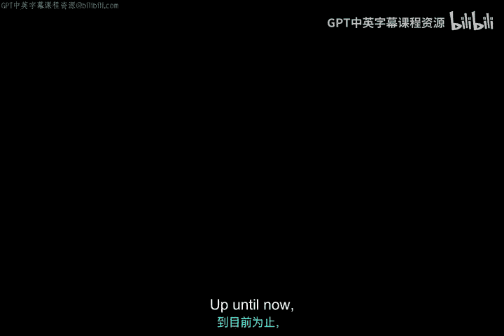
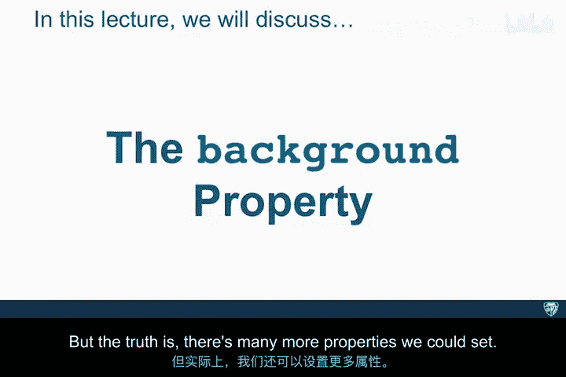
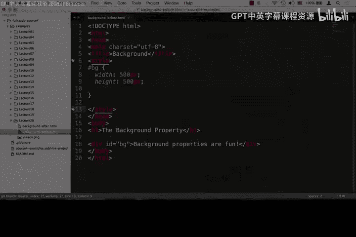
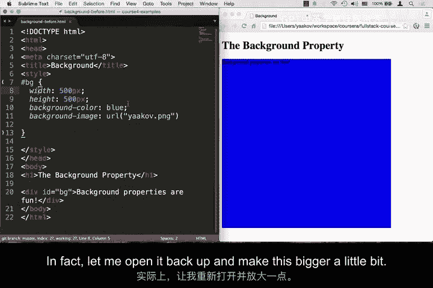
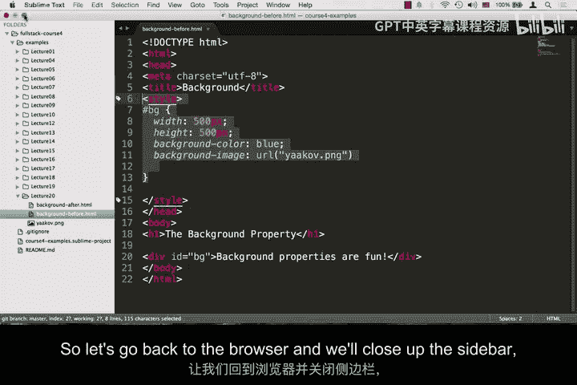
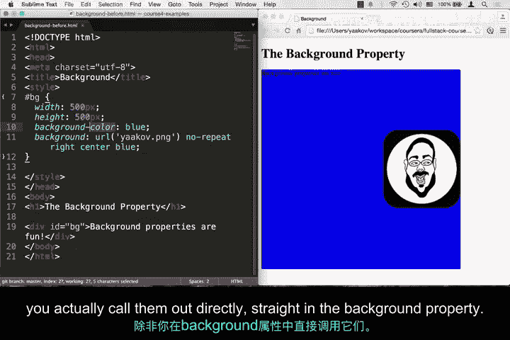
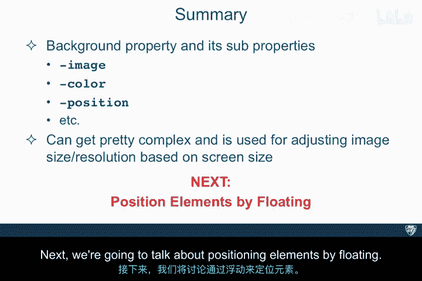
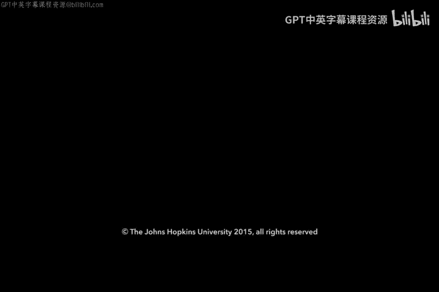

# 030：第20讲 背景属性 🎨

在本节课中，我们将要学习CSS背景属性的更多用法。到目前为止，我们主要使用`background`属性来设置背景颜色，但实际上，背景属性功能非常丰富，可以设置背景图片、控制图片重复方式、定位图片等。本节我们将逐一探索这些功能。







---

## 设置背景颜色与图片

上一节我们介绍了背景的基础概念，本节中我们来看看如何设置背景图片。

首先，我们有一个简单的HTML结构，包含一个`<div>`元素，其ID为`bg`。我们通过CSS将其设置为一个500x500像素的方块。

```css
#bg {
    width: 500px;
    height: 500px;
}
```

我们可以使用`background-color`属性为其设置一个纯色背景，例如蓝色。

```css
#bg {
    width: 500px;
    height: 500px;
    background-color: blue;
}
```

然而，背景不仅可以是纯色，还可以是图片。设置背景图片需要使用`background-image`属性。

以下是设置背景图片的语法：

```css
background-image: url("图片路径");
```

图片路径可以是相对路径或绝对路径。需要注意的是，路径是相对于CSS文件的位置而言的。例如，如果我们的图片文件名为`yakov.png`，并且与CSS文件在同一目录下，我们可以这样写：

```css
#bg {
    width: 500px;
    height: 500px;
    background-image: url("yakov.png");
}
```

设置后，图片会默认在元素内平铺显示。

---

## 控制背景图片的重复

默认情况下，背景图片会水平和垂直方向重复铺满整个元素。我们可以使用`background-repeat`属性来控制这一行为。



`background-repeat`属性有以下几种常用值：



*   `repeat`: 默认值，在水平和垂直方向都重复。
*   `no-repeat`: 不重复，只显示一张图片。
*   `repeat-x`: 只在水平方向重复。
*   `repeat-y`: 只在垂直方向重复。

例如，如果我们希望背景图片只显示一次，可以这样设置：

```css
#bg {
    width: 500px;
    height: 500px;
    background-image: url("yakov.png");
    background-repeat: no-repeat;
}
```

此时，图片默认会显示在元素的左上角。

---

## 定位背景图片

我们可以使用`background-position`属性来精确控制背景图片在元素内的位置。

该属性接受两个值：第一个值控制水平位置，第二个值控制垂直位置。值可以是关键词（如`left`, `center`, `right`, `top`, `bottom`）或具体的长度单位（如像素`px`）。

以下是几个例子：

```css
/* 图片位于右上角 */
background-position: right top;

/* 图片位于右下角 */
background-position: right bottom;

/* 只指定水平方向为右，垂直方向默认为居中 */
background-position: right;

/* 只指定垂直方向为底部，水平方向默认为居中 */
background-position: bottom;
```

---

## 使用简写属性

前面我们分别使用了`background-color`、`background-image`、`background-repeat`和`background-position`等属性。实际上，CSS提供了一个简写属性`background`，可以将所有这些设置合并到一行声明中。

简写属性的语法如下，属性值的顺序通常为：颜色、图片、重复方式、位置。

```css
background: <color> <image> <repeat> <position>;
```

例如，我们可以将之前的设置合并为：

```css
#bg {
    width: 500px;
    height: 500px;
    background: blue url("yakov.png") no-repeat right center;
}
```

**一个重要注意事项**：当使用简写属性`background`时，它会重置所有未在简写中声明的单个背景属性（如`background-color`）。这意味着，如果你之前单独设置了`background-color: blue;`，然后又使用了`background: url(...) no-repeat;`但没有包含颜色，那么蓝色背景将会被清除。因此，在简写属性中需要包含所有你希望保留的设置。

---



## 总结

本节课中我们一起学习了CSS背景属性的强大功能。我们了解到：

1.  除了设置纯色背景（`background-color`），还可以设置图片背景（`background-image`）。
2.  可以使用`background-repeat`属性控制图片是否重复以及如何重复。
3.  可以使用`background-position`属性精确定位背景图片在元素中的位置。
4.  可以使用简写属性`background`来一次性设置所有背景相关的值，但要注意它会覆盖未在简写中声明的单个属性。

背景属性是网页视觉设计的基础工具，通过组合使用，可以创造出丰富的视觉效果。在后续课程中，我们还会学习如何结合媒体查询，让背景在不同屏幕尺寸下自适应变化。





接下来，我们将进入新的主题：学习如何使用浮动（float）来定位页面元素。