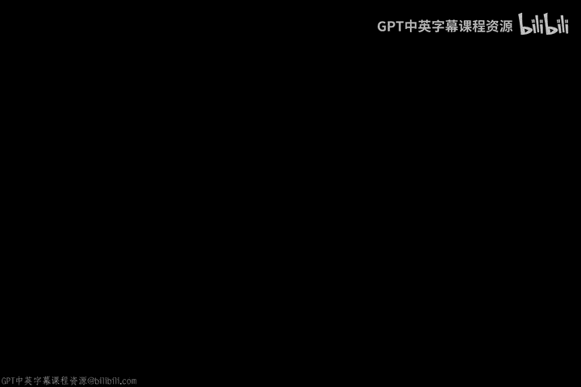
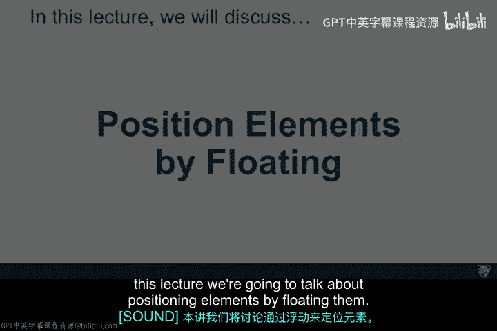
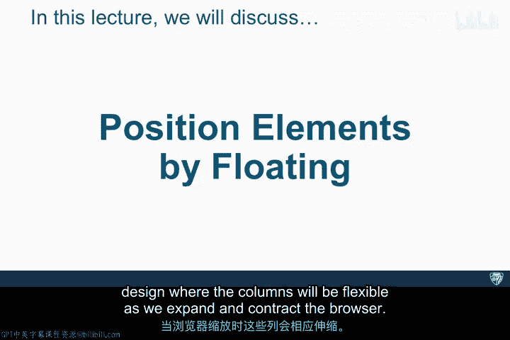
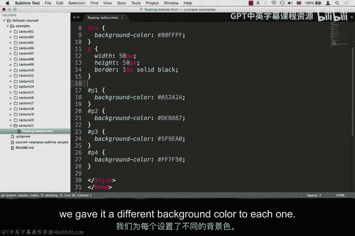
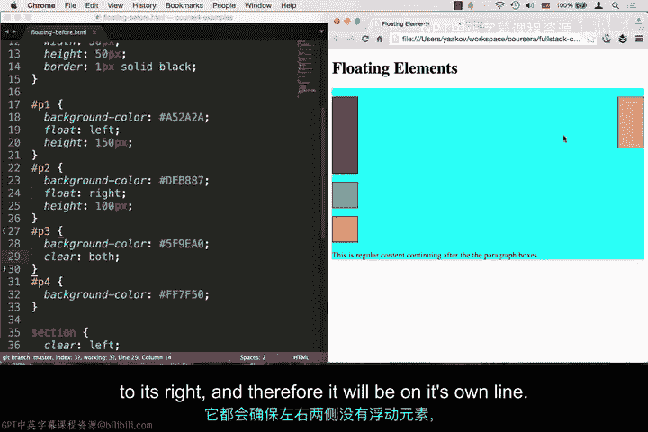
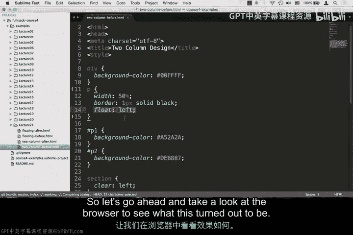
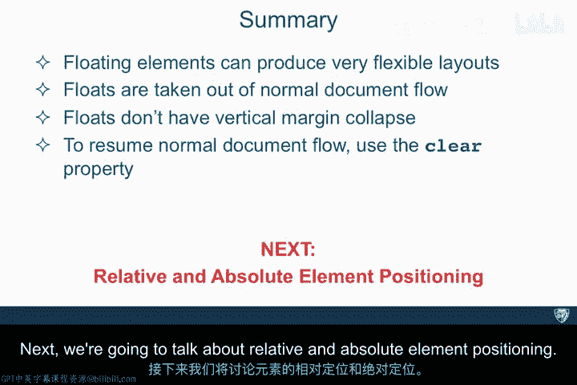

# 031：浮动定位 🎯





在本节课中，我们将学习如何使用CSS的`float`属性来定位元素。浮动是一种将元素从常规文档流中取出，并使其向左或向右移动，直到其外边缘碰到包含块或另一个浮动元素的边缘的技术。掌握浮动对于创建多列布局至关重要。

## 浮动基础





上一节我们介绍了盒模型，本节中我们来看看如何使用浮动来改变元素的布局方式。浮动元素会脱离正常的文档流，这会影响其周围元素的排列。

### 浮动元素

以下是浮动一个段落元素到右侧的示例代码：

```css
p {
    float: right;
}
```

应用此样式后，该元素会移动到其包含块的右侧顶部边缘。同时，文档流中的后续元素会向上移动，占据该元素原先的位置，因为浏览器认为该位置现在是“空”的。

### 边距与浮动

浮动元素的垂直边距不会发生折叠。这意味着，即使两个相邻元素的边距在常规流中会合并，一旦其中一个浮动，它们的边距将保持独立并完全显示。

## 清除浮动

当容器内的所有子元素都浮动时，容器的高度可能会“坍塌”，因为它不再包含在常规文档流中的内容。为了解决这个问题，我们需要使用`clear`属性。

### 使用 `clear` 属性

`clear`属性指定元素的哪一侧不允许出现浮动元素。这可以迫使该元素移动到浮动元素的下方，从而恢复正常的文档流。

以下是`clear`属性的三个值：
*   `clear: left;`：清除左侧浮动。
*   `clear: right;`：清除右侧浮动。
*   `clear: both;`：清除左右两侧的浮动。

例如，要确保一个`section`元素不被左侧的浮动元素影响，可以这样写：

```css
section {
    clear: left;
}
```

## 创建两列弹性布局

现在，让我们应用所学知识来创建一个经典的两列布局，该布局能够随着浏览器窗口的缩放而灵活调整。

### 布局结构



假设我们的HTML结构包含一个`div`，其内部有两个`p`元素和一个`section`元素。我们希望两个`p`元素并排形成两列。

### 关键样式步骤

以下是实现该布局的核心CSS步骤：



1.  **设置宽度**：将每个段落的宽度设置为`50%`，使其各占容器宽度的一半。
2.  **应用浮动**：将两个段落都设置为`float: left;`，使它们并排排列。
3.  **修正盒模型**：使用`box-sizing: border-box;`。这至关重要，因为它确保元素的`width`属性包含了内边距和边框的宽度。如果没有它，`50% + 边框 + 内边距`的总宽度会超过100%，导致第二列被挤到下一行。
4.  **添加内边距**：为内容添加一些内边距（如`padding: 10px;`）以改善可读性。
5.  **清除浮动**：在`section`元素上使用`clear: both;`，确保它出现在两列的下方，而不是被浮动元素环绕。

核心样式代码示例如下：

```css
p {
    width: 50%;
    float: left;
    box-sizing: border-box; /* 关键属性 */
    padding: 10px;
}
section {
    clear: both;
}
```

应用这些样式后，你将得到一个灵活的两列布局。当调整浏览器窗口大小时，两列的宽度会按比例变化，始终保持各占50%。

## 总结

本节课中我们一起学习了CSS浮动定位的核心概念。我们了解到，浮动元素会脱离正常文档流，可用于创建灵活的布局（如多列设计）。浮动元素的垂直边距不会折叠。当需要让后续元素脱离浮动影响、恢复正常流时，必须使用`clear`属性进行清除。通过结合百分比宽度和`box-sizing: border-box`，我们可以构建出自适应浏览器宽度的弹性布局。




下一节，我们将探讨相对定位和绝对定位。