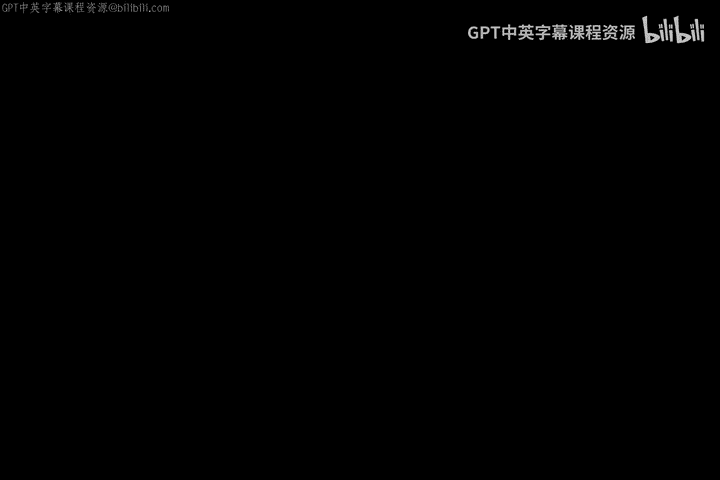
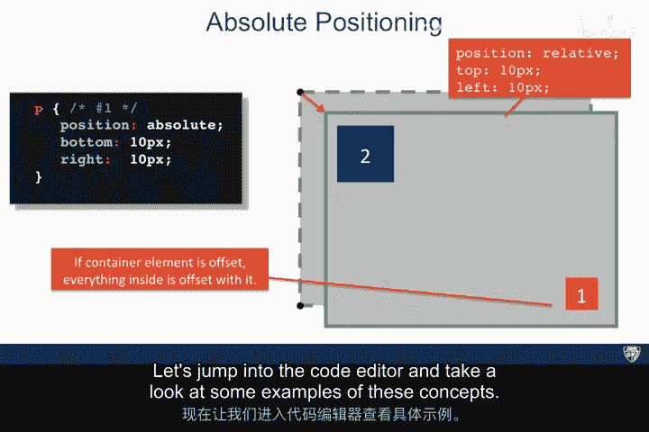
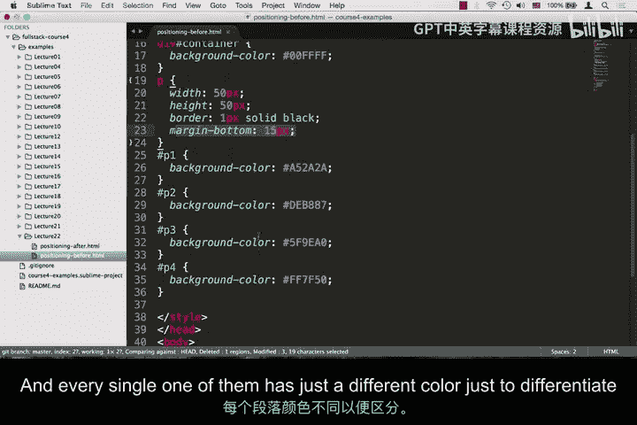
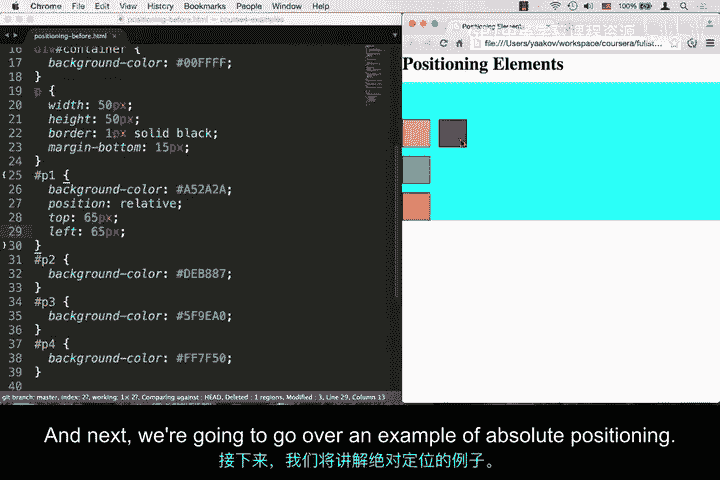
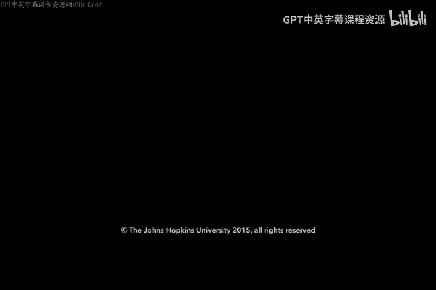

# 032：第22讲 第1部分 相对与绝对定位

## 概述

在本节课中，我们将要学习CSS中两种重要的定位方案：相对定位和绝对定位。这两种方案允许你通过指定精确的偏移量，将目标元素移动到页面的不同位置或区域。

## 静态定位

上一节我们介绍了浮动定位，它是一种替代正常文档流的定位方式。本节中，我们来看看另外两种定位方案。

首先，让我们谈谈静态定位。静态定位本质上是“正常文档流”的另一种说法。实际上，除了HTML元素外，它是所有元素的默认设置。如果你尝试对`position`属性设置为`static`的元素应用定位偏移量，这些偏移量将被忽略。

## 相对定位

一种不同的定位方案称为相对定位。当你对一个元素应用`position: relative;`时，该元素将相对于其在正常文档流中的原始位置进行定位。换句话说，如果你对该元素应用偏移量，这些偏移量将基于该元素在正常文档流中的原始位置进行计算。

以下是CSS偏移属性：
*   `top`
*   `bottom`
*   `left`
*   `right`

当你将一个元素设置为相对定位时，你基本上是在为偏移创建一个锚点。元素的`top`、`bottom`、`left`和`right`边就成为了你偏移该元素的边界。

关于相对定位，需要了解的重要一点是：设置为相对定位的元素**不会**被移出正常文档流。事实上，即使它通过偏移量移动了，其原始位置仍然被保留。对于HTML页面上的其他元素而言，该元素仍然位于其原始位置，尽管在视觉上它被偏移到了其他地方。

让我们看一个简单的视觉示例。这里有一个段落，用这个橙色方框表示。一旦我们对该元素设置`position: relative;`，它的边缘就成为了未来偏移的锚点。现在，当我们应用偏移量时，元素相对于其在正常文档流中的原始位置移动。在这个例子中，它从顶部移动50像素，从左边缘移动50像素。

这些值可能有点令人困惑，因为我们说`left: 50px;`，但元素却向右移动。理解这些偏移量的方式不是“向左”或“向上”，而是“从左边”和“从顶部”。如果你从左边取走50像素，元素就向右移动50像素；从顶部取走50像素，元素就向下移动50像素。

还要注意，除了这个元素移动之外，文档的其他部分没有发生任何变化。该元素的原始空间仍然保留，其周围的元素布局也保持不变，因为它们认为该元素仍在其原始位置。

你也可以为这些偏移量使用负值。至于使用`bottom`/`right`还是`top`/`left`，这更多取决于你编码时的便利性，根据你试图实现的具体用例。在这个例子中，我们通过使用负的`bottom`和`right`值，达到了与使用正的`top`和`left`值相同的效果。

## 绝对定位

现在，我们来探讨绝对定位的概念。绝对定位的核心思想是：所有偏移量（`top`、`bottom`、`left`、`right`）都是相对于**最近的、定位属性不是`static`的祖先元素**的位置来计算的。换句话说，某个父级、祖父级或更高级的祖先元素必须将其定位设置为`static`以外的值，绝对定位才会真正开始工作。

默认情况下，HTML元素是唯一一个定位属性不是`static`的元素，它实际上被设置为`relative`。

与相对定位不同，如果一个元素的定位被设置为`absolute`，它**会被移出**其正常的文档流。

让我们假设我们有一个灰色方框，它是一个容器元素，其定位设置为`relative`。我们有一个编号为1的方框（这是我们的目标元素）和一个编号为2的方框（其他元素）。如果我们对1号元素设置`position: absolute;`，首先，它会被移出正常的文档流，并且在没有任何其他偏移量的情况下，它会停留在原来的位置。正如你在图示中看到的，元素2向上移动到了元素1的下方，因为元素1不再是文档流的一部分，元素2认为它根本不存在。

现在，如果我们应用一些偏移量（在这个例子中，我们使用`bottom`和`right`偏移），我们将相对于我们的容器元素进行定位，因为该容器元素的定位设置为`relative`。我们设置`bottom: 10px;`和`right: 10px;`，这样我们就得到了1号方框位于容器元素右下角的结果。

这种组合的一个非常酷的特性是：如果你的容器元素本身被偏移了，那么该容器内的所有内容都会随之偏移。这意味着你可以在一个容器元素内设置特定的布局，然后移动或偏移该容器元素到屏幕的任何位置，而无需担心容器内每个元素的特定偏移值。

## 代码示例

让我们跳转到代码编辑器，看看这些概念的一些具体例子。

好的，现在我正在Sublime Text中查看一个名为`positioning_before.html`的文件，它位于`examples/lecture22`文件夹中。让我们快速检查一下HTML的结构，它非常简单：我们只有一个H1标题，用来宣布我们在这里做什么；然后是一个ID为`container`的`div`；接着是四个段落，每个段落都有ID（`p1`、`p2`、`p3`、`p4`）。我们的初始样式也很简单：首先，我们重置了`margin`和`padding`，并将`box-sizing`设置为`border-box`。由于重置了边距，我们给第一个H1标题添加了15像素的底部边距，以推下页面的其余内容。

我们给`div`容器设置了熟悉的浅蓝色。每个`
`标签都是50像素乘50像素，有一个1像素的黑色边框，并且每个都有15像素的底部边距。每个段落都有不同的颜色，以便区分我们正在看的是哪一个。让我们在浏览器中看看它的样子。

正如你所看到的，这里有我们的四个段落方框，它们位于这个浅蓝色的容器`div`内。我们要做的第一件事是处理第一个方框。我们将把它的定位设置为`relative`。当我们这样做并保存刷新后，我们看不到任何明显的变化。实际上，这里发生的是我们现在设置了一个锚点，所以现在这个元素的所有偏移都将相对于其在正常文档流中的位置（它仍然在这里）进行计算。让我们给它一些偏移量，模拟它移动到第二行的位置。我们设置`top: 65px;`（从顶部向下65像素）和`left: 65px;`（从左边缘向右65像素），然后刷新页面。

好了，我们把这个元素从这里移到了这里。正如你所看到的，这个元素没有被移出文档流，因为其余元素仍然位于它们的原始位置，而这个空间仍然完全空着。实际上，浏览器认为这个空间仍然被我们刚刚移走的这个元素占据着。这就是相对定位的基本原理。

接下来，我们将看一个绝对定位的例子。

## 总结

本节课中，我们一起学习了CSS中的相对定位和绝对定位。我们了解到，相对定位允许元素相对于其原始位置进行偏移，同时保留其在文档流中的空间。而绝对定位则将元素移出文档流，并相对于最近的已定位祖先元素进行定位。掌握这两种定位方式是实现复杂页面布局的关键。