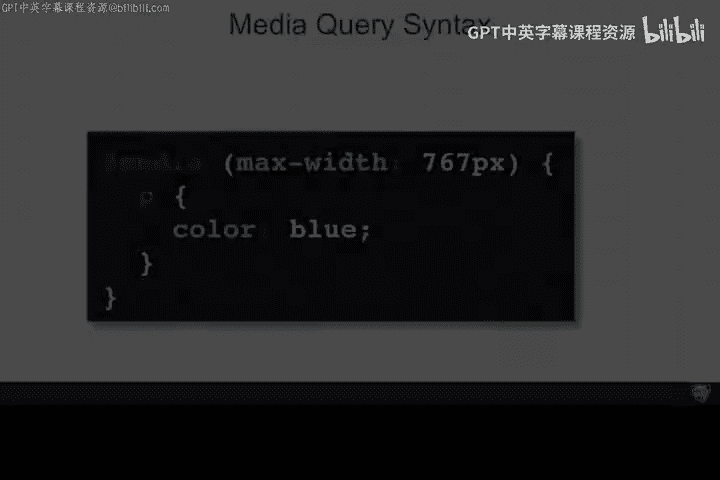
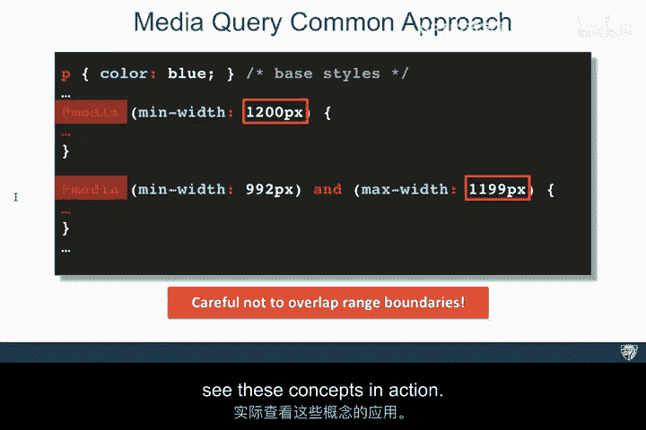
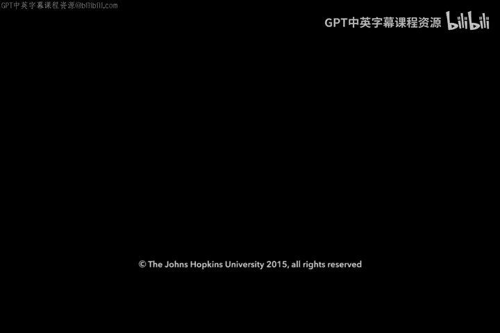

# 034：17_第23讲 第1部分 媒体查询


## 概述
在本节课中，我们将要学习CSS媒体查询的基础知识。媒体查询是响应式网页设计的核心技术，它允许我们根据用户设备的特性（如屏幕宽度、高度或方向）来应用不同的CSS样式。

## 媒体查询简介
媒体查询允许你将样式分组，并根据特定条件将其应用到不同的设备上。例如，你可以根据设备的宽度、高度或方向（横向或纵向）来应用样式。在桌面浏览器和手机上查看网站时，最明显的区别之一就是屏幕尺寸。请记住，使用CSS，你有能力从相同的HTML代码生成截然不同的网页布局。因此，为不同屏幕尺寸的设备提供不同的样式，是调整页面样式和布局最常见的方式。这就是为什么学习如何使用媒体查询至关重要，没有它们，我们即将讨论的响应式设计就无法实现。



接下来，让我们探索媒体查询的基本语法。

## 媒体查询基本语法
一个媒体查询以 `@media` 关键字开始，后面跟着一个或多个媒体特性，最后用花括号 `{}` 包裹样式规则。它基本上就像一个样式表中的样式表。

每个媒体特性会解析为 `true` 或 `false`。你可以使用逻辑运算符将多个媒体特性组合在一起。如果媒体特性解析为 `true`，则花括号内的样式将被应用。在编写媒体查询时，请确保正确关闭整个媒体查询的花括号，以及每个单独的样式规则。

以下是媒体查询的基本语法结构：
```css
@media (media-feature) {
  /* 你的样式规则 */
}
```

## 常用媒体特性
有许多可用的媒体特性。例如，你可以使用 `max-width`（最大宽度）、`min-width`（最小宽度）、`height`（高度，此处未列出），甚至可以针对设备的朝向（纵向或横向）。你还可以指定 `only screen`（仅屏幕）而非 `only print`（仅打印）。如果这些条件中的任何一个评估为 `true`，媒体查询花括号内的样式就会生效。

如前所述，尽管有许多媒体特性可用，但最常用的是 `max-width` 和 `min-width`。这主要是因为针对不同设备最常见的方式就是根据设备的宽度。

## 组合媒体特性
此外，媒体特性可以使用逻辑运算符进行组合。最常见的逻辑运算符之一是 `and` 运算符。

以下是一个代码片段示例，它针对一个宽度范围：
```css
@media (min-width: 768px) and (max-width: 991px) {
  /* 样式规则 */
}
```
在这个例子中，我们针对的是宽度在768像素到991像素之间的任何设备。如果设备的宽度小于或大于这个范围，此媒体查询内的样式将不会应用。

另一种组合媒体特性的方法是在它们之间使用逗号 `,`，这基本上等同于逻辑上的 `or` 运算符。

以下代码片段展示了我们如何针对宽度不超过767像素或宽度至少为992像素的任何设备：
```css
@media (max-width: 767px), (min-width: 992px) {
  /* 样式规则 */
}
```
在实际应用中，当你处理响应式设计和布局时，最常用的逻辑运算符是 `and` 运算符。所以，如果你掌握了这个运算符，就基本够用了。

## 媒体查询的组织结构
在深入代码示例之前，我想展示一种非常常见的方法，即如何在样式表中组织媒体查询。通常，你会有几个这样的媒体查询，但你几乎总是从一些基础样式开始。基础样式将普遍适用，无论你实际在何种屏幕尺寸上查看网站。然后，你开始针对特定的屏幕尺寸，通过更改基础样式的某些属性、添加新样式或移除某些样式来实现调整。

这里需要指出一个重点，尤其是在使用设备屏幕尺寸的宽度时，你必须非常小心，不要让范围边界重叠。在这个例子中，你会注意到第一个查询的最小宽度是1200像素，而第二个查询是一个范围，其最大宽度是1199像素。如果我写成1200像素，就意味着两个样式集都会应用，这很可能会导致样式混乱且难以维护。因此，在构建这些媒体查询时，保持清晰、独立的边界非常重要。

在本讲座的第二部分，我们将进入代码编辑器，看看这些概念的实际应用。





## 总结
本节课中我们一起学习了CSS媒体查询的基础知识。我们了解了媒体查询的语法结构，认识了最常用的媒体特性（如 `max-width` 和 `min-width`），并学习了如何使用 `and` 和 `,`（或）运算符来组合多个条件。我们还探讨了在样式表中组织媒体查询的常见模式，即从基础样式开始，再针对不同屏幕尺寸进行覆盖或增强，并强调了避免范围边界重叠的重要性。掌握这些基础知识是进行响应式网页设计的关键第一步。