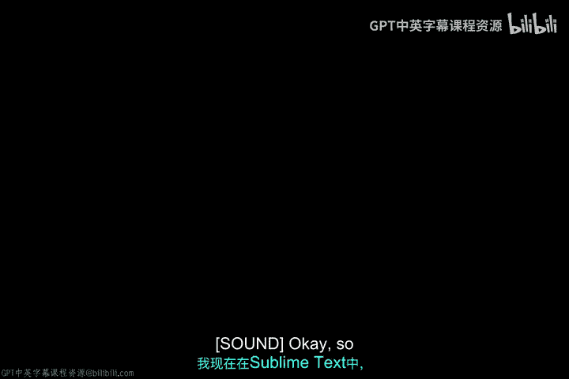
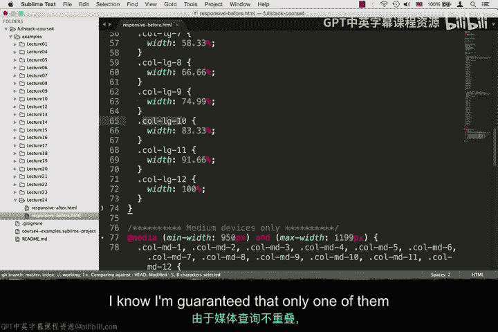
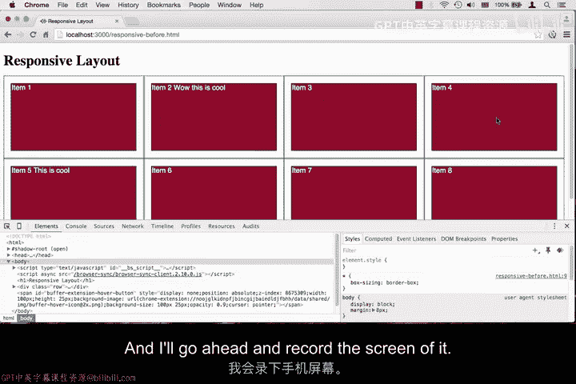
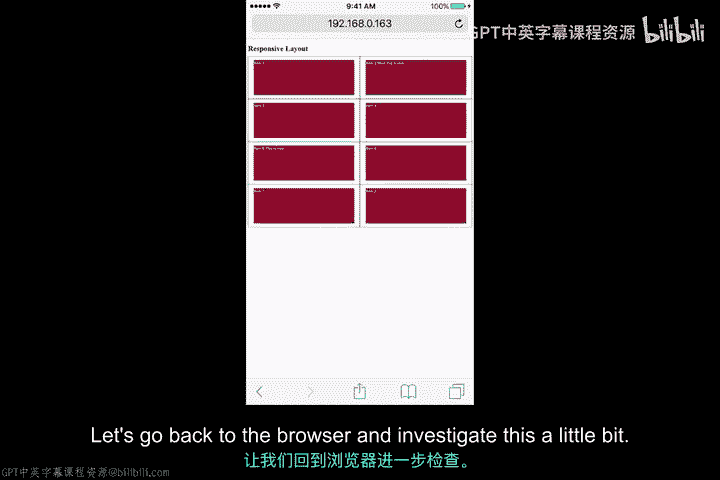
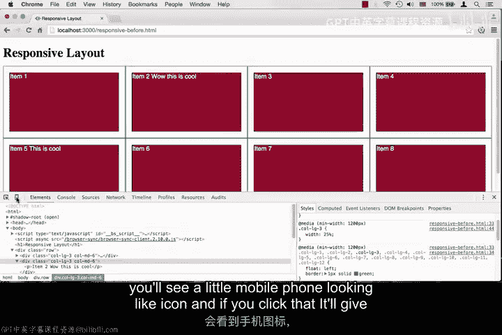
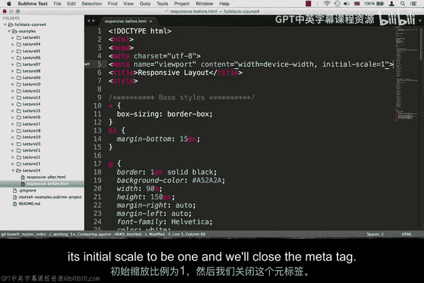
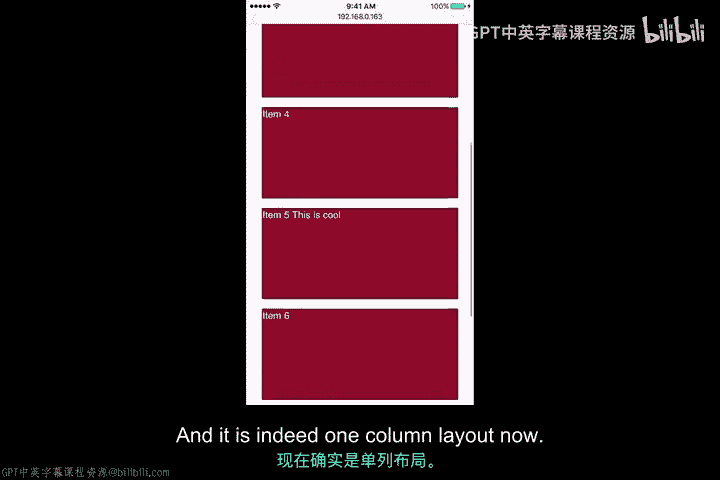
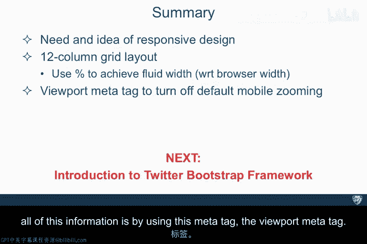

# 037：响应式设计实战



在本节课中，我们将学习如何构建一个简单的响应式网格框架，并理解其核心原理。我们将从编写CSS样式和媒体查询开始，最终实现一个能在不同屏幕尺寸下自动调整布局的网页。

---

## 概述

响应式设计的目标是让网页在不同设备上都能提供良好的浏览体验。本节我们将手动创建一个基于12列网格的响应式布局系统，并解决移动设备上常见的视口缩放问题。

---

## 第一步：基础样式设置

首先，我们为段落标签设置一些基础样式，它将作为我们布局中的视觉参考元素。

```css
p {
    background-color: #A9A9A9;
    border: 1px solid black;
    height: 150px;
    width: 90%;
    margin-left: auto;
    margin-right: auto;
}
```

这段代码为段落设置了背景色、边框和固定高度。宽度设为90%是为了模拟内边距效果，使其不占满整个网格单元格。通过设置左右外边距为`auto`，我们实现了在块级元素（`div`）内的水平居中。

---

## 第二步：构建响应式网格框架



上一节我们设置了基础样式，本节中我们来看看如何构建核心的网格框架。我们的框架将基于浮动布局，并通过媒体查询来适应不同屏幕尺寸。

以下是框架的核心CSS代码：

首先，定义行容器，它占据父元素的全部宽度。

```css
.row {
    width: 100%;
}
```

接着，我们为大屏幕设备（宽度大于1200像素）定义列样式。我们使用`lg`（large）作为类名前缀。

```css
@media (min-width: 1200px) {
    .col-lg-1, .col-lg-2, .col-lg-3, .col-lg-4,
    .col-lg-5, .col-lg-6, .col-lg-7, .col-lg-8,
    .col-lg-9, .col-lg-10, .col-lg-11, .col-lg-12 {
        float: left;
        border: 1px solid green;
    }
    .col-lg-1 { width: 8.33%; }
    .col-lg-2 { width: 16.66%; }
    .col-lg-3 { width: 25%; }
    .col-lg-4 { width: 33.33%; }
    .col-lg-5 { width: 41.66%; }
    .col-lg-6 { width: 50%; }
    .col-lg-7 { width: 58.33%; }
    .col-lg-8 { width: 66.66%; }
    .col-lg-9 { width: 75%; }
    .col-lg-10 { width: 83.33%; }
    .col-lg-11 { width: 91.66%; }
    .col-lg-12 { width: 100%; }
}
```

**核心概念**：在12列网格中，每列的宽度是总宽度的1/12。计算方式为：
`单列宽度 = 100% / 12 ≈ 8.33%`
`N列宽度 = (100% / 12) * N`

然后，我们为中屏幕设备（宽度在950像素到1199像素之间）定义另一组列样式，使用`md`（medium）作为前缀。

```css
@media (min-width: 950px) and (max-width: 1199px) {
    .col-md-1, .col-md-2, .col-md-3, .col-md-4,
    .col-md-5, .col-md-6, .col-md-7, .col-md-8,
    .col-md-9, .col-md-10, .col-md-11, .col-md-12 {
        float: left;
        border: 1px solid red;
    }
    .col-md-1 { width: 8.33%; }
    .col-md-2 { width: 16.66%; }
    /* ... 其余列宽度定义与.lg类似 ... */
    .col-md-12 { width: 100%; }
}
```

**布局逻辑**：通过为同一元素分配不同的类（如`col-lg-3`和`col-md-6`），我们可以确保在不同屏幕尺寸下应用不同的样式。由于媒体查询的范围不重叠，同一时间只有一个类会生效。

---



## 第三步：编写HTML结构

框架定义好后，我们需要编写HTML来使用它。以下是页面结构：

```html
<h1>响应式设计演示</h1>
<div class="row">
    <div class="col-lg-3 col-md-6"><p>项目 1</p></div>
    <div class="col-lg-3 col-md-6"><p>项目 2</p></div>
    <div class="col-lg-3 col-md-6"><p>项目 3</p></div>
    <div class="col-lg-3 col-md-6"><p>项目 4</p></div>
    <div class="col-lg-3 col-md-6"><p>项目 5</p></div>
    <div class="col-lg-3 col-md-6"><p>项目 6</p></div>
    <div class="col-lg-3 col-md-6"><p>项目 7</p></div>
    <div class="col-lg-3 col-md-6"><p>项目 8</p></div>
</div>
```

**布局说明**：
*   在大屏幕上（>1200px），每个`div`使用`.col-lg-3`，即每行放置4个项目（3+3+3+3=12）。
*   在中等屏幕上（950px-1199px），每个`div`使用`.col-md-6`，即每行放置2个项目（6+6=12）。
*   在小屏幕上（<950px），没有媒体查询生效，`div`失去浮动属性，变为块级元素并垂直堆叠。





---

## 第四步：移动设备视口问题与解决

在浏览器中测试时，布局切换正常。但在真实手机（如iPhone 6）上查看时，中屏布局（两列）却意外地出现在小屏幕上。

通过Chrome开发者工具的移动设备模拟器，我们发现问题的根源：手机浏览器为了适配非响应式网站，默认会进行缩放（viewport zoom out），导致媒体查询判断的屏幕宽度与实际不符。

解决方法是添加一个特殊的`meta`标签，告诉浏览器使用设备的实际宽度作为视口宽度，并禁止初始缩放。

```html
<meta name="viewport" content="width=device-width, initial-scale=1">
```



将此标签放入HTML文档的`<head>`部分后，移动设备浏览器就会正确识别屏幕尺寸，我们的单列布局得以在小屏幕上正常显示。

---

## 总结

本节课中我们一起学习了响应式设计的核心实践：
1.  **构建了12列网格系统**：使用百分比宽度实现流体布局，通过浮动排列元素。
2.  **应用了媒体查询**：针对不同屏幕尺寸范围（大屏、中屏）定义不同的列宽规则，实现布局自动切换。
3.  **理解了移动视口**：认识到移动浏览器默认缩放行为对响应式设计的影响。
4.  **使用了Viewport Meta标签**：通过`<meta name="viewport">`确保网页在移动设备上以正确尺寸渲染，这是响应式设计的必要步骤。






通过这个简单框架的搭建，我们掌握了响应式布局的基本原理。接下来，我们将开始学习一个更成熟、功能更强大的工具——Twitter Bootstrap框架。