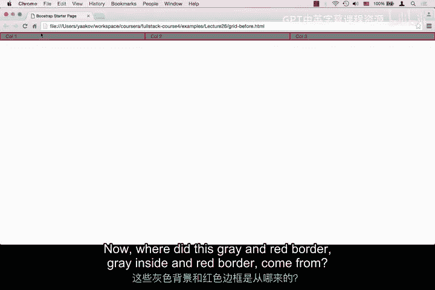
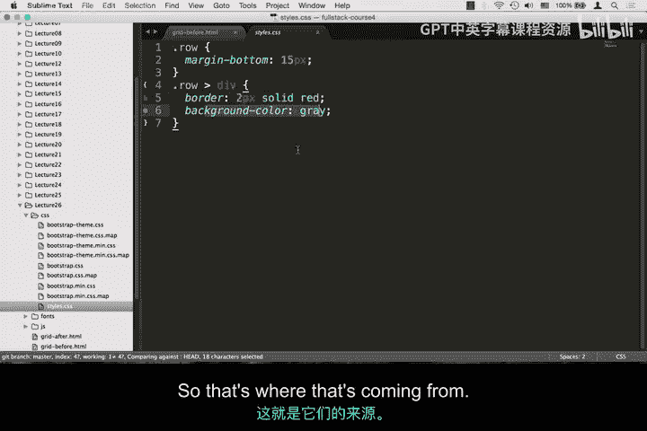
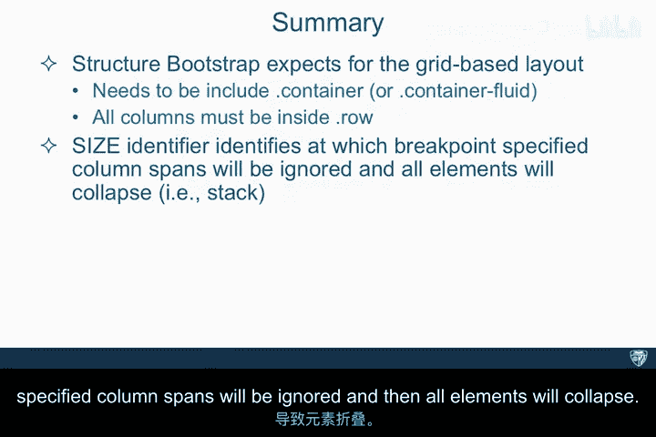

# 041：Bootstrap网格系统（第二部分）


在本节课中，我们将深入学习Bootstrap的网格系统，了解其核心结构、响应式断点以及如何通过不同的类来控制布局。我们将通过一个实际的例子，演示如何创建响应式网格，并解释不同尺寸标识符（如`md`、`sm`、`xs`）的行为差异。

## 准备工作 🛠️

首先，我们在Sublime Text中打开位于`Exs lecture 26`文件夹下的`gridd before that HTML`文件。这个文件是一个标准的Bootstrap页面起始模板。

```html
<!DOCTYPE html>
<html lang="en">
<head>
    <meta charset="UTF-8">
    <meta name="viewport" content="width=device-width, initial-scale=1.0">
    <title>Bootstrap Grid Demo</title>
    <!-- Bootstrap CSS -->
    <link rel="stylesheet" href="path/to/bootstrap.css">
    <!-- Custom CSS -->
    <link rel="stylesheet" href="styles.css">
</head>
<body>
    <div>Column 1</div>
    <div>Column 2</div>
    <div>Column 3</div>
    <!-- jQuery and Bootstrap JS -->
    <script src="path/to/jquery.js"></script>
    <script src="path/to/bootstrap.js"></script>
</body>
</html>
```

我们移除了仅用于IE8支持的HTML5 shim代码。当前，页面包含三个简单的`<div>`元素，它们会像普通块级元素一样垂直堆叠。

## 构建网格结构 🏗️

上一节我们查看了起始文件，本节中我们来看看如何将其转换为Bootstrap网格。

根据Bootstrap规则，网格系统必须位于一个具有`container`或`container-fluid`类的元素内。这里我们使用`container-fluid`来获得全宽容器和两侧的内边距。

```html
<body>
    <div class="container-fluid">
        <div>Column 1</div>
        <div>Column 2</div>
        <div>Column 3</div>
    </div>
    ...
</body>
```

保存并刷新浏览器后，可以看到容器两侧出现了15像素的内边距。





接下来，我们需要将列放入一个具有`row`类的元素中。`row`类用于抵消`container`的内边距，并为列提供正确的排列环境。

```html
<div class="container-fluid">
    <div class="row">
        <div>Column 1</div>
        <div>Column 2</div>
        <div>Column 3</div>
    </div>
</div>
```

现在，我们可以为每个列指定Bootstrap的网格类。我们使用`col-md-4`，这表示在中等（`md`）及以上尺寸的屏幕上，每个列占据4个网格单位，总共12个单位，从而形成三列布局。

```html
<div class="container-fluid">
    <div class="row">
        <div class="col-md-4">Column 1</div>
        <div class="col-md-4">Column 2</div>
        <div class="col-md-4">Column 3</div>
    </div>
</div>
```

保存并刷新页面，现在三个`<div>`并排显示为三列。页面中的灰色背景和红色边框来自我们预定义的CSS样式，仅为视觉区分。

## 理解响应式断点 📱

在上一部分我们提到了`md`是一个尺寸标识符，代表一个特定的断点。让我们查阅Bootstrap官方文档来理解其含义。

根据文档，`md`适用于屏幕宽度**大于等于992像素**的情况。当屏幕宽度小于992像素时，应用了`col-md-*`的列将垂直堆叠。

我们可以在浏览器中打开开发者工具，调整窗口宽度进行测试。当宽度大于等于992像素时，三列并排。当宽度减小到991像素或以下时，三列立即开始垂直堆叠。

这演示了`md`类的作用：它定义了布局开始“折叠”或堆叠的临界点。

## 组合不同断点类 🔀

然而，我们不仅可以定义一个断点的行为。我们可以为更小的屏幕指定不同的布局。例如，我们可以添加`col-sm-6`类。

```html
<div class="col-md-4 col-sm-6">Column 1</div>
<div class="col-md-4 col-sm-6">Column 2</div>
<div class="col-md-4 col-sm-6">Column 3</div>
```

这表示：
*   在`md`及以上（≥992px）：每列宽4个单位，三列并排。
*   在`sm`范围（≥768px 且 <992px）：每列宽6个单位（即半屏）。第一列和第二列并排，第三列因为一行只有12个单位而换行到下一行，并同样占据半屏。
*   在`xs`范围（<768px）：所有列垂直堆叠。

通过调整浏览器宽度，可以观察到布局在`992px`和`768px`这两个断点发生变化。

## 使用XS类实现固定布局 📐

Bootstrap的`col-xs-*`类与其他类有一个关键区别。查看文档表格，`xs`（超小屏幕）的网格行为是“始终水平排列”，而`sm`、`md`、`lg`是“在断点以下开始堆叠，在断点以上水平排列”。

这意味着，如果你使用`col-xs-*`，指定的布局将在**所有屏幕尺寸**下保持不变，永远不会堆叠。

让我们测试一下。我们创建新的一行，并只使用`col-xs-6`。

```html
<div class="row">
    <div class="col-xs-6">Column 1 (XS)</div>
    <div class="col-xs-6">Column 2 (XS)</div>
    <div class="col-xs-6">Column 3 (XS)</div>
</div>
```

保存并刷新。无论如何调整浏览器窗口大小，这三列始终保持“两个半宽列在一行，第三个半宽列换行”的布局，永远不会全部垂直堆叠。这证明了`col-xs-*`创建的是不受断点影响的固定比例布局。

## 总结 📝

本节课中我们一起学习了Bootstrap网格系统的核心概念和实操。

我们首先了解了构建网格的必要结构：网格必须位于`container`或`container-fluid`内，所有列必须放在`row`类元素中。

我们深入探讨了Bootstrap的网格列类（如`col-md-4`），重点在于其尺寸标识符（`xs`， `sm`， `md`， `lg`）定义了布局开始堆叠的响应式断点。通过组合这些类，我们可以为不同设备创建复杂的响应式布局。

最后，我们通过演示特别指出，使用`col-xs-*`类可以创建一种在所有屏幕尺寸下都保持固定水平比例的布局，而不会发生堆叠。



---


接下来，我们将转换话题，进入更多与业务/需求相关的分析模式，概述在接触真实客户时期望了解的一些基本要点。