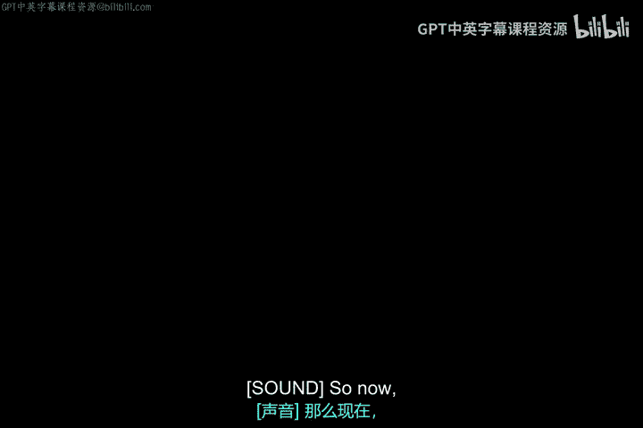
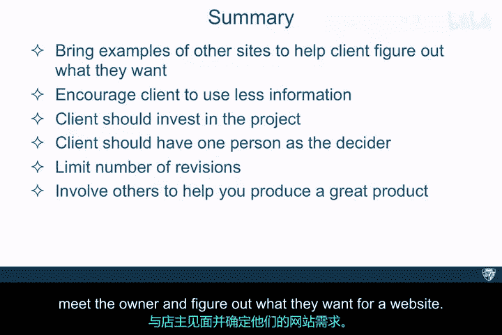
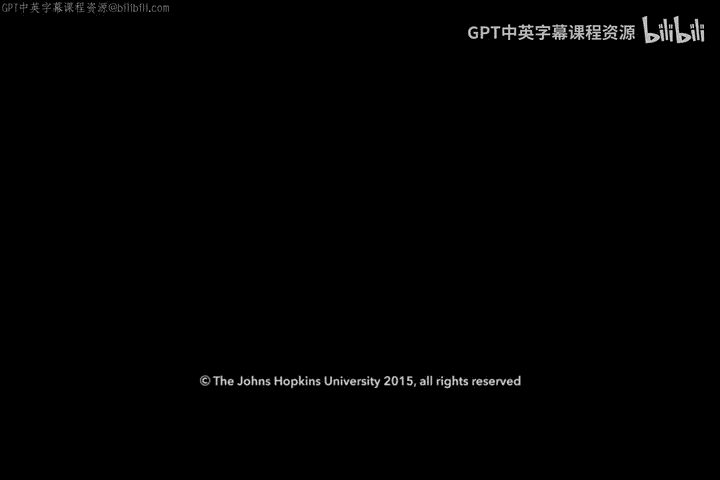

# 043：与客户会面（第一部分）

在本节课中，我们将学习如何为一个真实客户创建网站。我们将以一家名为“David Chohu's China Bistro”的本地餐厅为例，探讨在正式与客户会面前需要了解的基本规则和概念。本节内容旨在帮助你理解如何与客户有效沟通，明确项目需求，并为后续的网站开发工作奠定基础。

## 理解客户需求

上一节我们介绍了课程背景，本节中我们来看看与客户沟通的核心原则。首先需要记住一个关键概念：**大多数客户并不清楚他们具体想要什么**。这并非因为他们不了解自己的业务，事实上，他们通常非常精通自己的领域。问题在于，他们往往不清楚网站应该如何运作或呈现哪些内容。

因此，你的职责是提出正确的问题，引导客户理清他们的需求，并将其清晰地传达给你。

以下是引导客户的一个有效方法：

*   准备一些同行业已存在的网站示例。
*   向客户展示这些示例，并收集他们的反馈。
*   询问他们喜欢或不喜欢示例中的哪些部分。
*   通过足够的示例，你将逐渐了解客户的偏好和他们对网站的期望。

## 管理信息呈现

在引导客户明确需求后，我们常常会遇到下一个挑战：信息过载。通常，客户希望将大量关于其业务的信息都放在网站上。他们认为所有信息都很重要，并希望突出显示每一点。

这里存在一个根本问题：**当所有内容都被强调时，实际上没有任何内容真正突出**。

因此，你需要鼓励客户遵循一个简单的设计原则：**少即是多**。放置在网站上的信息越精炼，每条信息所能产生的影响力就越大。

你的目标是帮助客户识别出最关键、最具冲击力的核心信息，而不是试图塞进所有可能关于其业务的信息。

## 确保客户投入

另一个重要技巧是，**你应该设法让客户对项目进行投入**。这一点在你为了积累作品集而免费提供服务时尤其关键。客户需要感觉到他们也“下了赌注”。

如果客户没有投入，项目很可能变成他们不太关注的次要事务。你将投入大量时间，却可能得不到他们充分的配合。

即使免费提供服务，也应让客户承诺承担某些成本，例如：
*   支付产品摄影的费用。
*   提供用于演示的必要产品。
*   至少提供实物产品，以便你或合作的摄影师进行拍摄。

只要客户实际付出了某些东西（即使是小额资金），他们就会更认真地对待整个项目。

## 明确决策流程与修订限制

为了避免决策混乱，**确保客户指定一人作为项目决策负责人**。否则，不同的人可能会给出相互矛盾的意见。你可以告诉其他提建议的人，你会将建议转达给指定的决策者，并由其最终定夺。

这引出了下一点：**预先限制修订次数**。务必在项目开始前与客户沟通清楚，最好能签署合同，明确约定你愿意进行的免费修订次数。客户可能会无休止地要求修改，而你的时间是有限的。

具体操作可以是：
*   对于付费项目，不要直接拒绝修订，但可以限制免费修订的次数（例如3次）。
*   明确约定，在合理范围内的修订，免费进行3次；此后的修订将按小时收费。
*   具体的收费结构可以根据你的情况来制定。

## 准备会面与借助外力

在与客户会面前，**务必先了解客户的现状**。查看他们现有的网站（如果有的话），了解展示了哪些信息，从而对业务有个初步认识。以我们的示例餐厅为例，其现有网站只是一个展示了菜单图片的简单页面，用户体验很差，无法充分展示业务。

此外，**如果能力所限，应尝试借助他人的力量**。例如：
*   如果你不擅长平面设计，可以联系当地大学，寻找愿意提供免费设计服务以丰富简历的平面设计专业学生。
*   如果你需要产品摄影，可以寻找愿意为积累作品集而免费合作的年轻摄影师。

通过这种方式，你可以整合专业资源，不必独自承担所有工作，也能产出看起来相当专业的成果。在本案例中，讲师很幸运：他的妻子是平面设计师，儿子是初露头角的摄影师，他们分别负责设计和食品摄影。

即便如此，讲师依然遵循了“让客户投入”的原则：餐厅老板同意提供菜单上的每一道菜品，供团队拍摄。这需要餐厅员工加班烹饪，是一项不小的投入，但这表明了客户的参与度和承诺。

## 核心要点总结

本节课中我们一起学习了与客户初次会面前的关键准备步骤。让我们总结一下核心要点：

1.  **使用示例引导**：带上其他网站示例，帮助不清楚自身需求的客户通过讨论明确方向。
2.  **倡导精简信息**：鼓励客户避免信息堆砌，聚焦于更少但更有效的内容。
3.  **确保客户投入**：想办法让客户在项目中有实际投入（资金、产品或服务），以提高其重视程度，尤其是在免费项目中。
4.  **指定唯一决策者**：请客户指定一人作为最终决策者，以避免混乱和低效沟通。
5.  **限制修订次数**：预先明确约定免费修订的次数，以保护你的时间。
6.  **善用外部资源**：在需要时，联合设计师、摄影师等共同协作，以提升最终成果的专业度。

下一节，我们将前往实际的餐厅，会见店主，具体了解他们对网站的期望。这意味着，实地考察开始了！