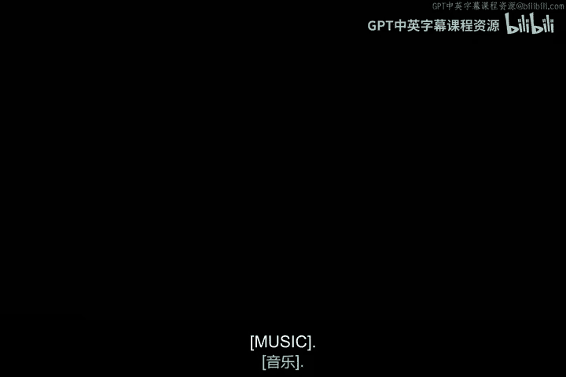
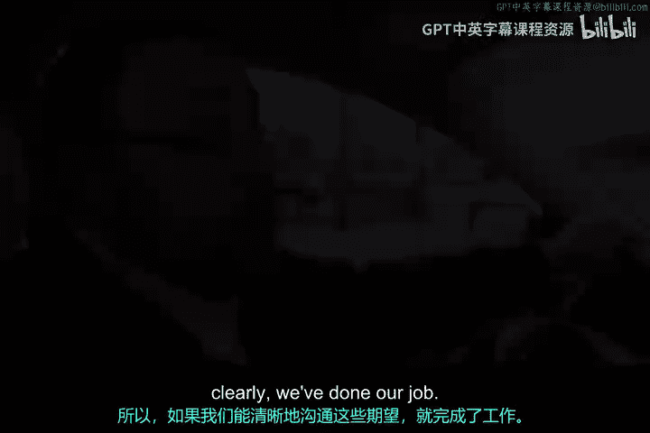

# 044：第27讲 第2部分 与客户的实地考察

在本节课中，我们将跟随课程团队进行一次实地考察，拜访客户并学习如何有效地与客户沟通，以明确网站项目的需求和期望。

## 概述

实地考察是网站开发项目中的关键环节。本节内容展示了开发团队如何与餐厅老板艾米会面，了解她对网站的需求，并尝试从顾客那里获取对餐厅的独特视角。核心目标是**明确双方的期望**，确保项目顺利进行。

## 与客户会面：明确期望

上一节我们介绍了项目背景，本节中我们来看看如何与客户进行初次沟通。这次会面的核心是**设定期望**。无论是客户对我们的期望，还是我们对客户将提供资源的期望，都需要清晰沟通。如果能做到这一点，我们就完成了初步任务。

## 收集客户反馈

在明确了沟通目标后，我们开始收集具体信息。以下是会面中采取的几个关键步骤：

**1. 了解顾客观点**
团队尝试采访了一些餐厅顾客，以获取外部视角。一位常客表示，他喜欢这里的氛围、服务、符合犹太洁食标准，并且食物品质始终如一。另一位顾客称赞了鸡肉的做法。

**2. 引导客户表达需求**
我们直接询问餐厅老板艾米，她希望改进的地方。她明确回答：“需要一个更好的网站”。这是一个非常清晰的项目起点。

**3. 使用视觉参考进行沟通**
为了更具体地了解客户的喜好，我们准备了一些其他中餐厅的网站作为参考。我们请艾米浏览这些网站，并指出她喜欢或不喜欢的地方。

*   **她喜欢的元素**：颜色清晰、看起来干净整洁、非常实用、用户友好。
*   **决策流程**：我们确认艾米将是该项目的唯一决策者，并承诺在需要决策时能及时响应。

**4. 明确项目流程与资源**
我们向艾米解释了网站开发的基本流程，并确认了所需资源。

*   **流程**：我们将首先创建网站的**线框图**（即布局草图），而非直接编写代码。客户将有**三次修订机会**来调整设计，之后将定稿。
*   **资源**：我们确认艾米可以提供完整的菜单，并允许摄影师为每一道菜拍照。同时，我们了解到这是一家**犹太洁食**餐厅，这意味着在食材和处理方式上有特定要求。

**5. 把握品牌调性**
我们讨论了餐厅给人的感觉。艾米确认，餐厅虽小但给人一种舒适、放松的感觉，这也是她希望在网站上传达的氛围。

## 总结与过渡

本节课中，我们一起学习了如何通过实地考察与客户进行有效沟通。我们明确了客户的期望，收集了关于网站风格和功能的初步想法，并确认了项目流程与所需资源。

在明确了所有需求之后，我们就可以离开餐厅，开始设计和编写网站代码了。但在开始之前，有一条最重要的原则：永远不要在饿着肚子的时候写代码。

