# 046：基本规则与开发环境配置概述 🎬

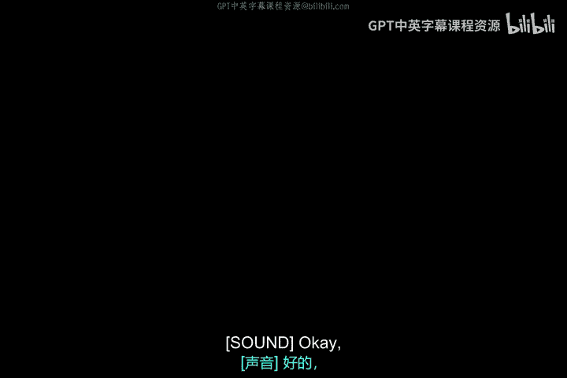

在本节课中，我们将学习课程的基本规则，并快速配置我们的开发环境。我们将使用一个真实的商业网站作为示例，从零开始逐步构建。

---

## 基本规则 📋

在开始之前，了解一些基本规则很重要。

首先，请记住这是一个视频课程。你可以根据自己的节奏来学习。如果你觉得我讲得太快，可以暂停或回放。如果觉得太慢，可以加快播放速度。

其次，所有源代码都是可用的。如果你错过了某些内容，或者想稍后查阅，可以随时查看源代码。即使我们构建的是一个真实的商业网站，源代码也100%会提供给你。

我们将逐步构建网站。每个讲座的文件夹都会包含“之前”和“之后”的内容。这样，你可以随时跳入任何一讲，查看我们的起点和终点。

为了节省时间，有些操作会在屏幕外完成。有时我也需要暂停思考下一步。我不想让你坐在那里等我思考，所以有些内容会暂停录制，在屏幕外完成后再放回屏幕。一旦内容出现在屏幕上，我会进行解释。

为了避免让你观看枯燥的打字过程，我会尽量在屏幕外完成一些操作，然后进行解释。当然，一些屏幕上的打字操作可能无法避免。

我通常使用双显示器进行开发，这样在一个屏幕上写代码，另一个屏幕上显示浏览器，使用像Browser Sync这样的工具会非常方便。但遗憾的是，由于这是单屏幕视频，并且为了让你们能看清代码，浏览器和代码编辑器不能同时显示。因此，我们不得不在代码编辑器和浏览器屏幕之间频繁切换。我为此表示歉意，但为了确保你们能看清内容，这是必要的。

---

## 开发环境配置 ⚙️

现在，让我们进入代码编辑器，看看我们的起点。

我目前在终端窗口中。如果我执行 `pwd` 命令，它会显示我当前所在的目录。你会看到我在 `examples/lecture29/before` 文件夹中。执行 `ls` 命令，你会看到我有 `css`、`fonts`、`js` 文件夹和一个起始的 `index.html` 文件。

我们首先要做的是开始使用Browser Sync。如果你向上移动一个文件夹并执行 `ls`，你会看到 `before` 和 `after` 文件夹。我们将主要在 `after` 文件夹中进行开发。让我们回到 `after` 文件夹，因为这是我们想要启动Browser Sync的地方。这样，每当我们编辑任何内容，它都会自动在浏览器中更新。

让我回忆一下Browser Sync的命令，并解释一下。希望你在欢迎视频中已经学习了如何安装Browser Sync。如果你还没有安装，请返回那个视频查看安装步骤，例如需要安装Node.js等。

以下是启动Browser Sync的命令：

```bash
browser-sync start --server --directory --files "*"
```

*   `browser-sync start`：启动Browser Sync。
*   `--server`：让Browser Sync作为服务器，从我们当前所在的目录（现在是 `lecture29/after` 目录）提供网站服务。
*   `--directory`：告诉Browser Sync列出目录结构，而不是尝试提供一个特定的文件。它会向我们展示所有文件作为起点。
*   `--files "*"`：指定需要监视哪些文件的修改。`"*"` 表示监视此目录下的任何文件。当任何匹配此条件的文件发生变化时，Browser Sync会自动并立即重新加载页面。

我按下回车键启动浏览器。它直接跳转到了浏览器页面。让我们回来看一下终端输出，它告诉我访问的URL，并直接跳转到了这个页面。但请注意，这里还有另一个页面 `http://localhost:3001`，这是Browser Sync的用户界面（UI），我之前没有展示过。

让我们进入那个UI，你会看到一个完整的Browser Sync配置界面。我鼓励你探索一下。同时，这是我们的目录列表。如果我们点击 `index.html`，目前什么也看不到，因为我们的代码中还没有任何内容。

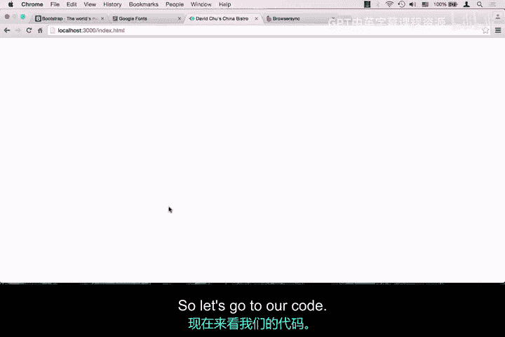

---

## 初始代码结构 🏗️

现在让我们看看我们的代码。我们这里有一个标准的Bootstrap起始页面。请注意，我们放弃了对Internet Explorer 9的支持，所以你看不到相关的垫片（shims），我们也没有使用jQuery 1.x，而是使用了jQuery 2.1.4。我们希望不再支持IE9，因为现在使用它的人已经非常少了。

我们这里只有标准的meta标签设置。我们把标题设为“David Chu‘s China Bistro”，这是餐厅的名字。

我们首先要做的是设置样式。在 `css` 文件夹里有很多文件，但我们真正需要的只是压缩版的 `bootstrap.min.css`，事实上我们已经引入了它。为了以后参考，我把所有文件都留在这里了。重要的是，你会看到 `styles.css` 文件就在这个文件夹里。

让我们打开 `styles.css` 文件。我们要做的第一件事是设置一些全局样式，这些样式将应用于整个页面乃至所有页面。我们将使用 `body` 选择器来设置。

首先，设置字体大小。我们将使用一个标准字体大小，比如16像素。

```css
font-size: 16px;
```

接下来，设置颜色。我们将颜色设为白色（`#FFF`）。这意味着我们所有的文本都将是白色的。

```css
color: #FFF;
```

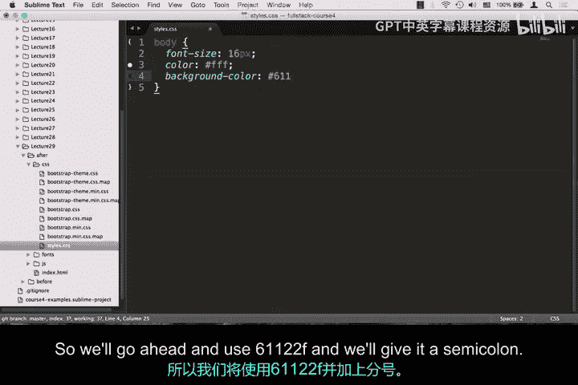

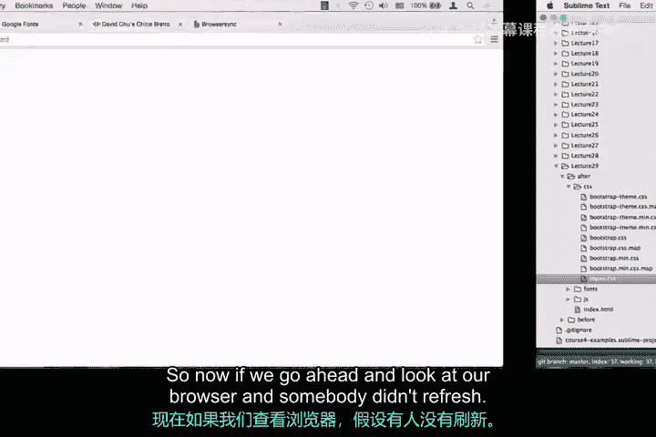

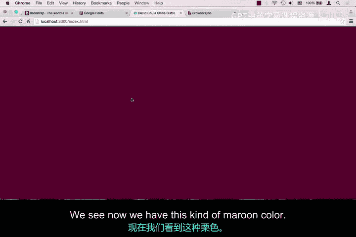

然后，设置背景颜色。我们需要参考我们的设计稿。设计稿中的背景颜色是一种特定的红色。但我们将使用 `#611122`，这个颜色与餐厅里餐巾和其他物品的风格相匹配。

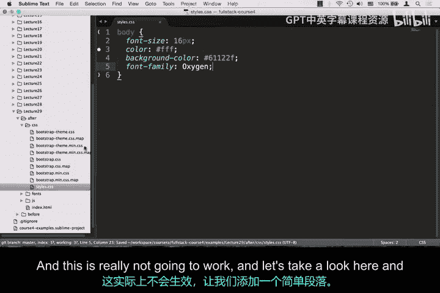

```css
background-color: #611122;
```

现在，如果我们查看浏览器（它应该自动刷新了），我们可以看到背景变成了这种栗色。

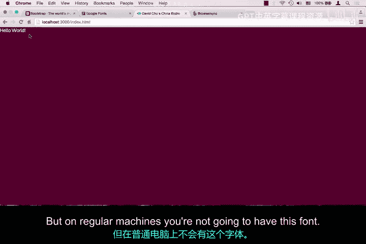

最后，我们来看看通用字体。设计稿上显示字体是“Oxygen”。让我们设置通用字体。

```css
font-family: oxygen;
```

但这可能不会生效。让我们在HTML中添加一个简单的段落 `<p>Hello World</p>` 来测试一下。它可能不会显示为Oxygen字体，因为我的机器上可能没有安装这个字体。实际上，它看起来很像Oxygen，所以可能我的机器上已经导入了。但在普通机器上，你可能没有这个字体。

那么，我们如何获取这个字体呢？我们可以访问 `fonts.google.com` 搜索“oxygen”。你会看到第一个结果是“Oxygen”，第二个是“Oxygen Mono”（那是不同的字体）。要获取这个字体，点击“Select this font”按钮，然后选择我们想要的字重（比如常规和加粗）。你可以看到Google会告诉你这会给页面加载带来多少负担。有时字体有很多选项，加载过多会使页面变慢。我们不想这样，但好在这个字体选项在绿色区域，表示负担较小。

向下滚动一点，你会看到一段代码，需要添加到你的网站。这段代码很简单，是一个链接。我们复制它，回到我们的HTML页面，将这个链接粘贴到 `<head>` 部分。

现在我们的页面就有了这个字体。回到Google Fonts页面，它还会告诉你应该如何指定这个字体。我们复制那行CSS规则，回到代码编辑器，用他们告诉我们的方式替换我们之前写的 `font-family` 规则，即 `font-family: 'Oxygen', sans-serif;`。这样，如果Oxygen字体不可用（现在应该可用了，因为我们从Google导入了），就会使用无衬线字体作为后备。

现在我们可以回到网页，刷新一下看看。字体基本上应该生效了。让我们回到代码编辑器，删除测试用的 `<p>Hello World</p>` 段落。现在我们准备好了背景颜色、默认字体大小，并且从Google Fonts导入了字体。我们可以继续下一步，即构建网站的页头部分。

---

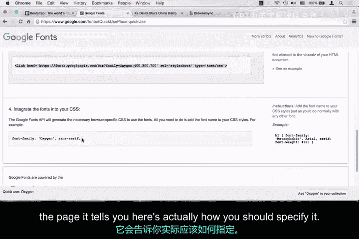

## 总结 📝

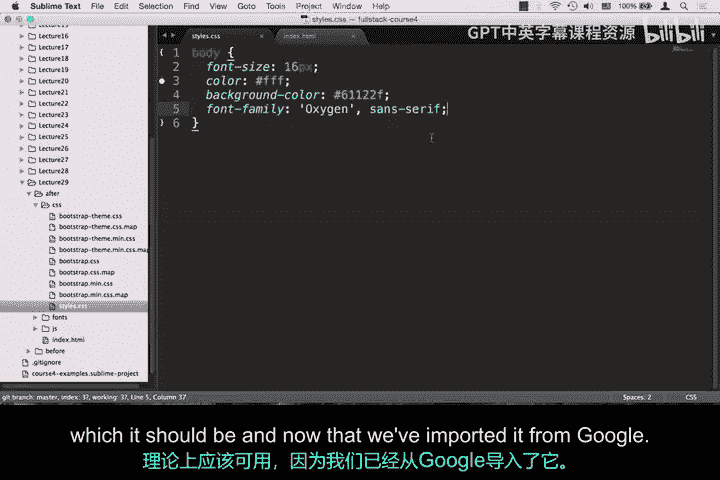

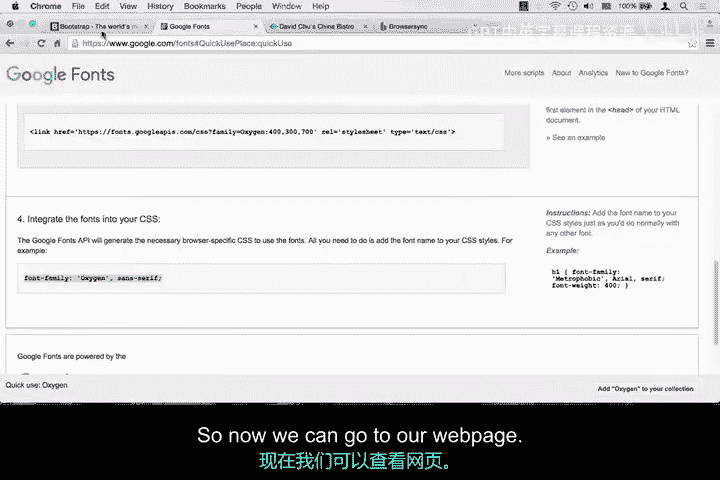

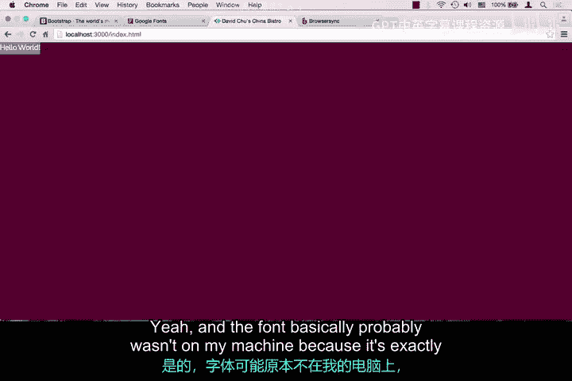

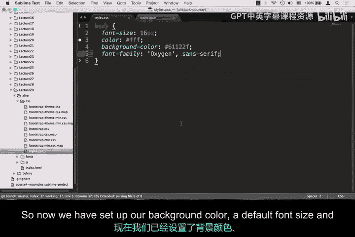

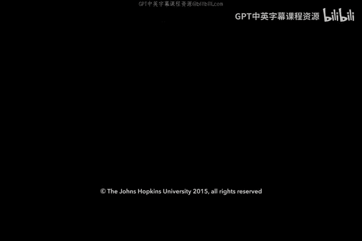

本节课中，我们一起学习了课程的基本规则，并配置了开发环境。我们了解了如何利用视频的灵活性，知道了源代码的可用性，以及项目逐步构建的方式。我们使用Browser Sync搭建了本地开发服务器，实现了代码修改后浏览器自动刷新。我们还为项目设置了全局CSS样式，包括背景色、字体大小，并通过Google Fonts引入了“Oxygen”字体。现在，我们的基础开发环境已经就绪，可以开始构建网站的具体部分了。