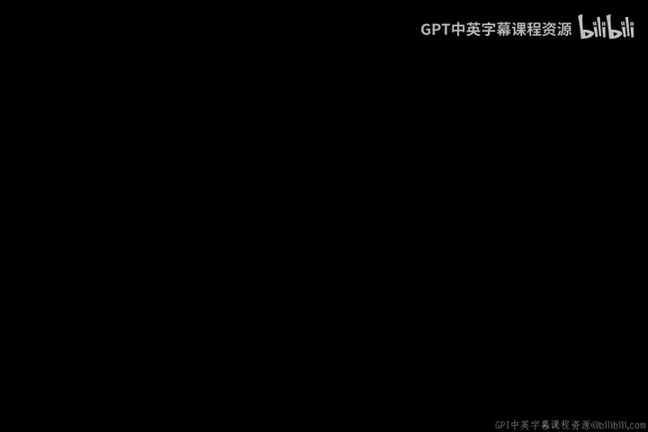
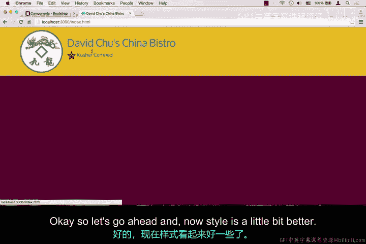
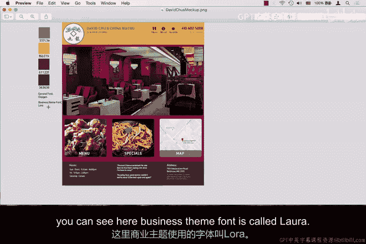
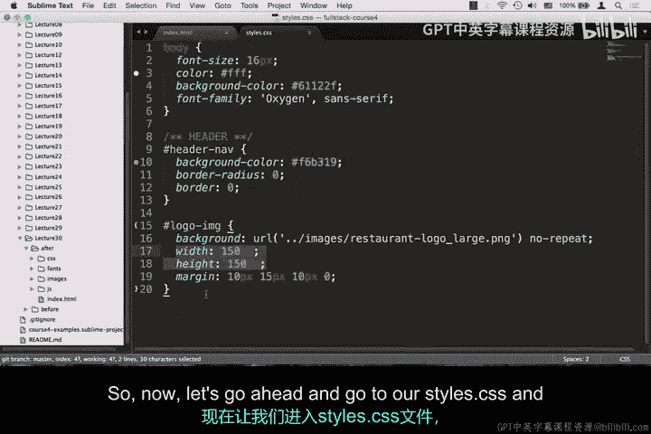
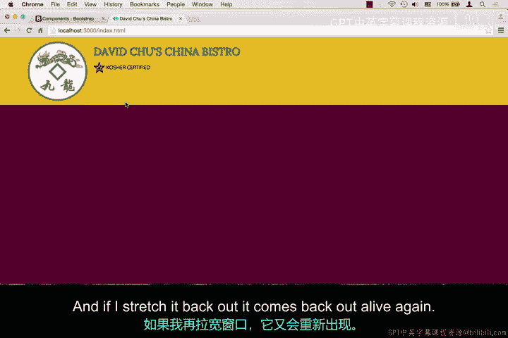
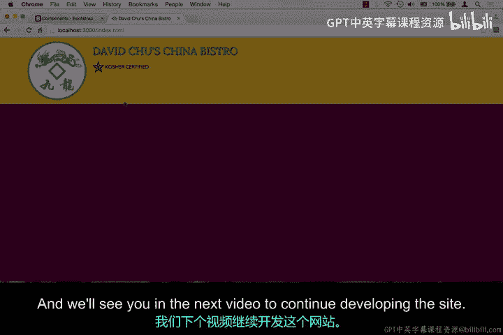

# 048：导航栏头部编码基础



在本节课中，我们将学习如何使用HTML、CSS和Bootstrap框架来构建一个响应式导航栏的头部区域。我们将重点处理餐厅名称和认证标志的布局与样式。

---

首先，我们回到代码编辑器，粘贴预先准备好的餐厅名称和犹太洁食认证标志的代码。


如果直接放置代码，其效果并不理想。让我们先解释一下这段代码的结构。

第一项是 `Navbar-brand`。根据Bootstrap文档，任何品牌信息（如公司名称）都应放在具有 `navbar-brand` 类的元素内。我们将餐厅名称“David Chu's China Bistro”放在一个 `<a>` 链接内，使其成为可点击区域，并包裹在 `<h1>` 标签中，因为这是页面上最重要的信息。

接下来是犹太洁食认证标志，它是一个小尺寸的图片，我们暂时不为其考虑响应式设计。图片内有一个 `<span>`，文字内容为“KOSHER CERTIFIED”。

保存代码并在浏览器中查看，效果并不理想。名称和标志垂直堆叠，看起来不美观。我们需要将它们并排放在头部区域。

问题在于这两个元素都是 `<div>`，默认会垂直堆叠。由于 `navbar-brand` 类已经设置了左浮动，我们只需让标志图片也左浮动，就能使餐厅名称出现在标志右侧。

我们使用Bootstrap的方式来实现，为标志所在的 `<a>` 元素添加 `pull-left` 类，其效果等同于 `float: left`。这比直接使用 `style` 属性添加内联样式更整洁。

```html
<a href="#" class="pull-left">
  
</a>
```

返回浏览器查看，现在所有内容都排列在标志右侧了。

---



上一节我们完成了基本布局，本节中我们来看看如何优化样式。





我们首先需要移除链接默认的下划线，并根据设计稿调整字体。设计稿中，商业名称使用的字体是“Lora”。

我们需要返回代码编辑器，通过Google Fonts导入Lora字体，方法与之前导入Oxygen字体相同。

```html
<link href='https://fonts.googleapis.com/css?family=Lora' rel='stylesheet' type='text/css'>
```

接着，在CSS样式文件中，为导航栏品牌区域添加预定义的样式。

首先，为 `.navbar-brand` 添加顶部内边距，将其向下推一点。

```css
.navbar-brand {
  padding-top: 25px;
}
```

然后，为餐厅名称（即 `.navbar-brand h1`）设置样式：应用Lora字体家族、改为绿色、增大字体尺寸、转换为大写、加粗、添加文字阴影、调整外边距和行高，并移除链接装饰。

```css
.navbar-brand h1 {
  font-family: 'Lora', serif;
  color: #557c3e;
  font-size: 1.5em;
  text-transform: uppercase;
  font-weight: bold;
  text-shadow: 1px 1px 1px #222;
  margin-top: 0;
  margin-bottom: 0;
  line-height: .75;
}
.navbar-brand a:hover, .navbar-brand a:focus {
  text-decoration: none;
}
```

接下来，为认证标志区域（`.kosher`）设置样式：调整颜色、转换为大写、减小字体尺寸，并添加顶部外边距以与品牌名称分开。

```css
.kosher {
  color: #000;
  text-transform: uppercase;
  font-size: .7em;
  margin-top: 15px;
}
```

最后，为了让“KOSHER CERTIFIED”文字在星形图标中垂直居中，我们为对应的 `<span>` 设置垂直对齐属性。

```css
.kosher span {
  vertical-align: middle;
}
```

在浏览器中查看效果，样式已基本符合预期，但布局可能仍有问题。检查CSS代码，修正可能存在的拼写错误（如残留的注释结束符）。修正后，头部区域应能正确显示。

---

最后，我们希望这个认证标志只在中等（md）和大（lg）屏幕尺寸下显示，在小屏幕上则隐藏，以节省空间。

Bootstrap提供了响应式工具类来实现这一点。我们可以为标志元素添加 `visible-md` 和 `visible-lg` 类。

```html
<a href="#" class="pull-left visible-md visible-lg">
  
</a>
```

现在，当浏览器窗口宽度处于中等或大尺寸时，标志会显示；当窗口缩小到小尺寸时，标志会自动隐藏。你可以通过拖动浏览器窗口来观察这一变化。




---


本节课中我们一起学习了导航栏头部的编码基础。我们使用Bootstrap的类进行布局，通过自定义CSS设置字体、颜色和间距等样式，并利用Bootstrap的响应式工具类控制元素在不同屏幕尺寸下的可见性。这为网站头部区域打下了一个良好的基础。