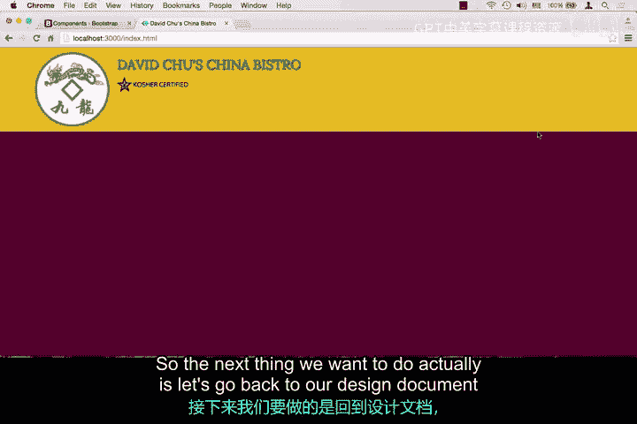
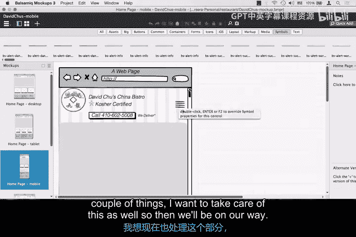
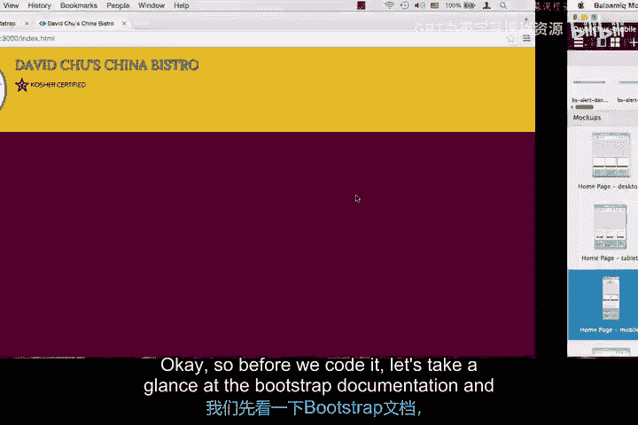
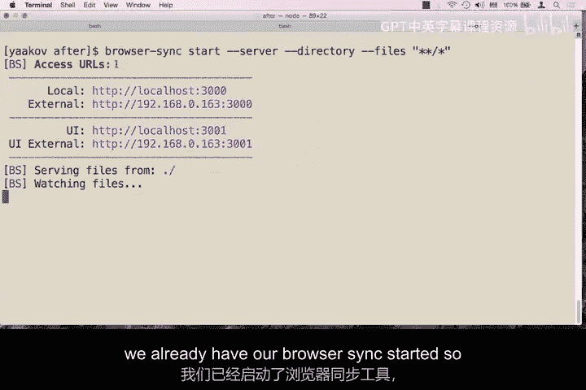
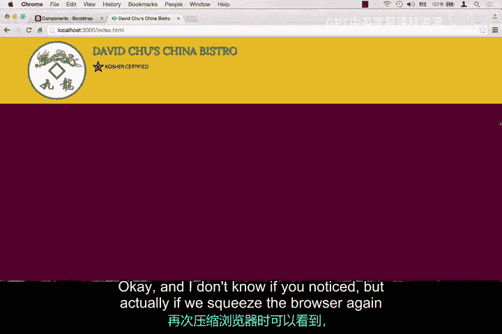

# 049：6_第31讲 可折叠菜单按钮编码 🧩


## 概述
在本节课中，我们将继续构建网站，重点是为移动端视图添加一个可折叠的导航菜单按钮。我们将学习如何使用Bootstrap的组件来实现这一功能，并理解其背后的代码结构。



---





## 回顾与目标
上一节我们处理了网站的Logo、餐厅名称和认证标志，并实现了Logo在浏览器窗口缩小时（小于中等尺寸）的隐藏效果。

本节中，我们来看看如何为移动端视图添加一个可折叠的菜单按钮。根据设计文档，在移动设备上，导航菜单项（如“菜单”、“关于”、“奖项”等）将被隐藏，取而代之的是一个按钮。点击此按钮可以展开导航菜单。我们选择现在处理这个按钮，是因为它属于导航栏头部的一部分，而我们已经开始构建这部分内容。



## 查看Bootstrap文档
在开始编码之前，我们先参考Bootstrap官方文档。文档中有一个导航栏组件的示例，当浏览器窗口缩小时，菜单项会折叠起来，点击一个按钮后才会显示。我们将借鉴这个示例的代码来实现我们的功能。

## 添加可折叠按钮代码
我们已经启动了浏览器同步工具。现在，需要将准备好的代码粘贴到导航栏头部（`navbar-header`）内部。这段代码与Bootstrap文档中展示的代码相同。

以下是粘贴的代码：
```html
<button type="button" class="navbar-toggle collapsed" data-toggle="collapse" data-target="#collapsible-nav" aria-expanded="false">
    <span class="sr-only">Toggle navigation</span>
    <span class="icon-bar"></span>
    <span class="icon-bar"></span>
    <span class="icon-bar"></span>
</button>
```

## 代码解析
让我们逐一分析这段代码中各个部分的作用：

*   **`class="navbar-toggle"`**：这个类控制整个按钮的定位和基本样式。在Bootstrap的CSS中，它定义了按钮的位置（如相对定位、右浮动），并且会在特定的媒体查询宽度下（例如小于中等尺寸时）显示，在其他情况下隐藏。
*   **`class="collapsed"`**：这个类本身在Bootstrap的CSS中没有定义。它的作用是向Bootstrap的一个插件（Collapse插件）表明按钮当前处于“折叠”状态（即未被点击）。当用户点击按钮后，这个类会被插件自动移除或添加，以切换状态。
*   **`data-toggle="collapse"`**：这是一个HTML5数据属性（`data-*`），它告诉Bootstrap的JavaScript插件，这个按钮用于触发“折叠”行为。
*   **`data-target="#collapsible-nav"`**：这是另一个关键的数据属性。它的值 `#collapsible-nav` 是一个我自定义的名称，对应着页面中另一个元素的ID。那个元素（我们稍后会创建）将包含所有需要折叠/展开的导航菜单项。这个属性建立了按钮和目标内容之间的连接。
*   **`aria-expanded="false"`**：这个属性主要用于辅助技术（如屏幕阅读器），表示关联的内容区域当前是折叠的。虽然本课程不深入讲解可访问性属性，但保留它是一个好习惯。
*   **`<span class="sr-only">Toggle navigation</span>`**：这个元素内的文字“Toggle navigation”仅对屏幕阅读器可见，不会显示在浏览器页面上，用于向使用辅助技术的用户说明按钮功能。
*   **三个 `<span class="icon-bar">`**：这三个元素负责在按钮内渲染出三条水平横线，即常见的“汉堡包”菜单图标。

## 查看效果与后续步骤
保存代码后，回到浏览器。目前你可能看不到任何变化，因为页面窗口还不够小。当我们缩小浏览器窗口到大约768像素以下时，按钮就会出现。

现在点击按钮，不会有任何反应。这是因为我们还没有在HTML中启用折叠行为，也没有将JavaScript功能连接起来。关键的一步是我们尚未创建ID为 `collapsible-nav` 的元素来容纳导航菜单。

此外，你可能注意到这个按钮的样式与网站整体风格不太协调，它目前使用的是Bootstrap的默认样式。我们不会保持原样，将在后续的视频中对其进行样式调整。

---




## 总结
本节课中我们一起学习了如何为响应式网站添加Bootstrap可折叠导航菜单按钮。我们理解了按钮代码的结构，包括控制样式的类（`navbar-toggle`）、与JavaScript插件交互的数据属性（`data-toggle`, `data-target`），以及用于可访问性和图标显示的元素。目前按钮已经能在移动端视图中显示，但功能尚未激活，样式也未定制，这将是后续课程的任务。