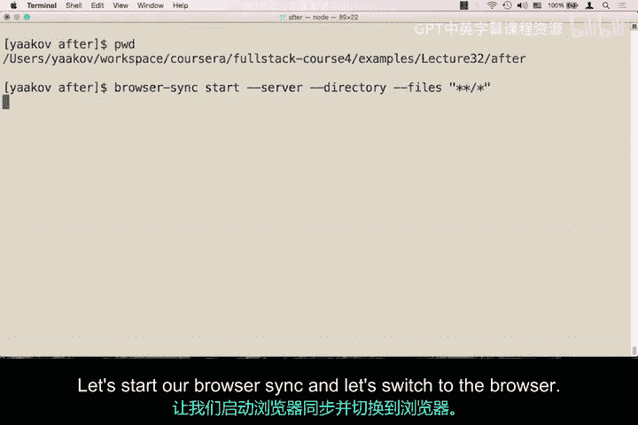
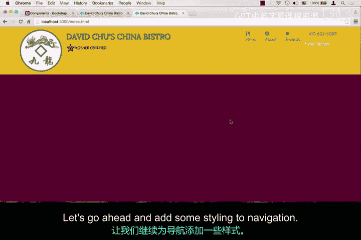
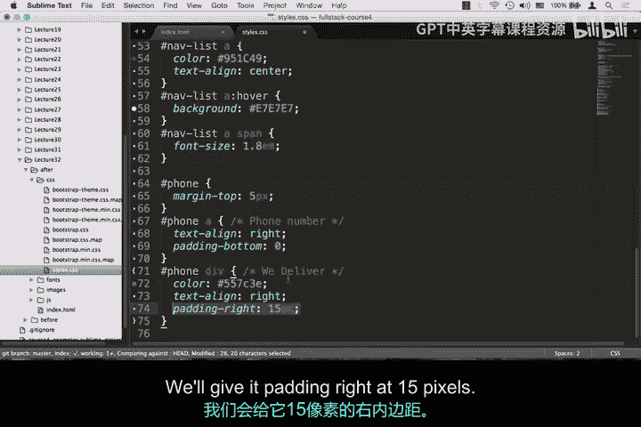
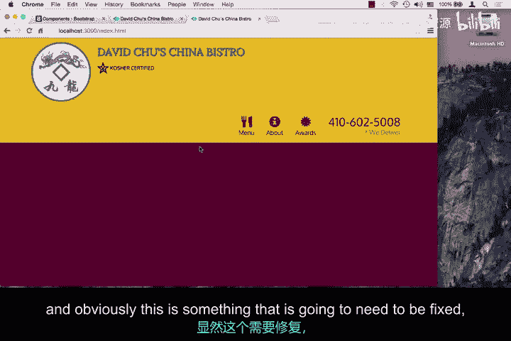

# 050：第32讲 第1部分 导航菜单按钮编码


## 概述
在本节课中，我们将继续构建网站，重点是为导航栏添加可交互的菜单按钮。我们将使用HTML来构建菜单结构，并用CSS进行样式设计，最终实现一个在移动设备上可折叠的响应式导航菜单。

---

## 构建导航菜单的HTML结构

上一节我们完成了导航栏标题部分。本节中，我们来看看如何为导航栏添加菜单按钮。

首先，我们需要在导航栏标题的下方添加菜单容器。这个容器将在页面变窄、主菜单折叠时，通过一个切换按钮来显示。

以下是构建菜单所需的HTML代码：

```html
<div id="collapsable-nav" class="collapse navbar-collapse">
  <ul id="nav-list" class="nav navbar-nav navbar-right">
    <li>
      <a href="#">
        <span class="glyphicon glyphicon-cutlery"></span>
        <br class="hidden-xs">
        菜单
      </a>
    </li>
    <li>
      <a href="#">
        <span class="glyphicon glyphicon-info-sign"></span>
        <br class="hidden-xs">
        关于
      </a>
    </li>
    <li>
      <a href="#">
        <span class="glyphicon glyphicon-certificate"></span>
        <br class="hidden-xs">
        奖项
      </a>
    </li>
    <li id="phone" class="hidden-xs">
      <a href="tel:123-456-7890">
        <span>123-456-7890</span>
      </a>
      <div>我们提供外送服务</div>
    </li>
  </ul>
</div>
```

现在，我们来详细解析这段代码的各个部分。

### 代码解析

**1. 可折叠菜单容器**
`<div id="collapsable-nav" class="collapse navbar-collapse">` 是整个菜单的容器。
*   `id="collapsable-nav"`：为这个`<div>`设置了一个ID。Bootstrap的折叠插件会通过这个ID（例如 `#collapsable-nav`）来定位和控制这个区域的展开与收起行为。
*   `class="collapse navbar-collapse"`：这两个类是Bootstrap框架要求的，它们共同作用，使这个容器具备响应式折叠的功能。

**2. 菜单列表**
`<ul id="nav-list" class="nav navbar-nav navbar-right">` 是一个无序列表，它将包含所有菜单项。
*   `id="nav-list"`：我们为这个列表设置ID，以便后续通过CSS进行样式定制。
*   `class="nav navbar-nav"`：这两个类告诉Bootstrap，这个列表是导航栏的一个组件，并将其样式化为导航菜单。
*   `class="navbar-right"`：这个类使整个菜单列表在导航栏内向右浮动对齐。在我们的设计中，菜单按钮是位于导航栏右侧的。

**3. 菜单项与图标字体**
每个菜单项（`<li>`）内部都包含一个链接（`<a>`）和一个图标。
*   **链接**：`<a href="#">` 定义了按钮的点击目标。`#`是占位符，在实际项目中应替换为具体的页面链接。
*   **图标字体**：`<span class="glyphicon glyphicon-cutlery"></span>` 用于显示图标。
    *   `glyphicon` 是基础类。
    *   `glyphicon-cutlery` 是具体图标类，代表刀叉图标。
    *   图标字体是一种矢量图形，可以像文字一样通过CSS调整大小和颜色，并且放大后依然清晰。
*   **换行控制**：`<br class="hidden-xs">` 在图标和文字之间插入了一个换行，但在超小屏幕（`xs`）上，这个换行会被隐藏（`hidden-xs`）。这样，在移动端展开的菜单中，图标和文字会水平排列，而不是上下堆叠，使按钮更紧凑。

**4. 电话号码项**
最后一个菜单项比较特殊，它包含了电话号码和外送信息。
*   `id="phone" class="hidden-xs"`：我们给这个`<li>`设置了`hidden-xs`类，这意味着在超小屏幕（如手机）上，整个电话号码区块会被隐藏。这是因为我们计划在移动端以另一种更醒目的方式展示电话号码。
*   **电话链接**：`<a href="tel:123-456-7890">` 使用 `tel:` 协议。当用户点击这个链接时，在支持通话的设备（如手机）上会直接触发拨号功能。
*   **外送信息**：`<div>我们提供外送服务</div>` 是一个简单的文本提示。

---

## 为导航菜单添加CSS样式



现在HTML结构已经就位，但看起来还很简陋。接下来，我们通过CSS来美化它。



我们将对之前定义的 `#nav-list` 及其子元素进行样式设计。

以下是需要添加的CSS代码：

```css
#nav-list {
  margin-top: 10px;
}
#nav-list a {
  color: #951C49;
  text-align: center;
}
#nav-list a:hover {
  background-color: #f0f0f0;
}
#nav-list a span {
  font-size: 1.8em;
}
#phone {
  margin-top: 5px;
}
#phone a {
  text-align: right;
  padding-bottom: 0;
}
#phone div {
  color: #557c3e;
  text-align: right;
  padding-right: 15px;
}
```

### 样式解析

以下是每个样式规则的作用：



*   `#nav-list { margin-top: 10px; }`：为整个菜单列表添加上边距，使其在导航栏中位置下移一些。
*   `#nav-list a { color: #951C49; text-align: center; }`：设置所有菜单链接的文字颜色为网站主题的酒红色，并将文字居中对齐。
*   `#nav-list a:hover { background-color: #f0f0f0; }`：当鼠标悬停在菜单项上时，添加一个浅灰色的背景色，提供视觉反馈，提示用户这是可点击的。
*   `#nav-list a span { font-size: 1.8em; }`：将图标字体的大小增加到原来的1.8倍，使其更醒目。
*   `#phone { margin-top: 5px; }`：为电话号码项添加上边距，使其与上面的菜单项有一些间隔。
*   `#phone a { text-align: right; padding-bottom: 0; }`：将电话号码的文字右对齐，并移除底部内边距，使其紧贴底部。
*   `#phone div { color: #557c3e; text-align: right; padding-right: 15px; }`：将“我们提供外送服务”的文字设置为绿色，右对齐，并添加右内边距，使其与电话号码的右边缘完美对齐。

应用这些样式后，我们的导航菜单在桌面端看起来就美观多了，并且拥有了悬停效果。更重要的是，由于我们正确使用了Bootstrap的类（如 `collapse`, `navbar-collapse`），当浏览器窗口缩小到移动端尺寸时，菜单会自动折叠起来。点击右上角的切换按钮，菜单可以平滑地展开和收起，这一切功能都是由Bootstrap框架自动提供的。

---




## 总结
本节课中我们一起学习了如何构建一个响应式导航菜单。我们首先使用HTML创建了菜单的结构，利用Bootstrap的类来实现折叠功能，并添加了图标字体来美化按钮。然后，我们通过CSS对菜单进行了详细的样式设计，包括颜色、对齐、间距和悬停效果。现在，我们的导航栏在桌面端显示完整菜单，在移动端则能优雅地折叠，为后续的移动端优化打下了基础。在下一部分，我们将重点设计那个控制菜单折叠的切换按钮。