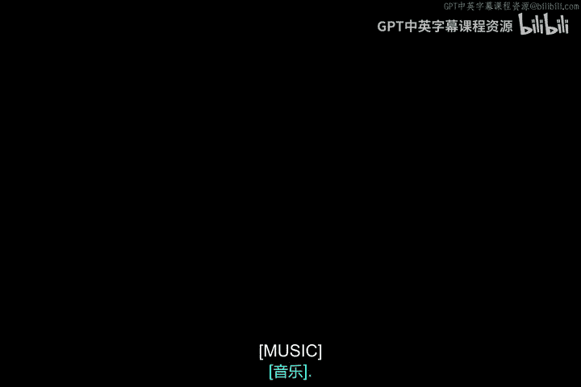
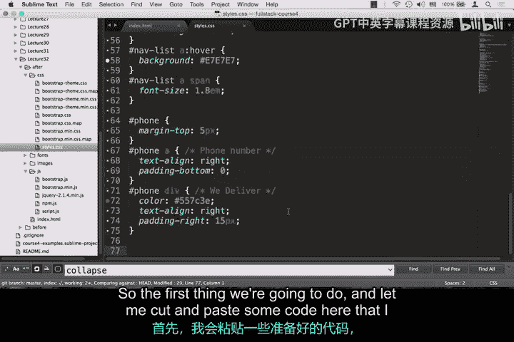
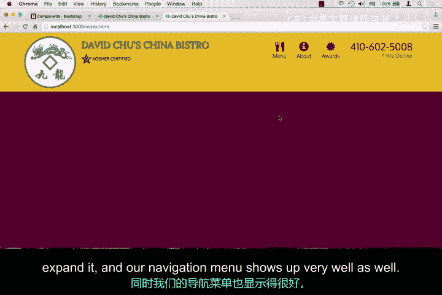
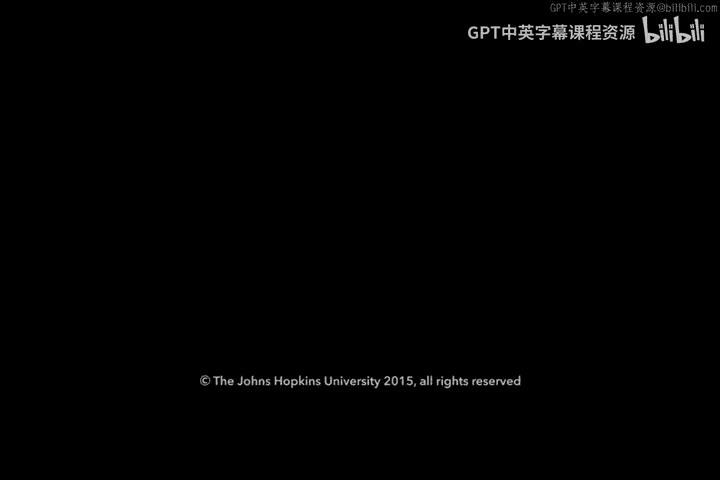

# 051：8_第32讲 第2部分 导航菜单按钮编码 🧭



在本节课中，我们将继续为移动端导航菜单编写样式，重点是设计并美化那个用于展开和收起折叠菜单的按钮。我们将调整按钮的颜色、解决布局问题，并确保它在不同屏幕尺寸下都能正常工作。

---

在上一节中，我们为主屏幕和折叠状态的菜单项编写了代码并应用了样式。本节中，我们来看看如何设计那个控制移动端菜单展开与收起的按钮。

让我们回到代码编辑器，为这个按钮添加更多样式，使其与网站的整体主题相匹配。

首先，我们要改变按钮边框的颜色。以下是实现此目标的CSS代码：

```css
.navbar-header button.navbar-toggle,
.navbar-header .icon-bar {
    border: 1px solid #61122f !important;
}
```

这段代码的目标是：在 `.navbar-header` 元素内，找到类名为 `navbar-toggle` 的按钮以及类名为 `icon-bar` 的元素（即按钮中的三条横线），并将它们的边框颜色设置为更接近栗色的 `#61122f`，这与网站其他部分的背景色一致。

现在，如果我们查看网站，可以看到按钮边框的颜色已经变成了我们想要的栗色（或餐巾纸色）。按钮背景目前显示为偏白的颜色，是因为它当前处于被选中状态。我们尚未编写代码使其在点击后自动取消选中状态。如果你点击页面其他区域，按钮会恢复为黄色。这个问题我们稍后会修复。

---



目前，按钮紧挨着餐厅名称，并且黄色的标题区域（`.navbar-header`）溢出了。这是因为，正如之前关于浮动的课程所讲，当一个元素浮动后，其父容器的高度可能会塌陷。

我们可以通过简单地应用 `clear` 属性来解决这个问题。让我们现在就在CSS文件中添加以下代码：

```css
.navbar-header {
    clear: both;
}
```

保存文件并刷新页面后，可以看到父容器不再塌陷，现在它包含了内部所有的浮动元素。

---

然而，这里仍然存在一个问题。即使在小型移动浏览器上，我们可能也不希望餐厅名称保持如此巨大的字体。这并不实用。我们需要将这两个元素（餐厅名称和按钮）更紧密地排列在一起，使用更小的字体，并缩小整个黄色区域的高度。

我们可以通过为按钮应用一个负的 `margin-top` 值来实现。让我们尝试一下：

```css
.navbar-header button.navbar-toggle {
    margin-top: -30px;
}
```

回到网站查看效果，可以看到黄色区域的高度确实变小了。但不幸的是，这在一定程度上抵消了我们之前通过 `clear: both` 解决的浮动塌陷问题。

真正彻底的解决方案是缩小这些元素（餐厅名称和按钮）本身的尺寸，让它们适应这个区域，而不是去改变区域的大小。我们将在后续的课程中处理这个问题。

---

目前，我们的切换按钮已经可以正常工作。我们可以缩小浏览器窗口来查看折叠的菜单，点击按钮后菜单也能很好地展开。


*按钮样式调整后*


*移动端菜单展开效果*

---


本节课中，我们一起学习了如何为移动端导航菜单的切换按钮添加样式。我们改变了按钮边框的颜色以匹配主题，通过 `clear: both` 解决了浮动导致的布局塌陷问题，并尝试使用负边距来调整按钮位置。虽然布局的最终优化留待后续课程，但我们已经实现了一个功能完整、样式协调的菜单切换按钮。