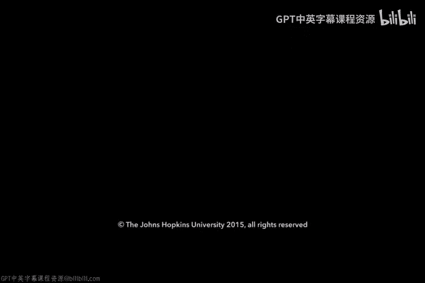

# 053：10_第33讲 第2部分 修正导航栏布局文本与下拉菜单


## 📖 概述
在本节课中，我们将学习如何为移动设备上的下拉菜单进行样式调整。我们将重点解决菜单图标与文本大小不一致的问题，并优化它们之间的间距，使移动端导航栏的视觉效果更加协调。

---

## 🖥️ 问题分析
上一节我们介绍了在桌面全屏模式下菜单的样式设计。本节中，我们来看看当浏览器切换到移动端下拉菜单模式时，样式上出现的问题。

观察我们这里的折叠菜单，可以发现存在一个问题：Glyph图标看起来太大了，尤其是与旁边的“菜单”文本相比。我们希望图标和文本的字体大小能够保持一致。

首先，我们来检查一下为什么这两者的字体大小确实不同。

1.  右键点击“菜单”文本，选择“检查”。
2.  点击这个 `a` 元素（链接元素）。
3.  尝试滚动查找 `font-size` 属性的首次定义。它应该来自我们的 `styles.css` 文件，值为 `16px`。

接下来，我们检查Glyph图标。Glyph图标实际上是一个 `span` 元素，位于 `a` 元素内部。点击图标进行检查，会发现它的字体大小由选择器 `#` 后跟 `a` 和 `span` 定义，同样来自 `styles.css`。

我们希望覆盖这个样式，让菜单文本稍微变大一点，因为它目前看起来有点小。

---

## ✏️ 调整菜单文本大小
以下是调整菜单文本大小的步骤：

1.  打开代码编辑器，找到可以应用的样式位置。
2.  添加以下CSS规则，将菜单文本的字体大小增加约20%。

```css
/* 增加菜单链接的字体大小 */
#navbarSupportedContent ul li a {
    font-size: 1.2em;
}
```

保存更改后，返回浏览器查看效果。现在“菜单”文本变大了，但Glyph图标也随之变大了。这是因为图标位于 `a` 元素内部，继承了其新的字体大小。

---

## 🔄 统一图标与文本大小
我们希望Glyph图标的大小与菜单文本完全相同。为此，我们需要让 `span` 元素继承其父元素（即 `a` 元素）的字体大小。

由于CSS选择器存在**特异性**，我们可以通过一个更具体的选择器来覆盖原有的图标样式。

以下是具体的实现方法：

1.  复制原有图标选择器，使其更具体。
2.  将字体大小设置为 `1em`，这意味着它将100%继承父元素的字体大小。

```css
/* 让图标继承父级a元素的字体大小 */
#navbarSupportedContent ul li a span {
    font-size: 1em;
}
```

保存并刷新页面。现在，图标和文本的字体大小应该看起来一致了。父元素 `a` 的字体大小现在是 `16px * 1.2 ≈ 19.2px`，图标将继承这个值。

---

## 📐 优化间距
最后一步是优化图标和文本之间的间距。目前它们看起来太近了。

我们可以为图标添加一个右边距来增加间距。以下是具体操作：

1.  在刚才的图标样式规则中，添加 `margin-right` 属性。
2.  设置一个合适的值，例如 `5px`。

```css
/* 为图标添加右边距，优化与文本的间距 */
#navbarSupportedContent ul li a span {
    font-size: 1em;
    margin-right: 5px;
}
```

保存更改并查看浏览器。现在，下拉菜单的视觉效果得到了显著改善，图标和文本大小一致，间距也恰到好处。

---



## ✅ 总结
本节课中，我们一起学习了如何优化移动端下拉菜单的样式。我们首先分析了图标与文本大小不一致的原因，然后通过调整 `font-size` 属性统一了它们的大小，最后使用 `margin-right` 属性优化了它们之间的间距。至此，我们完成了当前网站开发阶段中导航菜单的样式调整工作。