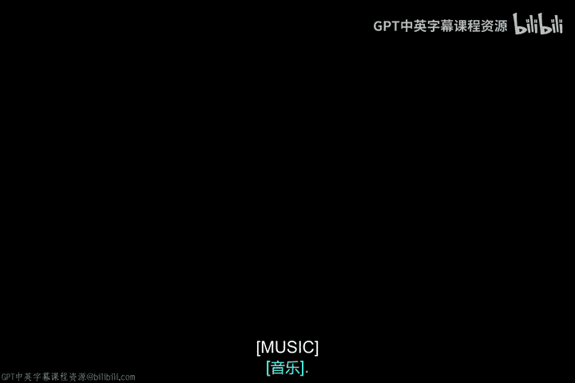
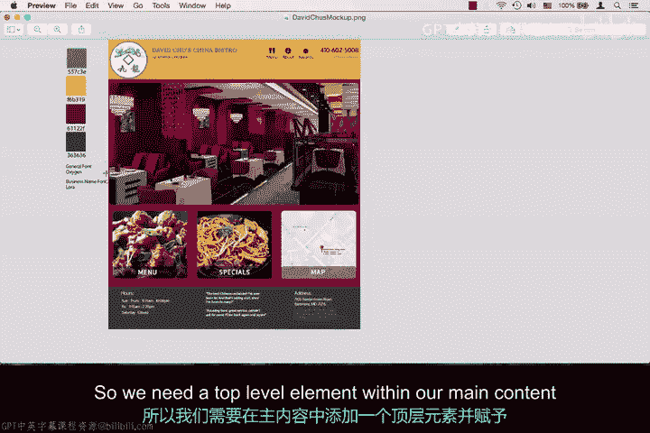
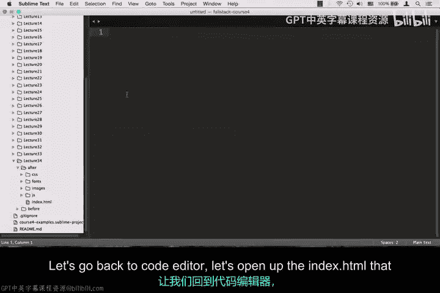
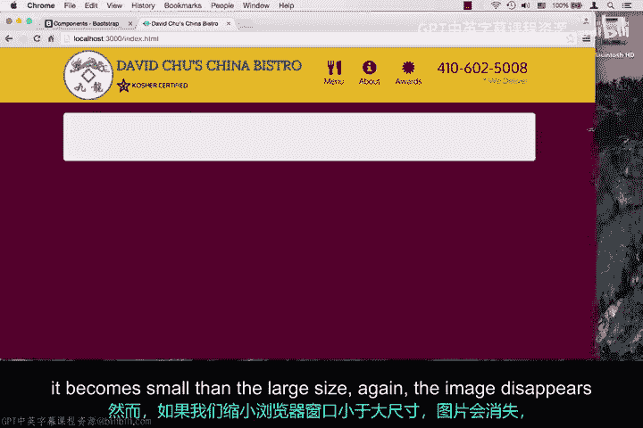
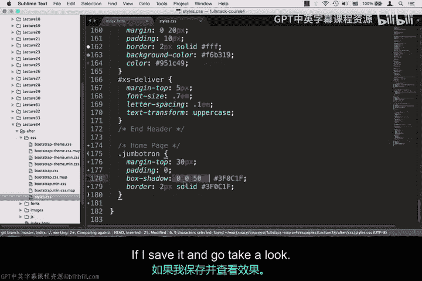
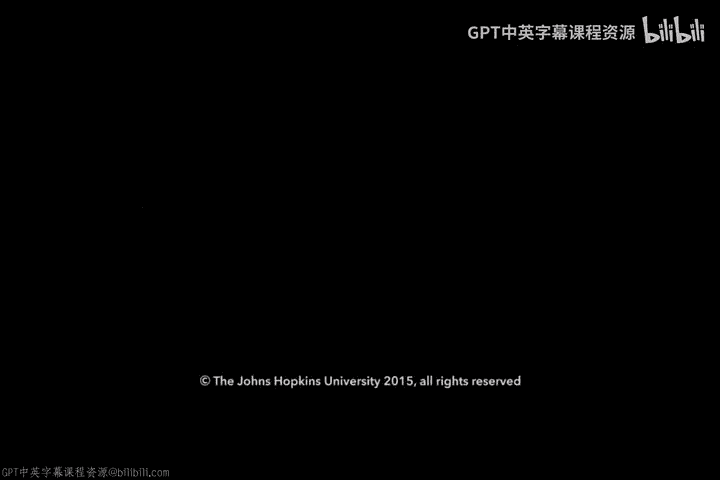

# 054：第34讲 巨幕区域编码 🖼️



在本节课中，我们将学习如何为网页的主要内容区域进行编码，特别是创建一个响应式的巨幕（Jumbotron）区域。我们将使用Bootstrap框架，并处理不同屏幕尺寸下的图片加载与样式调整。

---





上一节我们完成了页面的头部导航栏。本节中，我们来看看如何构建页面的主要内容区域，首先从展示餐厅内部环境的大型图片区域开始。

在Bootstrap中，这种大型展示区域被称为“Jumbotron”。但在开始编码之前，我们需要定义一个容器元素来包裹网站的所有主要内容。这是因为我们之前将页头放在了`.container`容器中，为了使所有内容都能与页头边缘对齐，我们需要在主内容区域的最外层也应用`.container`类。

让我们回到代码编辑器，打开位于示例文件夹`lecture 34 after`中的`index.html`文件。向下滚动到关闭的`</button>`标签下方，创建一个新的`<div>`元素。

```html
<div id="main" class="container">
```

我们为这个`<div>`添加了`id="main"`，以便后续更容易地定位它。现在，我们准备开始编码巨幕区域。

我们的`images`文件夹中有多张不同尺寸的巨幕图片（例如768px、992px、1200px宽）。目标是根据屏幕尺寸加载不同分辨率的图片，以节省移动设备的带宽。

我们将创建一个`<div>`来容纳巨幕。其背景图片将通过CSS属性响应式加载，即根据媒体查询加载不同尺寸的图片。但背景图片有一个限制：它无法很好地拉伸和收缩。因此，对于超小屏幕，我们将使用一个``标签，并为其应用Bootstrap的`.img-responsive`类，这个类能让图片随浏览器宽度按比例缩放。

以下是用于超小屏幕的``标签代码：

```html

```

`class="visible-xs"`确保此图片仅在超小屏幕尺寸下显示。保存后，在浏览器中挤压窗口到超小尺寸，可以看到图片出现。

现在，我们需要为更大的屏幕尺寸设置背景图片。我们打开`styles.css`文件，在对应的媒体查询中为`.container .jumbotron`类添加样式。

首先是为大屏幕设备（`min-width: 1200px`）添加样式：



```css
@media (min-width: 1200px) {
  .container .jumbotron {
    background: url('../images/jumbotron_1200.jpg') no-repeat;
    height: 675px;
    box-shadow: 0 2px 4px rgba(0,0,0,.5);
    border: 2px solid #ccc;
  }
}
```

这段代码设置了背景图片、固定高度、阴影和边框。保存后查看浏览器，巨幕区域已显示，并带有边框和阴影效果。

接下来，我们需要为中等屏幕和小屏幕设备重复此过程，分别指定对应的图片和调整高度。

以下是为中等屏幕设备（`min-width: 992px`）添加的样式：

```css
@media (min-width: 992px) {
  .container .jumbotron {
    background: url('../images/jumbotron_992.jpg') no-repeat;
    height: 558px;
    box-shadow: 0 2px 4px rgba(0,0,0,.5);
    border: 2px solid #ccc;
  }
}
```

以下是为小屏幕设备（`min-width: 768px`）添加的样式：

```css
@media (min-width: 768px) {
  .container .jumbotron {
    background: url('../images/jumbotron_768.jpg') no-repeat;
    height: 432px;
    box-shadow: 0 2px 4px rgba(0,0,0,.5);
    border: 2px solid #ccc;
  }
}
```

保存后，在浏览器中调整窗口大小，可以看到不同尺寸的图片会根据屏幕宽度切换。

最后，我们需要为超小屏幕设备（`max-width: 767px`）完善巨幕的样式。这里我们不仅使用之前添加的``标签，还需要为`.container .jumbotron`类本身添加一些样式，如边距和内边距。



```css
@media (max-width: 767px) {
  .container .jumbotron {
    margin-top: 30px;
    padding: 0;
    box-shadow: 0 2px 4px rgba(0,0,0,.5);
    border: 2px solid #ccc;
  }
}
```

保存后查看，可能会发现巨幕两侧出现了不需要的白边。通过浏览器开发者工具检查元素，发现是CSS选择器特异性（Specificity）问题。Bootstrap原有的`.container .jumbotron`规则比我们定义的更具体。

为了解决这个问题，我们需要确保我们的选择器具有相同的或更高的特异性。我们将代码中所有的`.jumbotron`选择器都改为`.container .jumbotron`。

修改后，白边问题得以解决。

此外，我们注意到`box-shadow`和`border`属性在每个媒体查询中都被重复定义。为了遵循DRY（Don‘t Repeat Yourself）原则，我们可以将这些公共样式提取到媒体查询之外。

```css
/* 公共样式，适用于所有屏幕尺寸 */
.container .jumbotron {
  box-shadow: 0 2px 4px rgba(0,0,0,.5);
  border: 2px solid #ccc;
}
```

然后从各个媒体查询块中删除这两行属性。保存后，所有功能依然正常，代码也更加简洁。

---

本节课中我们一起学习了如何构建一个响应式的巨幕区域。关键步骤包括：
1.  使用容器包裹主要内容。
2.  结合使用``标签（用于超小屏幕）和CSS背景图片（用于更大屏幕）来实现响应式图片加载。
3.  利用媒体查询为不同屏幕尺寸指定不同的图片和样式。
4.  处理CSS选择器特异性冲突。
5.  提取重复的CSS属性以优化代码。



现在，我们的巨幕区域已经能够在各种设备上良好显示，为后续添加更多页面内容打下了基础。