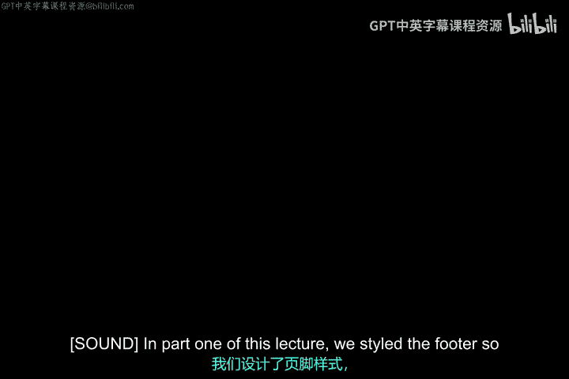
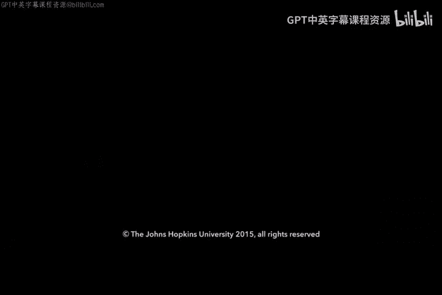

# 058：第36讲 第2部分 页脚编码

在本节课中，我们将学习如何为网页的页脚部分编写响应式样式，确保它在桌面、平板和手机等不同屏幕尺寸下都能良好显示。

---

在上一节中，我们完成了页脚在桌面浏览器尺寸下的样式布局。本节中，我们将专注于调整页脚样式，使其在平板和手机等较小屏幕尺寸下也能正常显示。

当浏览器处于完整的桌面模式时，页脚布局一切正常。

但是，当我们稍微挤压浏览器窗口时会发生什么呢？让我们来看看效果。

首先，可以看到页脚整体发生了跳动并自行挤压，这是一个好现象。如果我们继续缩小窗口，它仍然能很好地适应。当我们缩到最小尺寸时，整体效果不错，水平分隔线也显示出来了。

唯一的问题是，内容看起来有点过于紧凑，并且如果这些内容能居中显示，而不是靠左对齐，效果会更好。接下来，我们尝试解决这个问题。

让我们回到代码编辑器。这里已经有一些预设的样式，我们的目标显然是针对超小屏幕的媒体查询。

向下滚动到超小屏幕的媒体查询部分，它就在这里。我们找到位于页眉样式之后的最后一个媒体查询，并将我们的样式代码放在这里。

以下是我们要添加的样式代码，让我们快速浏览一下：

首先，我们将底部边距增加到30像素，因为之前的边距可能有点小。其次，我们设置面板页脚内的每个区块文本居中对齐，并增加其底部边距。

然而，对于最后一个区块，之前的通用桌面样式已经为其应用了边距。为了避免重复添加边距，我们特别指定第三个区块（即“客户评价”区块）的底部边距为零，因为整个行已经为其提供了边距。

此外，为了让水平分隔线看起来更美观，我们将其宽度设置为屏幕宽度的50%，这样它就能在各区块之间形成一条整洁的分隔线。

保存代码后，回到浏览器查看效果。现在所有内容都已居中，区块之间有了一条美观的分隔线，并且没有出现双倍边距的问题，整体看起来很不错。

让我们在不同尺寸下测试一下效果。在小屏幕下，布局看起来很好。当我们拉伸窗口时，页脚应该能平滑过渡到三列布局。在拉伸过程中，一切显示正常，底部内容分隔清晰、对齐整齐。

非常好，这就是我们的页脚部分。至此，主页的主要部分就全部完成了。接下来，我们将开始研究子页面，这些页面可以通过点击菜单磁贴或特色磁贴进入。显然，当我们进入菜单分类后，还需要进一步深入查看每个具体的菜单项。

---

本节课中，我们一起学习了如何为页脚编写响应式CSS代码。我们通过媒体查询针对小屏幕调整了边距、对齐方式和分隔线样式，确保了页脚在不同设备上都能提供良好的用户体验。下一节，我们将开始构建网站的子页面。