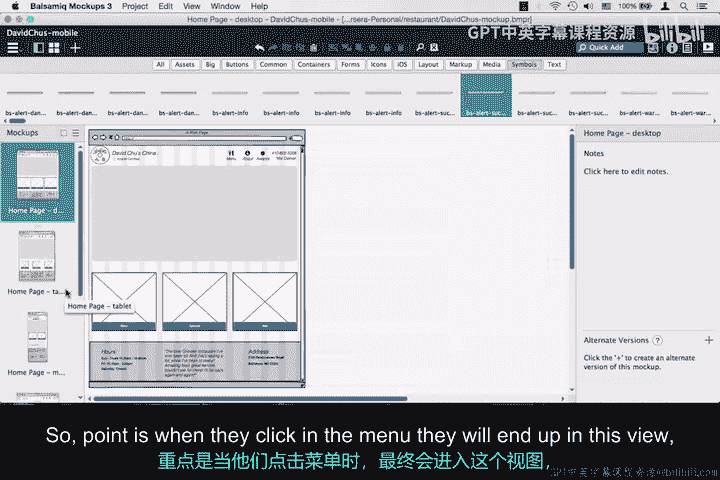
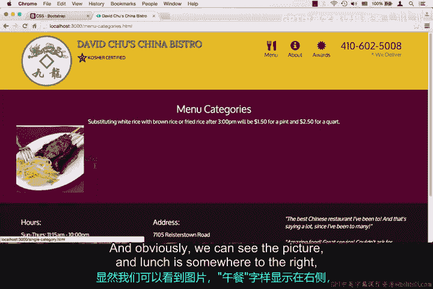
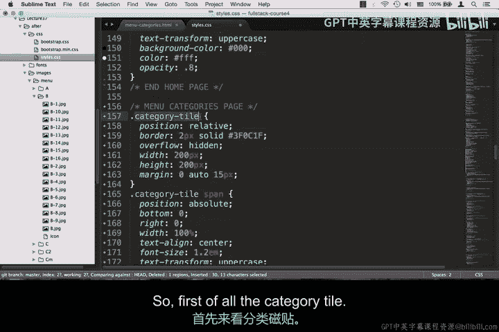

# 059：16_第37讲 第1部分 菜单分类编码

## 概述
在本节课中，我们将开始为网站的菜单分类页面编写代码。我们将创建一个网格布局来展示不同的菜单分类，并应用样式使其美观且响应式。

---

我们已经完成了网站首页的编码。现在，是时候回顾一下网站的导航结构了。

导航结构实际上相当简单。当用户首次访问首页时，他们可以选择点击“菜单”按钮，或者点击“菜单”图块。这两种操作都会将用户带到同一个地方：**菜单分类页面**。

这个页面会列出菜单中的所有分类，每个分类都配有一张图片和名称。其中一个分类叫做“特价菜”，这应该会让你想起首页上那个名为“特价菜”的图块。实际上，首页的“特价菜”图块只是一个指向名为“特价菜”的特定菜单分类的直接链接。

重点是，当用户点击“菜单”时，他们将进入这个视图，该视图会列出所有带有图片和名称的菜单分类。

如果他们点击页面右上角的菜单按钮，也会到达这个菜单分类页面。

现在，让我们回到代码编辑器，开始编写这个页面的代码。我目前在 Sublime Text 编辑器中，位于 `examples/lecture37/after` 文件夹。

尽管最终页面的结构在我们引入 JavaScript 并开始编写动态 HTML 后会有所不同，但在当前设计阶段，最简单的方法是复制 `index.html` 文件，并将其重命名为类似 `menu-categories.html` 的文件。我们这样做是因为 `index.html` 中的许多内容（如页眉、页脚和菜单项）都将完全相同，只有主要内容区域会发生变化。

我们复制并创建了 `menu-categories.html` 文件。现在，我们需要删除与这个新页面无关的所有内容。具体来说，我们需要清空 `main-content` 容器内的所有内容，以便为我们的菜单分类内容腾出空间。

现在，我们准备开始编写 `menu-categories.html` 的内容。如果我们现在在浏览器中查看这个页面（目前还是 `index.html`），点击“菜单”图块，实际上会跳转到 `menu-categories.html`。如你所见，目前只有页眉和页脚，页面内容区域是空的。

接下来，我们开始填充内容。

首先，我们需要让用户知道他们正在浏览哪个页面。我们将在主要内容区域添加一个 `H2` 标题（因为 `H1` 是网站主标题“David Chu‘s China Bistro”）。这个二级标题将是“Menu Categories”，并赋予它一个ID `menu-categories-title` 和一个用于居中的Bootstrap类 `text-center`。

保存后，在浏览器中刷新，我们应该能看到“Menu Categories”标题出现在页面中央。

接下来，我们需要添加一段来自原始菜单的提示文字，提醒顾客可以用糙米替换白米等。这属于餐厅特定的业务信息。我们同样将其放在一个 `div` 中，并使用 `text-center` 类使其居中。我们稍后可能会对它进行一些样式调整。

页面的标题部分基本完成。现在，我们需要开始编写分类图块的代码。这些图块当然需要放在一个网格布局中。

我们已经在 `container` 类内部，所以不需要再添加一个容器。但我们确实需要一个网格行。因此，我们将创建一个 `section` 元素，并赋予其 `row` 类。

观察我们想要的布局效果：在完整的浏览器宽度下，我们希望一行显示六个图块。显然，随着浏览器窗口缩小，我们希望它们能自适应排列，尽可能多地显示在同一行，同时保持良好的视觉效果，当然某些情况下它们需要堆叠显示。

我知道每个网格单元格都将是一个 `div`。我们将用一个 `div` 包裹它。我为每个网格单元格内部准备了一些代码，现在将其粘贴进来。

让我们快速浏览一下这段代码。我们还没有为这个网格分配任何列宽，但这将是每个网格单元格的基本内容。

1.  首先，我们有一个指向 `single-category.html` 的锚点（`<a>`）标签。`single-category.html` 是一个我们尚未编写的通用页面，它将指向由这个 `div` 和图片标识的特定分类。目前它只是一个占位页面，未来它将是一个展示特定分类的指定页面（或通过JavaScript动态加载内容）。
2.  锚点内部是一个 `div`，其类为 `category-tile`（这是我们创建的自定义类）。
3.  在这个 `div` 内部，有一张尺寸为 200x200 的图片。图片源路径指向 `images/menu/B/B.jpg`。我们暂时将这个分类命名为“Lunch”。

到目前为止一切顺利。让我们在浏览器中预览一下。我们可以看到图片，并且“Lunch”字样出现在图片右侧，但样式显然还没有完全调整好。

接下来，我们复制这个代表网格单元格的整个 `div`，并粘贴多次，比如粘贴8到9次，以模拟多个分类。

现在，我们实际上有了一个网格。它们目前看起来都一样，唯一不同的将是锚点标签的 `href` 链接地址和图片的 `src` 路径。

现在，让我们开始为网格设置样式。我们原本希望一行显示六个图块，这意味着每个单元格需要占据两列的宽度。我们可能希望在中型屏幕上也保持六列的布局，所以我们将使用类 `col-md-2`。

我们将这个类添加到每个网格单元格的 `div` 中。

保存并查看浏览器效果，我们立刻发现这行不通。因为图片相互重叠了，即使在完整的大屏幕尺寸下也是如此。显然，随着窗口缩小，情况会更糟。

这意味着六图块的布局确实不可行，我们需要重新考虑。

如果六图块不行，那试试一行四个图块怎么样？我们可以很容易地通过将 `col-md-2` 改为 `col-md-3` 来实现（因为12/4=3）。

我们将所有网格单元格的类都改为 `col-md-3`。

现在回到浏览器查看。虽然目前看起来有些混乱，但就图片在屏幕上的适应程度而言，看起来还可以。我们稍后会处理这些混乱的问题。

这看起来差不多了。现在，让我们开始使用 `styles.css` 文件来为实际单元格内部的内容设置样式。

我们滚动到CSS文件中首页样式之后的位置，大约在页脚样式附近。我将粘贴一些在本讲之前准备好的代码，并现在进行讲解。

首先，针对 `.category-tile` 类。在我们的HTML中，`.category-tile` 是锚点标签内部的 `div`。我们将采用与首页菜单图块类似的结构：我们有一些内容（这里实际上只是一张图片），并且我们有一个 `span` 元素。我们将定位这个 `span`，使其相对于 `div` 元素本身绝对定位。`div` 将作为其内部 `span` 的相对定位锚点，并且我们将把 `span` 放在底部。

让我们看看具体怎么做：
1.  `.category-tile` 本身设置为 `position: relative`，作为定位锚点。
2.  给它一个漂亮的边框。
3.  `overflow: hidden`，这样如果图片或其他内容超出边界，它将被裁剪而不是凸出来。
4.  因为我们知道图片尺寸是200x200，所以我们将 `width` 和 `height` 也设置为200像素。
5.  设置一些边距：`margin-top: 0`，`margin-right: auto`，`margin-bottom: 15px`，`margin-left: auto`。这是我们之前讨论过的技巧：只要给元素一个宽度，并将左右边距设为 `auto`，它就会自动水平居中。

接下来，针对 `span` 元素，也就是分类的标题：
1.  设置为 `position: absolute`。
2.  `bottom: 0` 和 `right: 0`，使其定位在右下角。
3.  `width: 100%`，使其横跨整个图片宽度。
4.  文本居中，字体大小为 `1em`，并转换为大写。
5.  背景色为黑色，前景色（文字颜色）为白色。
6.  稍微降低不透明度，以产生半透明的视觉效果。

然后，我们添加悬停效果。我们将添加一个与首页图块悬停时类似的盒阴影效果。请记住，这些分类图片中的每一个都是可点击的项目，因此我们需要某种视觉指示来告知用户。

最后，我们将通过选择器 `#menu-categories-title + div` 来定位 `menu-categories-title` 元素的下一个兄弟 `div` 元素。在我们的HTML中，`#menu-categories-title` 是顶部的“Menu Categories”标题，它的下一个兄弟元素就是包含“substituting white rice...”提示文字的 `div`。我们给这个 `div` 设置 `margin-top: 50px`，目的是在页面标题、给顾客的提示文字和下方的实际菜单分类之间创造一个良好的视觉分隔。

保存CSS文件，然后回到浏览器。我们可以看到至少第一行看起来很不错，但第二行似乎有些问题。

让我们回到代码，检查一下。此时它们应该都是 `col-md-3`。检查一下我们是否在哪里搞错了。果然，我们发现有些地方可能遗漏或写错了类名。确保所有网格单元格的 `div` 都正确应用了 `col-md-3` 类。

修正后，再次回到浏览器。现在它们应该都整齐地对齐了。如果我们挤压浏览器窗口，它们会靠得更近。在某个点（因为我们没有为小于中等屏幕的尺寸指定列宽），它们会开始堆叠显示。但显然，我们不希望它们在中型屏幕尺寸下就堆叠，我们还需要为小屏幕和超小屏幕指定样式，而这正是我们将在本讲座第二部分要处理的内容。

---

## 总结
本节课中，我们一起学习了如何创建菜单分类页面。我们复制了首页模板作为基础，清除了主要内容区域，并添加了页面标题和提示信息。接着，我们构建了一个网格系统来展示菜单分类图块，最初尝试了一行六列的布局，但发现不可行后调整为一行四列（使用 `col-md-3`）。然后，我们通过CSS为分类图块添加了样式，包括尺寸、边框、居中、内部标题的绝对定位以及悬停效果，并在页面标题和内容之间添加了间距。目前页面在中型及以上屏幕显示良好，响应式适配更小屏幕的工作将在下一部分完成。