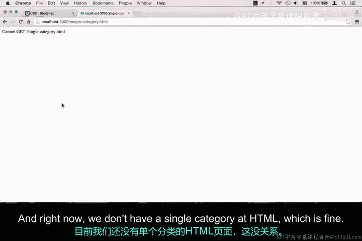
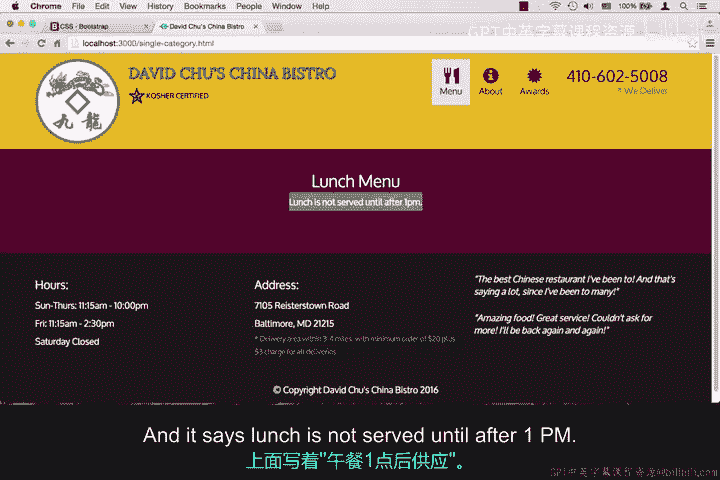

# 061：单个菜单分类页面编码（第一部分）


在本节课中，我们将学习如何为单个菜单分类页面编写HTML结构。我们将基于一个设计稿，创建一个展示特定分类下所有菜单项的页面，并重点讲解如何使用Bootstrap网格系统来布局这些项目。

## 概述与页面分析

上一节我们完成了菜单分类页面的编码。本节中，我们来看看当用户点击某个分类后，如何构建对应的单个分类页面。



根据设计稿，单个分类页面包含分类名称、一段描述信息，以及该分类下的所有菜单项。菜单项的布局特点是：每行显示两个项目，每个项目内部又分为图片/价格区和文字描述区。这意味着我们需要使用嵌套的Bootstrap网格系统。

## 设置页面基础与导航状态

首先，我们需要创建一个新的HTML文件作为单个分类页面。由于所有页面的头部、导航和页脚都相同，我们可以从菜单分类页面复制一份作为起点。

在开始编码主要内容之前，我们先优化导航菜单的视觉反馈，让用户明确知道自己位于“菜单”页面。

以下是具体步骤：
1.  在导航菜单中找到“Menu”链接。
2.  为其添加 `class="active"`。这是一个Bootstrap类，我们之前已自定义其样式以匹配悬停效果。



这样，当用户位于菜单相关页面时，“Menu”导航项会高亮显示。

## 构建页面主要内容结构

现在，我们开始编写页面的核心内容。首先清除从模板中复制的旧内容，得到一个干净的开始区域。

页面的主要内容结构如下：
1.  一个居中的页面标题（`<h2>`）。
2.  一段居中的分类描述文本。
3.  一个用于容纳所有菜单项列表的网格区域。

以下是初始代码结构：
```html
<h2 id="menu-categories-title" class="text-center">午餐菜单</h2>
<div class="text-center">午餐供应时间从下午1点开始。</div>

<section class="row">
    <!-- 菜单项将在这里插入 -->
</section>
```
标题和描述文本未来将通过JavaScript动态填充。

## 创建单个菜单项的网格布局

接下来，我们编码单个菜单项的结构。这是本节课的核心。每个菜单项将占据外部网格的一列（`col-md-6`），从而实现在中等及以上屏幕尺寸上每行显示两项。

在每个菜单项内部，我们还需要一个嵌套的网格来排列图片和文字。这个内部网格使用 `row` 类，并包含两个列：
*   **图片/价格区**：使用 `col-sm-5`。
*   **文字描述区**：使用 `col-sm-7`。

选择 `col-sm-*` 意味着在小型（sm）及以上屏幕，这两个区域并排显示；在超小（xs）屏幕，它们将上下堆叠。

以下是单个菜单项的完整HTML结构代码：
```html
<div class="menu-item-tile col-md-6">
  <div class="row">
    <!-- 图片与价格区域 -->
    <div class="col-sm-5">
      <div class="menu-item-photo">
        <div>D01</div>
        
      </div>
      <div class="menu-item-price">$10.95<span> (品脱)</span><br>$14.95 <span>(夸脱)</span></div>
    </div>
    <!-- 文字描述区域 -->
    <div class="col-sm-7">
      <h3 class="menu-item-title">菜品名称</h3>
      <p class="menu-item-details">这里是关于这道菜的详细描述文本，例如主要食材和口味特点。</p>
    </div>
  </div>
  <hr class="visible-xs">
</div>
```
**代码要点解析：**
*   `menu-item-photo`：包裹图片的容器，我们将使用CSS将其设置为相对定位，以便绝对定位其中的编号（D01）。
*   `menu-item-price`：价格信息。我们将`<span>`标签包裹货币单位，以便后续单独设置更小的字体。
*   `visible-xs`：这是一个Bootstrap响应式工具类。我们只在超小屏幕（xs）下显示`<hr>`水平线，作为菜单项堆叠时的视觉分隔符。

## 总结与下节预告

本节课中我们一起学习了单个菜单分类页面的HTML结构搭建。我们创建了页面的基础框架，并重点构建了使用嵌套Bootstrap网格的菜单项组件，实现了响应式布局。

现在，基本的HTML结构已经编写完成。在下一部分，我们将为这些元素添加CSS样式，让页面真正变得美观起来。