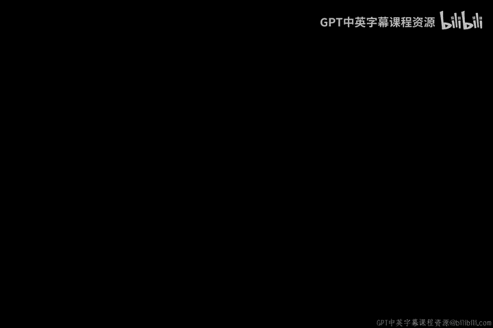
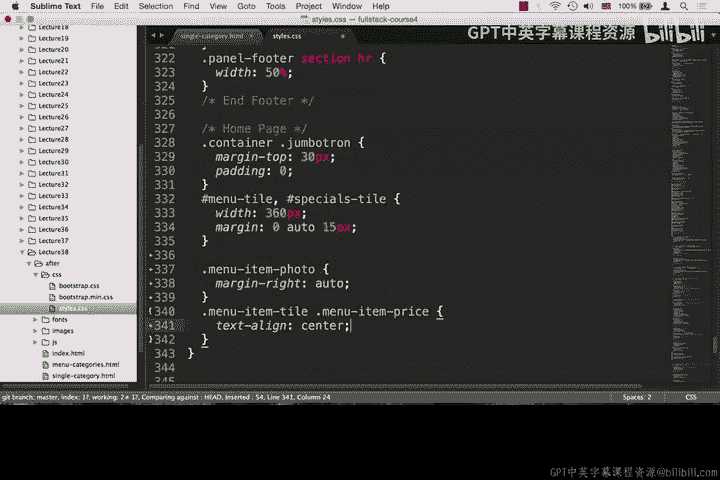
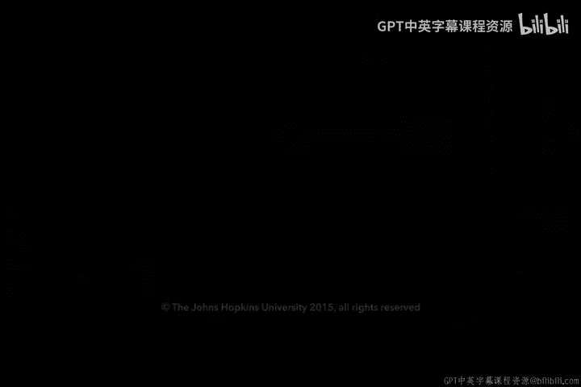

# 062：19_第38讲 第2部分 单个菜单分类页面编码



## 概述
在本节课中，我们将继续为单个菜单项网格编写样式。我们将从基本的布局和间距开始，逐步调整图片、价格和描述的样式，并最终解决在移动设备上的响应式布局问题。

---

## 样式编写：基础布局与间距

在上一部分，我们完成了单个菜单项网格的HTML结构。本节中，我们开始为其添加CSS样式，使其在视觉上更符合设计。

首先，我们为第二个单元格添加一个不同的类名`d2`，以便与第一个单元格`d1`区分。接着，我们在`styles.css`文件中，在已有的菜单分类样式下方，添加预设的样式代码。为了便于逐步讲解，我们将这些样式先注释掉。

以下是针对菜单项网格容器的初始样式：

```css
.menu-item-tile {
    margin-bottom: 25px;
}
```
这段代码为每个菜单项网格添加了25像素的下边距，目的是在视觉上分隔每一行项目，即使它们并非严格意义上的Bootstrap网格行。

接下来，我们处理水平分隔线`<hr>`的显示逻辑。我们希望它仅在浏览器窗口缩小到超小（extra small）屏幕尺寸时才显示，以视觉上分隔项目。

```css
.menu-item-tile hr {
    display: none;
}
/* 在超小屏幕的媒体查询中，我们会将其显示出来 */
```

保存并查看浏览器，当窗口缩小时，可以看到水平线出现，起到了分隔作用。

---

## 样式编写：价格与图片

上一节我们设置了基础布局，本节中我们来看看如何设置价格和图片的样式。

首先，我们设置价格的样式。价格元素位于类名为`menu-item-price`的`<div>`中。

```css
.menu-item-tile .menu-item-price {
    font-size: 1.2em;
    text-align: right;
    margin-top: -15px;
    margin-right: -15px;
}
```
这段代码增大了价格字体，并将其向右对齐，以匹配图片右侧的布局。负的`margin`值用于微调位置，使其与图片顶部对齐。

同时，我们希望价格单位（如“品脱”、“夸脱”）的字体小一些。这通过选择`menu-item-price`内的`<span>`元素来实现。

```css
.menu-item-tile .menu-item-price span {
    font-size: 0.8em;
}
```

现在，我们来设置图片容器的样式。图片容器（`.menu-item-photo`）需要相对定位，以便在其内部绝对定位菜单编号。

```css
.menu-item-photo {
    position: relative;
    border: 2px solid #800000; /* 栗色边框 */
    overflow: hidden; /* 溢出部分裁剪 */
    padding: 0;
    margin-right: 15px;
    margin-left: auto;
    margin-bottom: 20px;
    max-width: 250px;
}
```
我们设置了边框、内外边距，并限制了最大宽度为250像素，以防止图片拉伸导致像素化或布局混乱。

图片容器内部的菜单编号`<div>`需要绝对定位在右下角。

```css
.menu-item-photo div {
    position: absolute;
    bottom: 0;
    right: 0;
    width: 80px;
    background-color: #557c3e; /* 绿色背景 */
    text-align: center;
}
```
保存后，可以看到菜单编号已正确显示在图片右下角。

此时，由于图片的定位和边距，价格的位置可能有些偏移。这正是之前我们为价格设置负`margin`的原因，现在取消注释后，价格与图片的对齐看起来更协调了。

---

## 样式编写：标题与描述

上一节我们美化了价格和图片区域，本节我们来调整标题和描述的样式。

首先设置描述的样式。我们希望描述内容与右侧的网格单元格（或浏览器边缘）保持一定距离。

```css
.menu-item-description {
    padding-right: 30px;
}
```

接着，设置标题（`<h3>`）的样式。我们清除其可能继承的默认边距，并只设置底部边距。

```css
.menu-item-tile .menu-item-title {
    margin: 0 0 10px 0;
}
```

最后，调整描述详情文本的样式，使其稍小并呈斜体，看起来更美观。

```css
.menu-item-details {
    font-size: 0.9em;
    font-style: italic;
}
```
保存后，在浏览器中查看，标题和描述现在已整齐地对齐。

---

## 响应式调整：超小屏幕布局

到目前为止，在大中型屏幕上布局看起来不错。但当我们缩小浏览器窗口到超小（extra small）屏幕尺寸时，布局出现了问题：图片和描述没有居中，而是分别偏左和偏右。

我们需要在针对超小屏幕的媒体查询中添加样式来修复这个问题。

首先，调整图片容器（`.menu-item-photo`）的右边距。在大屏幕上它是`15px`，但在小屏幕上我们需要将其设置为`auto`以实现水平居中。

```css
@media (max-width: 767px) {
    .menu-item-photo {
        margin-right: auto;
    }
}
```

其次，让价格在超小屏幕上也居中对齐。

```css
@media (max-width: 767px) {
    .menu-item-tile .menu-item-price {
        text-align: center;
    }
}
```



最后，让描述文本也居中对齐。

```css
@media (max-width: 767px) {
    .menu-item-description {
        text-align: center;
    }
}
```
保存所有更改后，再次在超小屏幕尺寸下查看浏览器，现在图片、价格和描述都已完美居中显示。

---



## 总结
本节课中，我们一起学习了如何为一个菜单项网格编写完整的CSS样式。我们从基础间距和边框开始，逐步设置了价格、图片、标题和描述的样式。最后，我们通过媒体查询解决了在移动设备上的响应式布局问题，确保了在所有屏幕尺寸下都有良好的视觉效果。在下一部分，我们将探讨如何处理来自服务器的、长度不固定的描述文本所带来的布局挑战。