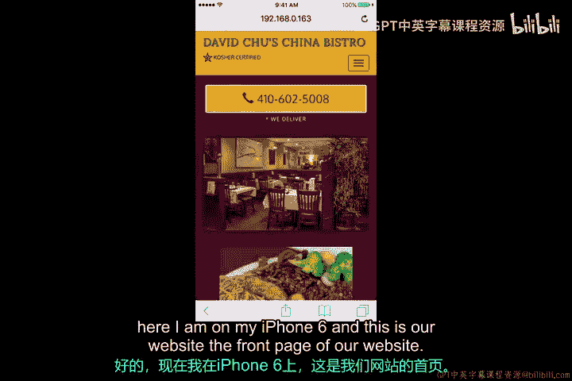

# 064：在真机上测试移动端版本


在本节课中，我们将学习如何在实际的移动设备上测试我们开发的网站，并发现和修复一些在移动端浏览时才会显现的布局与交互问题。

上一节我们完成了网站的主要布局和响应式设计。本节中我们来看看如何在实际的移动设备上进行测试，以确保网站在手机上的体验同样出色。


在我们宣布布局完全成功之前，让我们在实际的手机上测试这个网站。

我手边有一部iPhone 6。我将在iPhone 6上加载我们的网站，然后点击浏览，看看是否能发现任何需要修复的问题。

现在，我正使用我的iPhone 6浏览我们的网站，这是网站的主页。

让我们滚动页面看看效果，看起来一切正常。接下来，点击“菜单”板块，它应该会带我们进入菜单分类页面。这个功能运行良好。

我们再点击其中一个菜单分类，页面会跳转到显示具体菜单项的单个分类页面。这个功能也运行得很好。

现在，让我们点击电话号码按钮，看看它是否会尝试拨打电话。确实如此，它正在尝试拨打电话。我们取消这个操作。


接着，看看右上角的菜单按钮。如果我点击这里，菜单会显示出来。如果我点击菜单中的“菜单”选项，它会带我进入菜单分类页面。



让我们返回到单个分类页面。现在，打开那个下拉菜单。

有一个问题让我感到困扰：菜单里没有“主页”导航选项。目前只有“菜单”、“关于”和“奖项”。

在桌面版本中，我们或许可以接受没有“主页”按钮，因为不想让界面显得拥挤。但在移动端，除了点击餐厅名称“David Chu‘s China Bistro”返回主页外，我们确实需要其他选项。

因此，我真的很希望在这里能有一个“主页”选项。

还有另一个稍显奇怪的地方。例如，如果我点击“午餐菜单”并尝试选择它，我自然会认为下拉菜单应该自动消失。但它并没有，只有当我再次点击菜单按钮时它才会关闭。

这个问题我们目前无法解决，因为它不能仅靠HTML和CSS来处理，需要使用JavaScript。我们将在后续课程中学习JavaScript，所以这个问题暂时搁置。

但是，在下拉菜单中添加“主页”按钮，是我们现在就可以做的事情。

所以，让我们回到代码编辑器并添加这个功能。


现在，我回到了Sublime Text编辑器，位于`examples/lecture39/after`文件夹中，正在查看`index.html`文件。

我们需要做的只是添加一个新的菜单项，这其实相当简单。我们只需要找到菜单列表。

以下是我们的菜单列表代码片段，每个菜单项都是一个`<li>`元素：

```html
<ul class="nav navbar-nav">
  <li>
    <a href="index.html"><span class="glyphicon glyphicon-home"></span> Home</a>
  </li>
  <!-- 其他菜单项 -->
</ul>
```

我们只需要在前面腾出一些空间。我将粘贴一段预先写好的代码。

我们希望这个菜单项只在屏幕尺寸为超小（xs）时可见。并且，由于我们当前在`index.html`主页上，我们希望将其标记为“active”（激活状态），这样在移动端视图中，它会有一个灰色的背景高亮显示。

它只是一个指向`index.html`的链接，同时我们使用了Glyphicon的“home”图标，使其显示为一个小房子按钮，并加上文字“Home”。

让我们保存修改，然后回到浏览器查看效果。

点击菜单按钮，现在“主页”选项出现了。如果我们进入“菜单”页面，再次点击菜单按钮，现在显示的是“菜单”页面。但我们还没有在菜单分类页面上添加这个按钮。

所以，让我们来修复这个问题。复制刚才的代码。

打开我们的菜单分类页面（例如`menu-categories.html`），同样向下滚动到`<li>`列表所在位置。

我们将代码粘贴在这里，但这次需要移除`active`类，因为在这个页面上“主页”不是激活状态。

在单个分类页面（例如`single-category.html`）上，我们也需要进行同样的操作。向下滚动找到`<li>`列表，粘贴代码，并同样移除`active`类。

让我们回到浏览器测试一下。点击菜单按钮，现在我们进入了“菜单”页。如果我们点击“主页”，就会回到主页，并且“主页”选项会高亮显示。

如果我们进入“菜单”，再进入单个分类页面，菜单中仍然显示“菜单”为激活状态，这很好。点击“主页”，我们就能回到主屏幕。


看起来我们已经修复了这个次要问题，除了那些需要JavaScript才能处理的部分。现在，我们已经准备好继续前进了。


本节课中我们一起学习了在实际移动设备上测试网站的重要性。通过测试，我们发现了移动端导航中缺少“主页”入口的问题，并学会了如何通过修改HTML代码，在响应式导航栏中添加一个仅在移动端显示的“主页”链接。我们还了解到，一些更复杂的交互行为（如下拉菜单的自动关闭）需要未来学习的JavaScript知识来实现。