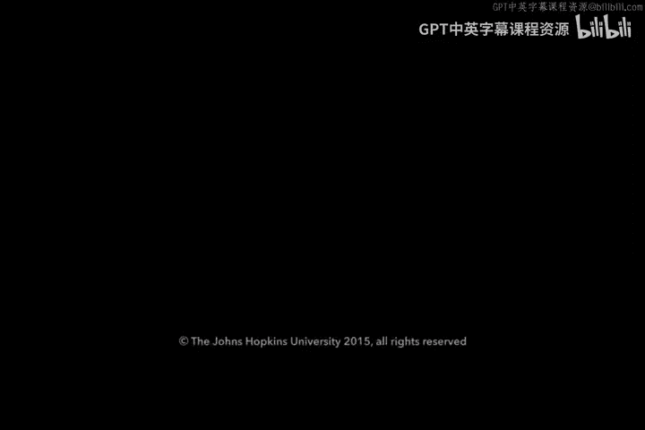

# 065：模块3总结

## 概述
在本节课中，我们将对模块3的学习内容进行总结，并了解如何为课程提供反馈，同时预告下一个模块的开始。

## 课程内容总结

模块3的学习已经结束。如果你到目前为止很享受这门课程，我们非常感谢你能花几分钟时间为这门课程打一个五星好评。这对我们意义重大。

## 后续安排

下一个模块是模块4。我们将在下一个模块中再见。

## 总结
本节课中我们一起回顾了模块3的结束，了解了课程反馈的重要性，并得知了模块4即将开始。