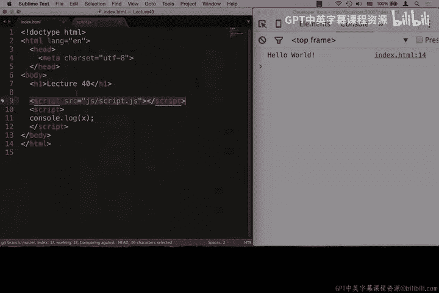

# 067：JavaScript代码放置位置


在本节课中，我们将学习在HTML文档中引入和执行JavaScript代码的不同位置。理解代码的放置位置对于控制代码的执行顺序和确保网页功能正常至关重要。

## 开发环境设置完成

上一节我们介绍了如何设置开发环境。本节中，我们来看看编写JavaScript代码的几个主要位置。

## 代码放置位置

以下是几种常见的JavaScript代码引入方式：

**1. 在 `<head>` 标签内的 `<script>` 标签中**

您可以在HTML文档的 `<head>` 部分直接编写JavaScript代码。代码写在 `<script>` 开始标签和结束标签之间。

```html
<head>
    <script type="text/javascript">
        // 您的JavaScript代码写在这里
    </script>
</head>
```

其中 `type="text/javascript"` 属性在现代HTML中不是必需的，可以简写为 `<script>`。

**2. 通过外部文件引入**

您可以将JavaScript代码保存在一个独立的 `.js` 文件中，然后通过 `<script>` 标签的 `src` 属性引入。

```html
<script src="script.js"></script>
```

请注意，即使是通过 `src` 属性引入外部文件，`<script>` 标签仍然需要闭合标签。

## 代码执行顺序

JavaScript代码的执行是**顺序**且**单线程**的。这意味着：
*   **顺序执行**：代码按照在HTML中出现的顺序，一行一行地执行。
*   **单线程**：在执行一段代码时，不会被其他地方的JavaScript代码中断。

让我们通过一个例子来理解执行顺序。假设我们有一个外部文件 `script.js`：

```javascript
// script.js 文件内容
var x = "hello world";
```

然后在HTML的 `<head>` 中引入它，并在后面添加一个内联脚本：

```html
<head>
    <script src="script.js"></script>
    <script>
        console.log(x); // 输出: hello world
    </script>
</head>
```

浏览器会先加载并执行 `script.js` 文件中的代码（定义变量 `x`），然后执行紧随其后的内联脚本（打印 `x` 的值）。因此，控制台会成功输出 “hello world”。

## 在 `<body>` 中放置代码

JavaScript代码不仅可以放在 `<head>` 中，也可以放在 `<body>` 的任何位置。常见的做法是将 `<script>` 标签放在 `<body>` 结束标签之前。

```html
<body>
    <!-- 页面内容 -->

    <script>
        console.log("在body结束前执行");
    </script>
</body>
```

这样放置可以确保在脚本执行时，HTML文档的DOM元素已经加载完成，这对于需要操作页面元素的脚本非常有用。

同样，您也可以在 `<body>` 中引入外部JavaScript文件：

```html
<body>
    <!-- 页面内容 -->

    <script src="script.js"></script>
</body>
```

引入外部文件的效果等同于将该文件中的所有代码“剪切并粘贴”到 `<script>` 标签所在的位置。

## 总结

本节课中我们一起学习了JavaScript代码在HTML中的几种放置方式：
1.  在 `<head>` 部分的 `<script>` 标签内编写。
2.  通过 `<script src="...">` 引入外部 `.js` 文件。
3.  在 `<body>` 部分的任何位置（包括末尾）使用以上两种方式。



关键是要记住代码的**顺序执行**特性，后引入的代码可以访问先引入代码中定义的变量和函数。根据脚本的功能和依赖关系，合理选择放置位置，是构建稳定Web应用的基础。