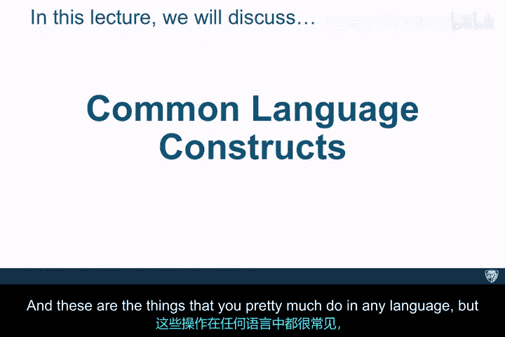
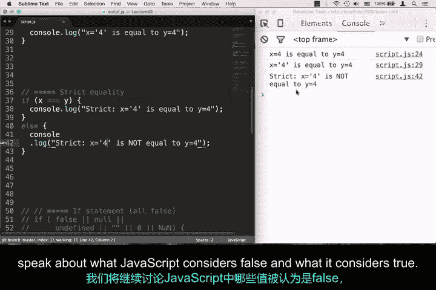

# 072：常见语言结构


在本节课中，我们将学习JavaScript中的一些基础但核心的语言结构。这些结构是几乎所有编程语言共有的，我们将重点了解它们在JavaScript中的具体实现方式。我们将涵盖字符串拼接、数学运算符、变量相等性比较等主题。

## 字符串拼接

就像许多其他语言一样，JavaScript允许你动态地拼接字符串，其操作方式类似于算术运算。




以下是字符串拼接的示例：

```javascript
var string = "Hello";
string += " World";
console.log(string + "!");
```

在这段代码中，我们首先声明了一个值为“Hello”的字符串变量。下一行使用 `+=` 运算符将字符串与另一个包含空格和“World”的字符串拼接起来。`+=` 运算符等同于 `string = string + " World"`。最后，我们使用 `console.log` 输出拼接后的字符串并加上感叹号。

## 数学运算符

JavaScript中的数学运算符非常直观，如果你在其他语言中进行过数学运算，这里几乎没有区别。

以下是数学运算符的示例：

```javascript
var result = (5 + 4) / 3;
console.log(result); // 输出 3
```

这里使用了加号 `+`、除号 `/` 和括号。括号的优先级规则在此同样适用，`(5 + 4)` 会先于除以 `3` 执行，因此结果是 `3`。

一个需要注意的情况是，如果尝试用 `undefined` 进行数学运算：

```javascript
var a;
console.log(a / 5); // 输出 NaN
```

`NaN` 是一个特殊值，表示“不是一个数字”。在调试代码时，如果函数内部出现 `NaN`，通常意味着某个应该传入的参数未被传递，或者在传递过程中出现了问题，导致函数内部变量为 `undefined`。

## 变量与相等性

上一节我们介绍了基本的数学运算，本节中我们来看看变量的声明和比较。

在JavaScript中，可以使用 `var` 关键字声明变量，并且可以在一条语句中声明多个变量。

以下是变量声明和相等性比较的示例：

```javascript
var x = 4, y = 4;
if (x == y) {
    console.log("x is equal to y");
}
```

这里，我们使用 `var` 同时声明了 `x` 和 `y` 两个变量。在 `if` 语句中，我们使用双等号 `==` 来比较 `x` 和 `y` 的值。需要注意的是，一个常见的错误是误用单等号 `=`，它表示赋值操作，而非比较。

## 类型转换与严格相等

当我们比较不同类型的值时，JavaScript会进行“类型强制转换”。

考虑以下情况：

```javascript
var x = "4", y = 4;
if (x == y) {
    console.log("x equals to 4 as a string is equal to y equals to 4");
}
```

尽管 `x` 是字符串 `"4"`，`y` 是数字 `4`，但使用 `==` 比较时，JavaScript会自动将其中一个类型转换为另一个类型，然后比较值，因此结果为真。这种行为称为“类型强制转换”。

如果你不希望JavaScript自动进行类型转换，可以使用“严格相等”运算符 `===`。

以下是严格相等的示例：

```javascript
var x = "4", y = 4;
if (x === y) {
    console.log("This will not print.");
} else {
    console.log("Strict: x as a string 4 is not equal to y equals 4");
}
```

三重等号 `===` 在进行比较时，会首先检查两个值的类型是否相同。如果类型不同，它会直接返回 `false`，而不会尝试转换类型。因此，字符串 `"4"` 和数字 `4` 严格不相等，代码会执行 `else` 分支。

---




本节课中我们一起学习了JavaScript的几个基础语言结构：字符串的拼接、数学运算符的使用、变量的声明与相等性比较，以及类型强制转换与严格相等的区别。理解这些概念是编写正确JavaScript代码的基石。在下一部分，我们将继续探讨JavaScript中真值与假值的概念。