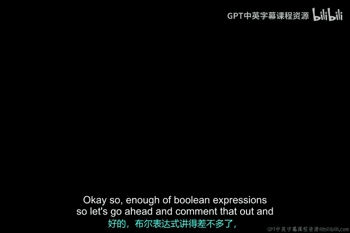
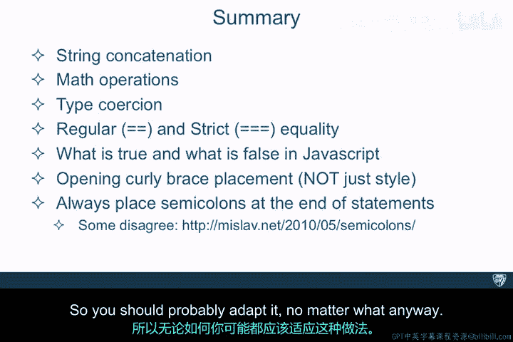

# 074：第43讲 第3部分 常见语言结构 🧱

在本节课中，我们将学习 JavaScript 中几个核心的语言结构，包括大括号的放置规则、分号的使用以及 `for` 循环的语法。理解这些概念对于编写正确且高效的 JavaScript 代码至关重要。

## 大括号放置的最佳实践 🔧



上一节我们介绍了表达式，本节中我们来看看代码格式中的一个重要细节：大括号的放置位置。关于大括号是应该放在同一行还是下一行，开发者们常有不同意见。但在 JavaScript 中，这不仅仅是一个风格问题，更关系到语法和引擎的解析方式。

让我们通过一个例子来演示。我们有两个函数，`functionA` 和 `functionB`，它们都返回一个对象字面量。区别在于大括号的放置位置。

```javascript
function functionA() {
    return
    {
        name: "Yaov"
    };
}

function functionB() {
    return {
        name: "Yaov"
    };
}

console.log(functionA()); // 输出：undefined
console.log(functionB()); // 输出：{ name: 'Yaov' }
```

你预料到这个结果了吗？`functionA` 返回了 `undefined`。这是因为 JavaScript 引擎在解析代码时，会在 `return` 语句后自动插入一个分号。因此，`functionA` 实际上等价于：

```javascript
function functionA() {
    return; // 引擎在此处插入了分号
    {
        name: "Yaov"
    };
}
```

这个例子清晰地表明，在 JavaScript 中，将左大括号 `{` 放在与声明语句（如 `function`、`return`）同一行是一种**最佳实践**，这能避免因自动分号插入（ASI）机制导致的意外错误。

## 分号的使用 💬

虽然 JavaScript 允许在语句末尾省略分号，但普遍接受的最佳实践是**始终加上分号**。这可以确保代码行为的一致性，并避免潜在的解析错误。尽管存在一些争议，但遵循大多数人的做法是明智的选择。

## For 循环 🔁

任何编程语言都离不开循环结构。接下来，我们来看看 JavaScript 中基础的 `for` 循环语法。

以下是一个简单的 `for` 循环，用于计算 0 到 9 的和：

```javascript
let sum = 0;
for (let i = 0; i < 10; i++) {
    console.log(`当前 i 的值是: ${i}`);
    sum = sum + i;
}
console.log(`0 到 9 的和是: ${sum}`); // 输出：45
```

一个 `for` 循环包含三个部分：
1.  **初始化**：在循环开始前执行一次，通常用于初始化计数器变量（如 `let i = 0`）。
2.  **条件判断**：在每次循环迭代前检查。如果条件为 `true`，则执行循环体；如果为 `false`，则退出循环（如 `i < 10`）。
3.  **最终表达式**：在每次循环体执行完毕后执行，通常用于更新计数器变量（如 `i++`，这是 `i = i + 1` 的简写形式）。

循环的执行顺序是：初始化 -> 检查条件 -> 执行循环体 -> 执行最终表达式 -> 再次检查条件，如此往复。

## 课程总结 📝

本节课中我们一起学习了 JavaScript 的几个重要概念：
*   **大括号放置**：左大括号 `{` 应放在与函数声明、`return` 语句等同一行，这是避免自动分号插入导致错误的最佳实践。
*   **分号使用**：尽管可选，但在每个语句末尾添加分号是推荐的做法，以确保代码清晰和稳定。
*   **For 循环**：掌握了 `for` 循环的基本语法结构，包括初始化、条件判断和计数器更新三个部分。




理解并应用这些基础语言结构，是编写可靠 JavaScript 代码的第一步。